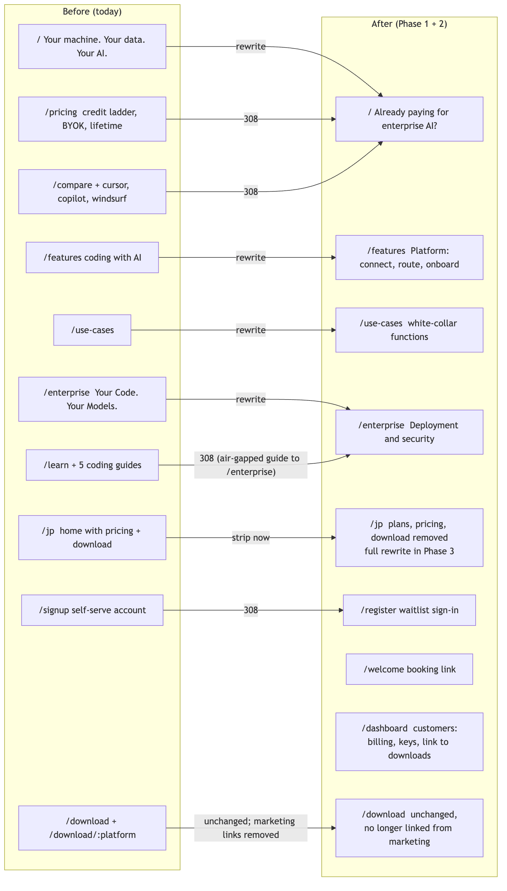
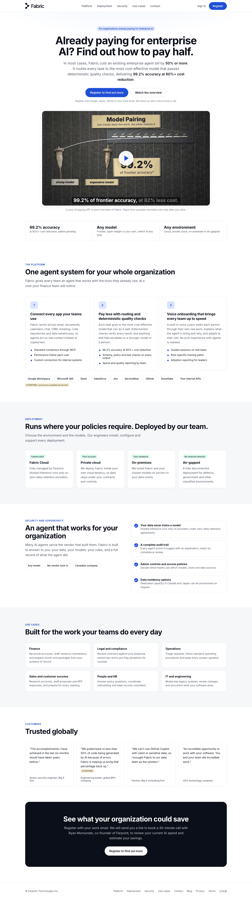
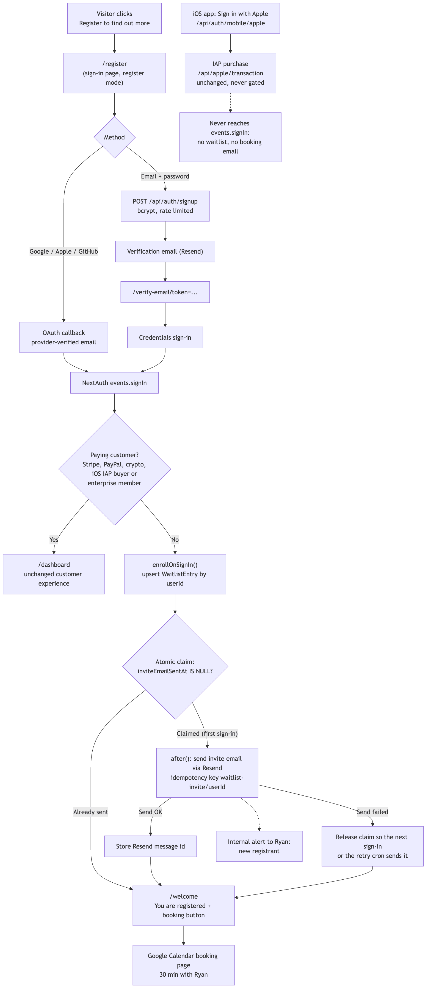

# Enterprise Repositioning: codewithfabric.com

!!! tip "Homepage mockup"
    **[Open the static light-theme homepage mockup](enterprise-homepage-mockup/index.html){ target=_blank }**.
    It uses the recommended hero (Variant B) and the real enterprise video thumbnail. Screenshots at
    1440px and 375px are embedded under [Homepage design](#homepage-design-light-theme).

## Summary

Reposition codewithfabric.com from a private coding tool for individuals into an **enterprise-first,
general-purpose agent system for white-collar work**. The lead message speaks to organizations that
already pay for an enterprise AI or agent platform: Fabric can likely cut that bill by 50% or more,
backed by the approved proof point **99.2% accuracy at 80%+ cost reduction**. The site gets a light
theme, loses the public "Download" buttons and links on marketing pages and every individual plan on the
website, and gains a single call to action,
**Register to find out more**. Registration is a sign-in (Google, Apple, GitHub, or email and password).
The first sign-in of a non-customer adds them to an enterprise waitlist and sends one email inviting
them to book a 30-minute call with Ryan.

**Decisions already made (do not re-litigate):**

| Decision | Choice |
|---|---|
| Positioning | Enterprise-first agent system for white-collar work: "like Glean, with any model, plus on-prem or private cloud deployments done by us". Coding is one use case, never the lead. |
| Lead hook | Organizations already paying for an enterprise agent platform can likely cut the bill by 50% or more. Qualified ("likely", "in most cases"), never a guarantee. |
| Proof point | "99.2% accuracy at 80%+ cost reduction" (patent pending). Approved for public use, no CONFIRM tag. |
| Traction numbers | No client counts or industry counts anywhere on the site. |
| Testimonials | Keep, anonymized by role and industry only (Big 4, global BPO, existing site quotes). |
| Supporting pillars | Connect all your apps; cost-saving routing with deterministic quality checks; built-in voice onboarding and training; deployment flexibility. |
| Theme | Light. |
| Domain | Stay on codewithfabric.com. Brand copy avoids leaning on "code". |
| Personal positioning | Removed entirely (hero, rotating personal prompts, the parent's medical record example). |
| Downloads | Remove the public "Download" buttons and links on marketing pages (EN and JP). The `/download` page, its installer links, installer hosting, the release bucket and the auto-updater stay exactly as they are; signed-in users reach downloads from the dashboard. |
| Individual plans (website) | Not advertised and not purchasable on the website (EN and JP), even when signed in. Existing payers keep renewals, dashboard, keys and billing. The no-purchase rule applies to **web checkout only**. |
| iOS in-app purchases | **Stay, for new and existing users alike.** The iOS app keeps its full IAP flow; nothing in this plan blocks or hides anything in the app, and every backend path IAP depends on is listed under "Must not change". IAP buyers are paying individuals: they skip the waitlist and never get the booking email. |
| Single CTA | "Register to find out more" leads to sign-in, then waitlist plus booking email. Never from an anonymous form. |
| Video | Farpoint's enterprise video embedded under the hero with a click-to-load youtube-nocookie facade. |
| /jp | Plans, checkout, sign-up CTAs and download buttons come off **in Phase 1**, together with English. The full JP copy rewrite follows in Phase 3 (reviewer: kaoru@farpointhq.com). |
| Shipping | Feature branch plus PR with Vercel preview. Never straight to main. |

**Found during research (facts the plan relies on):**

| Item | Finding |
|---|---|
| Calendar link | `https://calendar.google.com/calendar/appointments/schedules/AcZssZ3QiabKpcObhEbwzy5C3LPEhxx5N6GTn6F_Vdo0zUNES5TA4cepLqnlnY3gZB-CdP_bKIeKpSny`. Ryan's own Google appointment schedule (page title "Ryan Monsurate, Booking, 30 min appointments", live with open slots on 2026-10-28). Source: Ryan's sent email "Buzz revenue ledger: next steps" to Aydin, 2026-09-29 ("you can book a 30-minute slot here"). |
| Other calendar links seen | Three one-off "Meeting with Ryan Monsurate" links generated by Gmail's offer-times feature, not reusable booking pages: `.../schedules/AcZssZ2zpbYED40rxyHsQKQMR5Ca...` (Dell/TuffTek thread, last seen 2026-09-30), `.../schedules/AcZssZ0m39kGmr-LnTtYQV8T4zaC...` (Northeastern, last seen 2026-09-30), `.../schedules/AcZssZ3bk0ipgadWD8s2d8_D2JyY...` (TuffTek/Breqwatr, last seen 2026-10-05). Do not use these. |
| Enterprise video | `https://youtu.be/slNxkQR3960`, "Is your AI paying off? Fabric for engineering teams", Fabric channel `@codewithfabric`. Public and embeddable (oEmbed 200 on 2026-10-28). Source: Fabric-repo Claude session that uploaded the films ("Enterprise: https://youtu.be/slNxkQR3960"). |
| Transactional email | **Resend** (`resend` 6.6.0) via `getResendClient()` in `src/lib/email.ts:6`, from `EMAIL_FROM` (default `noreply@codewithfabric.com`). Already used for verification, password reset, support, team and enterprise emails. Reuse it. |
| Email and password auth | **Already exists on main.** Credentials provider (`src/lib/auth.ts:47-97`), bcrypt with 12 rounds (`src/lib/password.ts`), `/api/auth/signup` with rate limit and verification email, `/verify-email`, `/forgot-password`, `/reset-password`, `/api/auth/resend-verification`. Phase 2 hardens it rather than building it. |
| Inter font | Already fixed on main and live: `--font-inter` is set on `<html>` (`src/app/layout.tsx:38-41`, `:107`), and production HTML carries the Inter variable class. The light-theme work only has to keep it that way and add a regression test. |
| JSON-LD | The dead "Teams $99" offer is gone, but `SoftwareApplication.offers` is now derived from `PLANS` (`src/app/layout.tsx:12-30`, `:157`), so it still advertises individual plans. It must go. |
| Beta gate | `NEXT_PUBLIC_BETA_ENABLED` gates user creation (`src/lib/auth.ts:25-36`). Production `/signin` shows no beta wording, so it appears off. Confirm in Vercel before Phase 2. |
| Footer newsletter | The footer "newsletter" form (`src/components/marketing/footer.tsx:49-57`) is a no-op: it shows success after a timeout and stores nothing. Remove it. |

## Approach

1. **Phase 1 (copy, theme, removals; EN and JP removals together).** Rewrite the homepage around the
   savings hook, switch the marketing surface to light tokens, delete the public pricing, compare and
   coding-guide pages behind permanent redirects, strip pricing, plans, checkout, sign-up CTAs and
   "Download" buttons from both locales, and add a server-side purchase-eligibility guard so no
   non-paying account can start a **web** checkout. The iOS in-app purchase path is untouched. The single CTA points at the
   existing sign-in page until Phase 2 lands (it already creates an account).
2. **Phase 2 (waitlist, auth hardening, booking email).** Add `/register`, the `WaitlistEntry` table,
   the sign-in enrollment hook and the one-time booking email. Harden the existing email and password
   flow (persistent rate limits, enumeration-safe responses, password length cap). Give signed-in
   non-customers a `/welcome` page instead of the purchase-oriented dashboard.
3. **Phase 3 (/jp rewrite).** Translate and adapt the new homepage, platform, use-case and deployment
   copy for Japan with Cloud Ace positioning, reviewed by kaoru@farpointhq.com.

## Sitemap: every public route



| Route | Today | Disposition | Phase | Notes |
|---|---|---|---|---|
| `/` | "Your machine. Your data. Your AI." | **Rewrite** | 1 | New homepage below. |
| `/jp` | Coding harness, BYOK and credit plans, download CTA | **Strip now, rewrite later** | 1 strip, 3 rewrite | Remove `EnterprisePricing`, download and sign-up CTAs in Phase 1. Interim CTA label "ウェイトリストに登録" **[JP REVIEW]**. |
| `/features`, `/jp/features` | "Coding with AI feel like magic" | **Rewrite** as the Platform page | 1 (EN), 3 (JP copy) | Keep the URL to avoid a redirect. JP CTAs swap in Phase 1. |
| `/use-cases`, `/jp/use-cases` | Mixed coding and personal use | **Rewrite** for white-collar functions | 1 (EN), 3 (JP copy) | JP CTAs swap in Phase 1. |
| `/contact`, `/jp/contact` | Contact form | **Keep**, reframe as "Talk to us" | 1 | The contact form never adds anyone to the waitlist. |
| `/enterprise` | "Your Code. Your Models. Your Infrastructure. Always." | **Rewrite** as Deployment and security | 1 | Absorbs the air-gapped guide. |
| `/pricing` | "AI Coding IDE Plans" | **Delete, 308 to `/`** | 1 | |
| `/jp/pricing` | 307 to `/pricing` | **308 to `/jp`** | 1 | Explicit rule before the generic `/jp/*` fallback. |
| `/download`, `/download/[platform]`, `/jp/download` | Installer page and installer redirects | **Keep unchanged** | | Only the marketing buttons and links pointing here are removed. The page, its links, `/api/releases`, installer hosting and the auto-updater do not change. |
| `/compare`, `/compare/cursor`, `/compare/copilot`, `/compare/windsurf` | Coding competitor pages | **Delete, 308 to `/`** | 1 | |
| `/learn` | Coding guide index | **Delete, 308 to `/`** | 1 | |
| `/learn/air-gapped-ai-ide` | Air-gapped coding guide | **Delete, 308 to `/enterprise#air-gapped`** | 1 | |
| `/learn/best-ai-coding-tools`, `/learn/vibe-coding`, `/learn/transparent-ai-reasoning` | Coding SEO guides | **Delete, 308 to `/`** | 1 | |
| `/learn/getting-started` | Download and BYOK setup guide | **Delete, 308 to `/dashboard`** | 1 | Customers find setup inside the dashboard and docs. |
| `/blog`, `/blog/[slug]`, `/blog/category/[category]` | DB-backed posts | **Keep**, audit posts | 1 | Unpublish posts that sell individual plans, downloads or personal AI (see Open decisions). |
| `/changelog`, `/changelog/[slug]` | Desktop release notes | **Keep, noindex, remove from nav and footer** | 1 | Existing customers still use it. |
| `/privacy`, `/terms` | Legal | **Keep, edit** | 1 | Terms link `/pricing` five times. |
| `/signin` | Sign-in with OAuth and email | **Keep** | 1 | Becomes the Register target until `/register` ships. |
| `/signup` | Self-serve account creation | **308 to `/register`** | 2 | |
| `/register` | (new) | **New**: register mode of the sign-in page | 2 | |
| `/welcome` | (new) | **New**: "You are registered" with booking button | 2 | Signed-in non-customers only. |
| `/forgot-password`, `/reset-password`, `/verify-email` | Auth | **Keep** | 2 | Hardening only. |
| `/beta/welcome` | Legacy beta coupon flow | **308 to `/dashboard`** | 2 | Coupon flow is superseded by the waitlist. |
| `/dashboard/*` | Customer dashboard | **Keep**, gate web purchase UI | 1 | Download card unchanged. See inventories. |
| `/connect/remix`, `/desktop-auth`, `/account/delete` | Functional | **Keep** | | `/connect/remix/page.tsx:55` links to billing; gated by the same eligibility guard. |
| `/claw` | Already 308s home | No change | | |
| `/llms.txt` | Lists Pricing and Download | **Rewrite** | 1 | |
| `/sitemap.xml`, `/robots.txt` | Lists pricing, download, compare, learn | **Edit** | 1 | Remove pricing, compare and learn; `/download` stays listed. Add `/welcome` and `/register` to robots disallow. |
| `/og`, `/opengraph-image` | Dark OG image | **Regenerate light** | 1 | |

## Homepage copy (English, final draft)

All copy below is ready to ship except items tagged **[CONFIRM: ...]**, which need Ryan's sign-off
before launch. No em-dashes, no competitor named in the hero, no positioning against Anthropic or Claude.

### Hero: three variants

| | Headline | Subhead |
|---|---|---|
| **A** | The enterprise AI you rely on, likely at half the cost. | Fabric connects to the apps your teams already use and routes every task to the most cost-effective model that passes deterministic quality checks. With 99.2% accuracy at 80%+ cost reduction, most organizations already paying for an enterprise agent platform can cut that bill by 50% or more. |
| **B (recommended)** | Already paying for enterprise AI? Find out how to pay half. | In most cases, Fabric cuts an existing enterprise agent bill by 50% or more. It routes every task to the most cost-effective model that passes deterministic quality checks, delivering 99.2% accuracy at 80%+ cost reduction. |
| **C** | Enterprise agents that work for you, at a fraction of today's cost. | Organizations already paying for an enterprise agent platform can likely cut that bill by 50% or more with Fabric: any model, any environment, and 99.2% accuracy at 80%+ cost reduction. |

**Why B:** it addresses the buyer Ryan described in his own words, it asks a question the reader can
answer yes to, and "find out how" carries the qualification inside the headline so the subhead can
state the number plainly. A states the saving as a near-promise in the headline; C buries the hook.

**Recommended hero block (Variant B):**

- Eyebrow: **For organizations already paying for enterprise AI**
- Headline: **Already paying for enterprise AI? Find out how to pay half.**
- Subhead: In most cases, Fabric cuts an existing enterprise agent bill by **50% or more**. It routes
  every task to the most cost-effective model that passes deterministic quality checks, delivering
  **99.2% accuracy at 80%+ cost reduction**.
- Primary CTA: **Register to find out more**
- Secondary CTA: **Watch the overview** (scrolls to the video)
- Fine print: Register with Google, Apple, GitHub or your work email. We follow up with a link to book a call.

### Video (directly under the hero)

- Embed `https://youtu.be/slNxkQR3960` ("Is your AI paying off?") as a **click-to-load facade**: a
  static `<button>` with the poster image (`i.ytimg.com/vi/slNxkQR3960/sddefault.jpg`, or a copy on
  Vercel Blob next to the other marketing media), a play glyph and an accessible label. On click,
  replace it with `<iframe src="https://www.youtube-nocookie.com/embed/slNxkQR3960?autoplay=1&rel=0"
  allow="autoplay; encrypted-media; picture-in-picture" allowfullscreen loading="lazy">`. No YouTube
  script, cookie or network request happens before the click.
- Caption under the frame: *Is your AI paying off? A short overview of Fabric.*
- Video ID lives in `src/content/marketing-videos.ts` next to the existing clip registry, never
  hardcoded in the component.

### Proof strip (under the video)

| | |
|---|---|
| **99.2% accuracy** | at 80%+ cost reduction, patent pending |
| **Any model** | Frontier, open-weight or your own, switch at any time |
| **Any environment** | Cloud, private cloud, on-premises or air-gapped |

### The platform (three pillars)

**Kicker:** The platform
**Heading:** One agent system for your whole organization
**Intro:** Fabric gives every team an agent that works with the tools they already use, at a cost your
finance team will notice.

1. **Connect every app your teams use.**
   Fabric works across email, documents, calendars, chat, CRM, ticketing, code repositories and data
   warehouses, so agents act on real context instead of copied text.
   - Standard connectors through MCP
   - Permissions follow each user
   - Custom connectors for internal systems
   - Connector row: Google Workspace, Microsoft 365, Slack, Salesforce, Jira, ServiceNow, GitHub,
     Snowflake, your internal APIs **[CONFIRM: exact connector list available at launch]**
2. **Pay less with routing and deterministic quality checks.**
   Each task goes to the most cost-effective model that can do it well. Deterministic checks verify
   every result, and anything that fails escalates to a stronger model or a person.
   - 99.2% accuracy at 80%+ cost reduction
   - Schema, policy and test checks on every output
   - Spend and quality reporting by team
3. **Voice onboarding that brings every team up to speed.**
   A built-in voice coach walks each person through their own real work, explains what the agent is
   doing and why, and adapts to their role. No prior experience with agents is needed.
   - Guided sessions on real tasks
   - Role-specific training paths
   - Adoption reporting for leaders
   **[CONFIRM: is voice onboarding available today, or should this read "early access"?]**

### Any model

**Heading:** Plug in any model
**Body:** Use frontier models, open-weight models or your own fine-tuned models, hosted by us, by your
cloud provider or on your own hardware. Change models at any time without changing how your teams work.

### Deployment options

**Kicker:** Deployment
**Heading:** Runs where your policies require. Deployed by our team.
**Intro:** Choose the environment and the models. Our engineers install, configure and support every deployment.

| Option | Label | Copy |
|---|---|---|
| Fabric Cloud | Fastest start | Fully managed by Farpoint. Hosted inference runs only on zero-data-retention providers. |
| Private cloud | Your account | We deploy Fabric inside your own cloud tenancy, so data stays under your contracts and controls. **[CONFIRM: name the clouds supported, for example AWS, Azure, Google Cloud]** |
| On-premises | Your hardware | We install Fabric and your chosen models on servers in your data centre. |
| Air-gapped | No external network | A fully disconnected deployment for defence, government and other classified environments. |

### Security and sovereignty

**Kicker:** Security and sovereignty
**Heading:** An agent that works for your organization
**Body:** Many AI agents serve the vendor that built them. Fabric is built to answer to you: your data,
your models, your rules, and a full record of what the agent did.

- **Your data never trains a model.** Hosted inference runs only on providers under zero-data-retention agreements.
- **A complete audit trail.** Every agent action is logged with an explanation, ready for compliance review.
- **Admin controls and access policies.** Decide which teams use which models, tools and data sources.
- **Data residency options.** Dedicated capacity in Canada and Japan can be provisioned on request.
- Chips: Any model · No vendor lock-in · Canadian company

No certification (SOC 2, ISO 27001 and so on) is claimed anywhere until one exists. **[CONFIRM: any certifications to list]**

### Use cases

**Heading:** Built for the work your teams do every day

| Function | Copy |
|---|---|
| Finance | Reconcile accounts, draft variance commentary and prepare month-end packages from your systems of record. |
| Legal and compliance | Review contracts against your playbook, extract key terms and flag deviations for counsel. |
| Operations | Triage requests, follow standard operating procedures and keep every system updated. |
| Sales and customer success | Research accounts, draft proposals and RFP responses, and prepare for every meeting. |
| People and HR | Answer policy questions, coordinate onboarding and keep records consistent. |
| IT and engineering | Modernize legacy systems, review changes and document what your software does. |

### Customers

**Heading:** Trusted globally (the shipped heading, kept)

One card per real source. Anonymized by role and industry only. The real-source mapping stays out of the repo.

| Quote | Attribution | Source |
|---|---|---|
| "The accomplishments I have achieved in the last six months would have taken years before." | Senior security engineer, Big 4 firm | Series A deck |
| "We pulled back to less than 50% of code being generated by AI because of errors. Fabric is helping us bring that percentage back up." **[CONFIRM: approve the "50%" figure inside this quote]** | Engineering leader, global BPO company | Series A deck |
| "We can't use GitHub Copilot with client or sensitive data, so I brought Fabric to our data team as the solution." | Partner, Big 4 consulting firm | Current site |
| "An incredible opportunity to work with your software. You and your team did incredible work." | CEO, technology company | Current site (was "VR technology company"; broadened) |
| Stat card: "A legacy migration estimated at 20 days, finished in 3 hours, then rolled out from 5 to 40 developers." **[CONFIRM: all four numbers]** | Engineering lead, enterprise fintech | Current site |

The current quotes contain em-dashes; they are re-punctuated above without changing meaning.

### Final CTA

**Heading:** See what your organization could save
**Body:** Register with your work email. We will send you a link to book a 30-minute call with Ryan
Monsurate, co-founder of Farpoint, to review your current AI spend and estimate your savings.
**Button:** Register to find out more

### FAQ (replaces the coding FAQ on the EN homepage)

- **How do you estimate my savings?** On a 30-minute call we review what your organization pays for
  enterprise AI today, the work it is used for and your deployment requirements, then estimate the cost
  of running the same work on Fabric.
- **Which models does Fabric use?** Any model you choose: frontier, open-weight or your own. Fabric
  routes each task to the most cost-effective model that passes its quality checks.
- **Where does our data go?** Wherever your policies require. Fabric Cloud uses zero-data-retention
  providers only, and private cloud, on-premises and air-gapped deployments keep data inside your perimeter.
- **Can individuals sign up?** Fabric is sold to organizations. Existing customers can manage their
  accounts from the dashboard.
- **How long does a deployment take?** **[CONFIRM: typical timelines per deployment option, or drop this question]**

### Navigation and footer

- Nav: **Platform** (`/features`) · **Deployment** (`/enterprise`) · **Security** (`/enterprise#security`)
  · **Use cases** · **Contact** · **Sign in** (text link, for customers) · **Register** (primary button).
- Removed from nav: Features label, Compare, Pricing, Talk to Sales (replaced by Contact), Download.
- Footer: Platform, Deployment, Security, Use cases, Contact, Blog, Privacy, Terms, 日本語. Removed:
  Download, Docs (customers reach docs from the dashboard), Changelog, Pricing, Compare, Discord
  **[CONFIRM: keep Discord?]**, and the non-functional newsletter form.

### Metadata

- Title: **Fabric: Enterprise AI agents at a fraction of the cost**
- Description: Fabric is an enterprise agent system for white-collar work. Connect every app, run any
  model, deploy in the cloud, your private cloud, on-premises or air-gapped, and cut what you pay for
  enterprise AI.
- The title template `%s | Fabric` stays.

## Homepage design (light theme)

| Desktop, 1440px | Mobile, 375px |
|---|---|
|  |  |

**Tokens** (defined once in `globals.css` under `.marketing`, consumed through Tailwind theme variables,
so no component hardcodes a hex value again):

| Token | Value | Use |
|---|---|---|
| `--bg` | `#ffffff` | Page background |
| `--bg-subtle` | `#f6f7f9` | Alternating sections |
| `--bg-tint` | `#eef3ff` | Hero glow |
| `--surface` | `#ffffff` | Cards |
| `--border` / `--border-strong` | `#e4e6eb` / `#cfd3db` | Card and button borders |
| `--text` | `#0b0f19` | Headings, body |
| `--text-muted` | `#4b5563` | Secondary copy (AA on white) |
| `--text-faint` | `#6b7280` | Fine print (AA for 14px+) |
| `--accent` | `#1f4fd8` | Primary buttons, links, kickers (AA on white; the current `#448eff` fails AA for text on white) |
| `--accent-soft` | `#dbe5ff` | Icon tiles, eyebrow |
| `--success` | `#047857` | Deployment labels |

**Type:** Inter for everything (already loading). Headings 700 with -0.025em to -0.03em tracking:
H1 60/63px desktop, 38px mobile; H2 40px, 30px mobile; body 16 to 20px at 1.55 to 1.6 line height.
The AlphaLyrae pixel font used in the old hero (`pixelated-font`) is dropped from marketing pages.

**Scope of the theme switch:** marketing pages only (`.marketing` root, auth pages, `/welcome`). The
dashboard keeps its current theme in this project. The marketing components hardcode dark values
about 350 times across 37 files (`#373737` 229 times, `#fafafa` 84, `#0a0a0a` 24, `#448eff` 11); the
rewrite replaces them with tokens, and an ESLint rule (`no-restricted-syntax` on hex literals in
`src/components/marketing/**`) keeps them out.

**Assets:** `public/logo-full.svg` and `public/logo.svg` are white-only. Add dark variants
(`logo-full-dark.svg`, `logo-dark.svg`) and regenerate `og-image.png` and the `/og` route on a light background.

## Download link removal inventory

Scope is deliberately narrow: remove the public "Download" buttons and links on marketing pages (EN and
JP) that send visitors to the downloads page. Nothing else about downloads changes.

**Remove (Phase 1):**

| File:line | What | Action |
|---|---|---|
| `src/components/marketing/navigation.tsx:97-100` | Desktop nav "Download" button (EN and JP) | Remove |
| `src/components/marketing/navigation.tsx:172-176` | Mobile nav "Download" button (EN and JP) | Remove |
| `src/components/marketing/footer.tsx:32` | Footer "Download" link (EN and JP) | Remove |
| `src/components/marketing/jp/enterprise-sections.tsx:235-236` | JP BYOK plan card CTA "ダウンロード" to `/download` | Removed with the JP pricing block |
| `src/app/learn/getting-started/page.tsx:110-150`, `:424-432` | "Download Fabric" section and CTA | Page deleted with the coding guides (308 to `/dashboard`) |
| `src/app/learn/page.tsx:56` | "Download for macOS, Windows, or Linux" card | Page deleted with the coding guides |
| `public/llms.txt:14` | "Download" entry in the public link list | Dropped in the llms.txt rewrite |
| `src/messages/en.json:9`, `src/messages/jp.json:9` | `nav.download` | Remove key once unused |
| `src/messages/en.json:215`, `src/messages/jp.json:215` | `footer.download` | Remove key once unused |

**Unchanged (do not touch):**

| File | Why it stays |
|---|---|
| `src/app/download/page.tsx`, `src/app/download/layout.tsx` | The downloads page and its installer links stay as they are |
| `src/app/download/[platform]/route.ts` and its test | Installer redirects keep working for existing links |
| `src/lib/download-redirect.ts`, `src/lib/release-links.ts`, `src/lib/releases-snapshot.ts` | Installer resolution |
| `src/app/api/releases/route.ts` | Release manifest for the dashboard |
| `src/components/dashboard/download-card.tsx`, `src/app/dashboard/page.tsx:153` | Signed-in users reach downloads from the dashboard |
| `src/app/sitemap.ts:43` | `/download` stays in the sitemap |
| `releases.codewithfabric.com`, `releases.json`, the desktop auto-updater | Installer hosting, bucket URLs and updates are out of scope |
| Enterprise onboarding emails (`src/lib/enterprise-email-templates.ts`) | Installer links for provisioned customers |

## Pricing and checkout removal inventory

### Public surfaces (EN and JP, Phase 1)

| File:line | What | Action |
|---|---|---|
| `src/app/pricing/page.tsx:1-286` | "AI Coding IDE Plans" page, plan cards, lifetime FAQ | Delete; 308 to `/` |
| `src/app/pricing/layout.tsx` | Pricing layout | Delete |
| `src/content/pricing-plans.ts:133-172` | `PLANS` (BYOK free, credit ladder, Enterprise) | Delete `PLANS`; keep `PLAN_TIERS` and `TIER_BY_UNLIMITED_TIER`, which the dashboard imports (`src/app/dashboard/page.tsx:9`) |
| `src/components/marketing/pricing/pricing-cards.tsx` | Card renderer | Delete |
| `src/components/marketing/home/pricing.tsx` | Homepage pricing section | Delete |
| `src/app/[locale]/page.tsx:16`, `:149` | `<Pricing />` on EN homepage | Remove |
| `src/app/[locale]/page.tsx:30`, `:126` | `<EnterprisePricing />` on JP homepage | Remove (Phase 1) |
| `src/components/marketing/jp/enterprise-sections.tsx:218-268` | JP plans: 個人（BYOK）無料, 従量課金 クレジットを購入 to `/dashboard/billing`, エンタープライズ | Delete (Phase 1) |
| `src/components/marketing/jp/enterprise-sections.tsx:271` onward | `EnterprisePricing` component (料金プラン) | Delete (Phase 1) |
| `src/components/marketing/navigation.tsx:16`, `:21` | Pricing link (EN `/pricing`, JP `/#Pricing`) | Remove |
| `src/components/marketing/navigation.tsx:85-88`, `:158-162` | "Sign in" | Keep as a text link |
| `src/components/marketing/navigation.tsx:91-94`, `:165-169` | "Talk to Sales" | Replace with the Register button |
| `src/components/marketing/footer.tsx:41`, `:43` | Pricing and Compare links (EN and JP) | Remove |
| `src/components/marketing/home/hero.tsx:104-106` | "Sign Up" | Replaced by new hero |
| `src/app/[locale]/features/page.tsx:11`, `:121`, `:224`, `:240` | `SIGNUP_URL` CTAs (both locales) | Point to the register route; label from `featuresPage.signUp` |
| `src/components/marketing/jp/enterprise-hero.tsx:64` | JP hero primary CTA to `/jp/contact` | Primary becomes "ウェイトリストに登録" **[JP REVIEW]** to register; contact becomes secondary |
| `src/messages/jp.json:5`, `:220` (`nav.pricing`, `footer.pricing` 料金) | JP pricing labels | Remove keys |
| `src/messages/jp.json:11` (`nav.signUpNav` サインアップ) | JP sign-up label | Becomes "ウェイトリストに登録" **[JP REVIEW]** |
| `src/messages/jp.json:21` (`hero.ctaPrimary` ベータ版に申し込む) | Unused JP key | Remove |
| `src/messages/jp.json:74-88` (`pricing` namespace, すべての方のためのプラン) | Unused JP plan copy | Remove |
| `src/messages/jp.json:105-106` (`featuresPage.signUp`, `signUpCta` サインアップ) | JP features CTAs | Become "ウェイトリストに登録" **[JP REVIEW]** |
| `src/messages/en.json:5`, `:11`, `:21`, `:74-88`, `:105-106`, `:220` | EN equivalents | Remove or relabel "Register to find out more" |
| `src/app/compare/page.tsx:172-175`, `src/app/compare/cursor/page.tsx:244-249`, `src/app/compare/copilot/page.tsx:235`, `src/app/compare/windsurf/page.tsx:236` | "Sign Up" and Pricing CTAs | Pages deleted |
| `src/app/learn/*/page.tsx` (`best-ai-coding-tools:390-393`, `vibe-coding:387-390`, `transparent-ai-reasoning:371-374`, `getting-started:147`, `:357`, `:429-434`) | "Sign Up" and Pricing CTAs, BYOK free tier | Pages deleted |
| `src/components/beta-signup-landing.tsx:36` | Beta sign-up landing | Remove with the beta gate in Phase 2 |
| `src/app/layout.tsx:4`, `:12-30`, `:157` | JSON-LD `offers` derived from `PLANS` | Remove `offers` entirely |
| `src/app/layout.tsx:149-150` | `applicationCategory: "DeveloperApplication"`, OS list | Change to `BusinessApplication`; drop desktop OS list |
| `src/app/sitemap.ts:37`, `:55-109` | Pricing, compare and learn URLs | Remove |
| `public/llms.txt:3`, `:12` | "AI workspace for individuals", Pricing line | Rewrite |
| `src/app/terms/page.tsx:154`, `:848`, `:916`, `:959`, `:972` | Terms link to `/pricing` | Re-word to "your order form or the billing page in your dashboard"; run past the Canadian legal-review subagent before merge |
| `src/app/[locale]/page.tsx:91-113` | JP FAQ (coding product) | Phase 3 rewrite |

### Signed-in purchase surfaces and APIs (Phase 1)

| File:line | What | Action |
|---|---|---|
| `src/app/api/stripe/checkout/route.ts:8` | New subscription checkout | Return 403 `PURCHASE_NOT_AVAILABLE` unless `eligibility.canSubscribe` |
| `src/app/api/stripe/checkout-onetime/route.ts:8` | One-time top-up (card, crypto) | 403 unless `eligibility.canTopUp` |
| `src/app/api/paypal/create-order/route.ts:9` | PayPal top-up | 403 unless `eligibility.canTopUp` |
| `src/app/api/team/members/[memberId]/subscribe/route.ts:12` | Owner buys a seat for a member | 403 unless the owner `canTopUp` |
| `src/app/api/stripe/portal/route.ts:6` | Stripe customer portal | **Keep** for anyone with a `stripeCustomerId` (renewals, cards, invoices, cancel) |
| `src/app/api/stripe/webhooks/route.ts:99` | Renewals and payment events | **Keep unchanged** |
| `src/app/dashboard/billing/page.tsx:169-171` | `?subscribe=` auto-starts checkout | Ignore unless `canSubscribe` |
| `src/app/dashboard/billing/page.tsx:380-436` | "Pay As You Go" top-up buttons | Render only when `canTopUp` |
| `src/app/dashboard/billing/page.tsx:437-520` | "Monthly Credit Plans" ladder | Render only when `canSubscribe` |
| `src/app/dashboard/page.tsx:107-110`, `:121`, `:129-131` | "No subscription / Subscribe", "Add Credits" | Hide for non-eligible accounts (web only) |
| `src/app/dashboard/layout.tsx:89` | "Billing" nav item | Show only to accounts with a billing history |
| `src/app/connect/remix/page.tsx:55` | Link to `/dashboard/billing?sender=monsurate.com` | Show only when `canTopUp` |

### Must not change: the iOS in-app purchase path

The iOS app keeps its full IAP flow for new and existing users. None of these files, endpoints or
behaviours change in any phase, and the web purchase-eligibility guard is **never** applied to them.

| File / endpoint | Role in IAP |
|---|---|
| `POST /api/apple/transaction` (`src/app/api/apple/transaction/route.ts`) | Receives the StoreKit 2 signed transaction from the app, validates it and grants credits (session-authed, rate limited per user) |
| `POST /api/apple/notifications` (`src/app/api/apple/notifications/route.ts`) | App Store Server Notifications V2: refunds, refund reversals and other lifecycle events |
| `src/lib/apple-iap.ts` | SKU catalog and `verifyAppleTransaction` (JWS signature, bundle id and environment checks) |
| `src/lib/apple-certs/` | Vendored Apple root certificates used by the verifier |
| `src/lib/apple-iap-grant.ts` | `grantAppleTransaction`, `clawbackAppleTransaction`, `reverseAppleRefund`, app account token resolution |
| `src/lib/balance.ts` (`grantCreditsInTx`, `provisionLiteLLMAfterGrant`) | Credit grant and key provisioning after a purchase |
| `src/lib/litellm-sync.ts` (`syncLiteLLMForUser`, the `credit-topup` path) | Lifts the LiteLLM budget so the purchased credits are spendable |
| `src/lib/reconcile-entitlement.ts`, `src/app/api/user/status/route.ts`, `src/app/api/keys/*` | Entitlement and API key issuance the apps rely on |
| `POST /api/auth/mobile/apple` (`src/app/api/auth/mobile/apple/route.ts`), `src/lib/apple-mobile.ts`, `src/lib/desktop-auth.ts` (`mintSessionResponse`) | Sign in with Apple for the iOS app and the session the IAP routes authenticate with |
| `appleTransactionRateLimiter`, `mobileAppleAuthRateLimiter` (`src/lib/rate-limit.ts:160-183`) | When Phase 2 moves rate limits to a shared store, these keep their current limits and keys |
| `Payment` rows with `provider = APPLE` and the Apple fields on `Payment` in `prisma/schema.prisma` | Purchase records; the waitlist migration is additive only |
| `APPLE_IAP_*` and Apple sign-in environment variables | Configuration |

The Phase 2 waitlist hook runs in NextAuth `events.signIn` on the web. iOS sign-in goes through
`/api/auth/mobile/apple`, which mints its own session and never reaches that hook, so the app never
triggers waitlist enrollment or the booking email. The beta-gate check inside the mobile route
(`route.ts:43-48`) is left in place; Phase 2 only confirms `NEXT_PUBLIC_BETA_ENABLED` stays off.

**App Store review note found in the code:** `src/lib/apple-iap.ts:203-215` says App Review testers use
sandbox receipts on a production build, and production mode rejects them as `invalid_environment` by
design, with a follow-up planned only "if App Review trips on it". Nothing in this plan changes that
behaviour or affects the app binary, so it adds no new review risk, but the existing note stands.

### Existing-customer carve-out for web checkout (recommended)

One module, `src/lib/purchase-eligibility.ts`, answers one question for every **web** checkout UI and
API path. It is not called by any iOS or Apple route.

```ts
type PurchaseEligibility = {
  canTopUp: boolean;      // web one-time credits
  canSubscribe: boolean;  // web: start or change a credit plan
  reason: "enterprise" | "paying-customer" | "iap-customer" | "prior-customer" | "none";
};
getPurchaseEligibility(userId): Promise<PurchaseEligibility>
```

| Account | `canTopUp` (web) | `canSubscribe` (web) | Waitlist and booking email |
|---|---|---|---|
| Enterprise member or owner (`isEnterpriseViewer`) | No (invoiced) | No | Skipped |
| Active Stripe subscription | Yes | Yes (change plan only) | Skipped |
| At least one `Payment` with `provider = APPLE` and status `SUCCEEDED` (iOS IAP buyer) | Yes | No | **Skipped: a paying individual, not an enterprise lead** |
| At least one other `SUCCEEDED` `Payment` (Stripe, crypto or PayPal), no active plan | Yes | No | Skipped |
| Unlimited team member (`team.isUnlimited`) | No (as today) | No | Skipped |
| Anyone else, including every new web registrant | No | No | Enrolled once, one booking email |

**Recommendation:** accounts with an existing paid relationship can still top up on the web and manage
what they already have; nobody else sees web purchase UI, and every web purchase API enforces the same
rule server-side. Buying in the iOS app is always available and is not affected by this table.

## Waitlist, email and password auth, booking email



### Rules

- **Only a sign-in enrolls.** There is no anonymous waitlist form anywhere. The contact form stays a
  contact form.
- **One email per user, ever.** The booking email goes out on the first successful sign-in of a
  non-customer and never again, however often they sign in, across concurrent sign-ins and retries.
- **Customers are never enrolled.** Anyone whose `getPurchaseEligibility().reason` is not `"none"`
  skips enrollment and lands on the dashboard as today. That includes anyone who has bought through iOS
  IAP: they are paying individuals and never receive the booking email.
- **Verified emails only.** OAuth emails are provider-verified; credentials users can only sign in after
  email verification (`src/lib/auth.ts:84-88`). GitHub accounts without a public email
  (`profile.email` null) cannot be enrolled; the register page asks them to use another method.

### Data model (new table, Phase 2)

```prisma
model WaitlistEntry {
  id                 String         @id @default(cuid())
  userId             String         @unique
  user               User           @relation(fields: [userId], references: [id], onDelete: Cascade)
  email              String
  emailDomain        String         // for company grouping in the admin view
  locale             String         @default("en")
  source             String?        // e.g. "home-hero", "jp-home", from the register link
  status             WaitlistStatus @default(WAITING)
  inviteEmailSentAt  DateTime?
  inviteEmailId      String?        // Resend message id
  inviteEmailError   String?
  createdAt          DateTime       @default(now())
  updatedAt          DateTime       @updatedAt

  @@index([status, createdAt])
  @@map("waitlist_entries")
}

enum WaitlistStatus { WAITING CONTACTED CONVERTED DECLINED }
```

!!! danger "Shared production database: the DROP check is mandatory"
    The Neon `fabric_portal` database is shared with the community/remix app (`Post`, `Comment`,
    `CommentVote`, `Vote`, `RemixSession`, `AccessRequest`, `api_key_revoke_queue`). Before **any**
    `prisma db push` or migrate command, run:

    ```bash
    npx prisma migrate diff --from-url "$DATABASE_URL" \
      --to-schema-datamodel prisma/schema.prisma --script
    ```

    If the output contains any `DROP TABLE`, `DROP COLUMN` or `DROP TYPE`, do not push: merge `main`
    and re-check. The only acceptable output for this change is `CREATE TYPE "WaitlistStatus"`,
    `CREATE TABLE "waitlist_entries"`, its indexes and its foreign key. Production has no
    `_prisma_migrations` table, so `migrate deploy` will fail until it is baselined; apply this change
    with the same reviewed-diff process. Do not reuse the community app's `AccessRequest` table.

### Enrollment hook

- `src/lib/waitlist/enroll.ts` exports `enrollOnSignIn(user, { locale, source })`, called from NextAuth
  `events.signIn` in `src/lib/auth.ts` (fires for OAuth and credentials). It never throws into sign-in.
- Steps: check eligibility (customers return early) → `upsert` by `userId` → atomic claim
  `updateMany({ where: { userId, inviteEmailSentAt: null }, data: { inviteEmailSentAt: now } })` →
  only when the claim count is 1, schedule the send with `after()` from `next/server` so the redirect
  is not delayed and the work is not cut off on Vercel.
- Send through `getResendClient()` with the idempotency key `waitlist-invite/<userId>` (verify the
  option on `resend` 6.6). On failure, store `inviteEmailError` and clear `inviteEmailSentAt` so a
  daily cron (`/api/cron/waitlist-retry`, added to `vercel.json`) retries entries older than an hour.
- After sign-in, non-customers are sent to `/welcome` instead of `/dashboard` (one check in the
  dashboard root plus the register callback URL).

### The booking email

- From: `Ryan Monsurate <ryan@codewithfabric.com>` **[CONFIRM: sender address on the Resend-verified domain; falls back to `EMAIL_FROM`]**. Reply-To: `ryan@farpointhq.com`.
- Subject: **Book your Fabric savings review**
- Body:

    > Hi {firstName},
    >
    > Thank you for registering for Fabric. The next step is a 30-minute call with me. We will look at
    > what your organization pays for enterprise AI today and the work it is used for, and I will
    > estimate what the same work would cost on Fabric.
    >
    > **[Book a 30-minute call]**({BOOKING_URL})
    >
    > If none of the times suit you, reply to this email and we will find one that does.
    >
    > Ryan Monsurate
    > Co-founder, Farpoint

- `BOOKING_URL` comes from the env var `WAITLIST_BOOKING_URL`, defaulting to the constant in
  `src/lib/waitlist/config.ts`:
  `https://calendar.google.com/calendar/appointments/schedules/AcZssZ3QiabKpcObhEbwzy5C3LPEhxx5N6GTn6F_Vdo0zUNES5TA4cepLqnlnY3gZB-CdP_bKIeKpSny`
  The schedule is currently named "Booking"; renaming it in Google Calendar to "Fabric savings review"
  would read better to prospects.
- Template follows the table-based, inline-styled layout already in `src/lib/email.ts`, with a light
  header. A Japanese version (locale `jp`) ships in Phase 3; until then JP registrants get English.
- **Internal alert:** each new entry also emails `ryan@farpointhq.com` (name, email, domain, source).
  `sales@codewithfabric.com` is not provisioned yet.

### Email and password: already built, harden it

| Gap today | Fix in Phase 2 |
|---|---|
| Rate limits are in-memory per serverless instance (`src/lib/rate-limit.ts:26-35`), so they reset on every cold start and do not hold across instances | Back `signupRateLimiter` and new limiters with a shared store (Upstash Redis through the Vercel Marketplace, or a Postgres table) |
| Credential sign-in attempts (`authorize`, `src/lib/auth.ts:53`) have no rate limit | Add per-IP and per-email limits on credential sign-in, forgot-password and resend-verification |
| Signup reveals existing accounts ("An account with this email already exists", `src/app/api/auth/signup/route.ts:75-78`) | Return the same "check your email" response in every case; email the account owner instead |
| Password rule is only 8 characters minimum (`src/lib/password.ts:32-42`); bcrypt silently ignores bytes past 72 | Minimum 10, maximum 128 characters, reject over 72 bytes, optional breached-password check (HIBP k-anonymity) |
| Signup provisions a LiteLLM user for every account (`signup/route.ts:135-149`, `auth.ts:186-203`) | Leave as is in Phase 2 (budget is 0, harmless). Revisit when conversion is designed. |
| Beta gate (`NEXT_PUBLIC_BETA_ENABLED`) would block every new registrant if switched on | Keep the flag off (confirm the production value). Remove the web-only checks in `auth.ts` and `signup/route.ts`; leave the mobile Apple route untouched. |

The register page is the existing sign-in page in a "register" mode (`/register`): OAuth buttons
first, then email and password with name, using the existing `/api/auth/signup` endpoint.

## SEO, JSON-LD, metadata and redirects

- **Redirects** (in `next.config.ts`, all `permanent: true` so search engines move link equity):
  `/pricing` → `/`; `/compare` and `/compare/:slug` → `/`; `/learn` → `/`;
  `/learn/air-gapped-ai-ide` → `/enterprise#air-gapped`; `/learn/getting-started` → `/dashboard`;
  other `/learn/:slug` → `/`; `/jp/pricing` → `/jp`; `/signup` → `/register` (Phase 2);
  `/beta/welcome` → `/dashboard` (Phase 2). Explicit `/jp/*` rules go before the generic untranslated-segment fallback.
- **Root metadata** (`src/app/layout.tsx:43-93`): replace "Your Private Canadian AI" and "available for
  macOS, Windows, and Linux" with the enterprise title and description above; keywords move to
  enterprise AI agents, AI cost reduction, private cloud AI, on-premises AI, air-gapped AI, sovereign AI.
- **JSON-LD:** `Organization` description rewritten; `SoftwareApplication` keeps name, publisher and
  URL, becomes `applicationCategory: "BusinessApplication"`, and loses `offers` and `operatingSystem`.
  The homepage FAQ JSON-LD regenerates from the new FAQ.
- **Sitemap and robots:** remove deleted URLs (`/download` stays); add `/register` and `/welcome` to the disallow list.
- **llms.txt:** rewrite as an enterprise agent system with Platform, Deployment, Security, Use cases,
  Contact, Blog and the Japanese site. No Pricing, no Download.
- **OG image:** regenerate light, with the Variant B headline.
- **JP metadata** (`src/app/[locale]/page.tsx:48-66`, "AI IDE") changes with the Phase 3 rewrite.

## Files to Modify

| File | Phase | Change |
|---|---|---|
| `src/app/[locale]/page.tsx` | 1 | New EN section order; remove `Pricing`, `EnterprisePricing`; new metadata |
| `src/components/marketing/home/*.tsx` | 1 | Replace `feature-modes`, `privacy-in-action`, `multimodal`, `performance`, `human-first`, `roadmap-teaser` with the new sections; update `testimonials.tsx` |
| `src/components/marketing/navigation.tsx`, `footer.tsx` | 1 | New links, Register button, no Download, Pricing or Compare, no newsletter form |
| `src/components/marketing/jp/enterprise-sections.tsx`, `enterprise-hero.tsx` | 1 | Remove pricing block, swap CTA |
| `src/app/[locale]/features/page.tsx`, `use-cases/page.tsx`, `contact/page.tsx` | 1 | Rewrite EN copy; CTA target |
| `src/app/enterprise/page.tsx` | 1 | Deployment and security page with `#air-gapped` and `#security` anchors |
| `src/app/globals.css` | 1 | Light tokens under `.marketing`; drop dark marketing values |
| `src/app/layout.tsx` | 1 | Metadata, JSON-LD |
| `src/app/sitemap.ts`, `src/app/robots.ts`, `public/llms.txt`, `src/app/og/route.tsx`, `src/app/opengraph-image.tsx` | 1 | SEO |
| `next.config.ts` | 1, 2 | Redirects |
| `src/messages/en.json`, `src/messages/jp.json` | 1 | Remove pricing, download and sign-up keys; JP interim labels |
| `src/content/pricing-plans.ts` | 1 | Remove `PLANS`; keep tier constants |
| `src/content/marketing-videos.ts` | 1 | Add the YouTube entry |
| `src/app/api/stripe/checkout/route.ts`, `checkout-onetime/route.ts`, `src/app/api/paypal/create-order/route.ts`, `src/app/api/team/members/[memberId]/subscribe/route.ts` | 1 | Eligibility guard (web checkout only; no Apple route is touched) |
| `src/app/dashboard/page.tsx`, `src/app/dashboard/layout.tsx`, `src/app/dashboard/billing/page.tsx`, `src/app/connect/remix/page.tsx` | 1 | Hide web purchase UI by eligibility (download card unchanged) |
| `src/app/terms/page.tsx` | 1 | Replace `/pricing` references |
| `src/lib/auth.ts` | 2 | `events.signIn` enrollment; remove web beta-gate checks |
| `src/lib/rate-limit.ts` | 2 | Shared store |
| `src/app/api/auth/signup/route.ts`, `src/lib/password.ts` | 2 | Enumeration-safe response, password policy |
| `src/app/signin/page.tsx`, `src/app/signup/page.tsx` | 2 | Register mode; `/signup` redirects |
| `src/middleware.ts` | 2 | Add `/register`, `/welcome` to matchers |
| `prisma/schema.prisma` | 2 | `WaitlistEntry`, `WaitlistStatus`, `User.waitlistEntry` relation |
| `vercel.json` | 2 | `waitlist-retry` cron |

## New Files

| File | Phase | Purpose |
|---|---|---|
| `src/lib/purchase-eligibility.ts` | 1 | The single answer to "can this account start a web checkout?" |
| `src/components/marketing/home/hero-enterprise.tsx` | 1 | Variant B hero |
| `src/components/marketing/home/video-facade.tsx` | 1 | Click-to-load youtube-nocookie player |
| `src/components/marketing/home/platform-pillars.tsx` | 1 | Three pillars and connector row |
| `src/components/marketing/home/deployment-options.tsx` | 1 | Four deployment cards (reused on `/enterprise`) |
| `src/components/marketing/home/security-sovereignty.tsx` | 1 | Security section |
| `src/components/marketing/home/use-cases-grid.tsx` | 1 | Six functions (reused on `/use-cases`) |
| `src/components/marketing/register-cta.tsx` | 1 | The one CTA, with `source` tag and locale-aware label |
| `src/content/home-copy.ts` | 1 | All homepage strings in one place for the Phase 3 translation |
| `public/logo-full-dark.svg`, `public/logo-dark.svg` | 1 | Light-theme logos |
| `src/lib/waitlist/config.ts` | 2 | Booking URL and sender, from env with defaults |
| `src/lib/waitlist/enroll.ts` | 2 | Enrollment and atomic claim |
| `src/lib/waitlist/send-invite.ts` | 2 | Resend send, idempotency, error capture |
| `src/lib/waitlist/email-template.ts` | 2 | Booking email HTML and text |
| `src/app/register/page.tsx` | 2 | Register mode of sign-in |
| `src/app/welcome/page.tsx` | 2 | Registered state and booking button |
| `src/app/api/cron/waitlist-retry/route.ts` | 2 | Retry failed sends |
| `src/app/dashboard/waitlist/page.tsx` | 2 | Staff-only list of entries (status, domain, sent date) |
| `e2e/enterprise-repositioning.spec.ts` | 1, 2 | Playwright suite below |

## Test Strategy

**Unit (Vitest), written before the code:**

- `purchase-eligibility`: every row of the eligibility table, plus refunded-only payments (not a paid
  relationship), failed payments, enterprise beating a stray Stripe customer id, a user with no team,
  and an Apple-only buyer resolving to `iap-customer`.
- `enrollOnSignIn` skips an Apple-only buyer: no `WaitlistEntry`, no email.
- Every purchase API returns 403 `PURCHASE_NOT_AVAILABLE` for a non-eligible session and is untouched
  for eligible ones; `?subscribe=` does nothing for a non-eligible user.
- `enrollOnSignIn`: customers are never enrolled; two concurrent calls send exactly one email; a failed
  send releases the claim and the retry sends once; a second sign-in sends nothing; a null email is skipped.
- Signup returns the same response for new and existing emails; passwords over 72 bytes are rejected.
- Redirect table: each old URL returns 308 to the planned destination (one hop, no chains, including `/jp/pricing`).
- Copy guard: no rendered marketing page contains an em-dash, "Download", "BYOK", "lifetime", a `$` price
  or "/pricing" (catches regressions from future copy edits).

**Playwright (against the Vercel preview, signed out, then the prod deployment after merge):**

1. **Light theme:** `getComputedStyle(body).backgroundColor` is white on `/`, `/jp`, `/features`,
   `/use-cases`, `/enterprise`, `/contact`, `/signin`; the `h1` font family resolves to Inter and
   `document.fonts.check('700 16px Inter')` is true.
2. **375px:** no horizontal scroll (`scrollWidth == 375`) on every public page; hero CTA is full width
   and visible above the fold; full-page screenshots at several scroll positions; no console errors.
3. **No Download buttons on marketing pages:** on `/`, `/jp`, `/features`, `/use-cases`, `/enterprise`,
   `/contact` (both locales), nav, mobile nav and footer contain no link to `/download`. `GET /download`
   still returns 200 with its installer links unchanged, and the dashboard download card still renders
   for a signed-in customer.
4. **No purchase UI for a non-paying signed-in user:** previews cannot do OAuth, so this runs against
   production after merge with a seeded credentials test account that has no payments (and once more
   with an existing payer, which must still see top-ups). Assert `/dashboard/billing` shows no
   "Pay As You Go", no "Monthly Credit Plans", no plan prices, and that a direct `POST
   /api/stripe/checkout` returns 403.
5. **Waitlist email sent once on sign-in:** with a test inbox (Resend test address or a dedicated
   mailbox), sign in three times including two parallel sign-ins; assert one `WaitlistEntry`, one
   `inviteEmailId`, and exactly one received email containing the booking URL.
6. **Video facade:** no request to youtube.com or youtube-nocookie.com before click; after click, one
   iframe from `youtube-nocookie.com/embed/slNxkQR3960`.
7. **/jp Phase 1:** no 料金, ダウンロード, サインアップ or クレジットを購入 on any JP page; the CTA reads the interim label.
8. **iOS IAP grant path still works (integration test, Vitest against a test database, runs in CI on
   every PR):** with a fixture StoreKit 2 transaction signed by a test key and the verifier pointed at
   the matching test root, `POST /api/apple/transaction` as a fresh user with **no prior payments**
   (a brand-new iOS buyer) returns 200, writes one `Payment` (`provider = APPLE`, `SUCCEEDED`), raises the
   balance by the SKU's credits, calls key provisioning and the LiteLLM sync; replaying the same
   transaction grants nothing; a `REFUND` notification to `POST /api/apple/notifications` claws the
   credits back. The same test asserts the web eligibility guard is never invoked on this path, and that
   the buyer then resolves to `iap-customer`. A smoke check on production confirms both Apple routes
   still answer (401 without a session, 400 for a malformed JWS) after each phase ships.

**Final verification:** `npm test`, `npm run typecheck`, `npm run build`, then the Playwright suite;
screenshots of the preview posted to the PR.

## Phasing

| Phase | Ships | Depends on |
|---|---|---|
| **1. Copy, theme, removals (EN and JP removals)** | New EN homepage and Platform, Use cases, Deployment pages; light tokens; video facade; all redirects; marketing Download buttons and pricing removed in both locales; web-checkout eligibility guard on UI and APIs (iOS IAP untouched; IAP integration test added); JSON-LD, sitemap, robots, llms.txt, OG; terms wording. CTA points to `/signin`. | Ryan's answers to the CONFIRM items; legal-review pass on terms |
| **2. Waitlist, auth hardening, booking email** | `/register`, `/welcome`, `WaitlistEntry` (after the DROP check), enrollment hook, booking and alert emails, retry cron, staff list, rate limits on a shared store (Apple limiters keep their settings), enumeration-safe signup, password policy, web beta-gate checks removed, `/signup` and `/beta/welcome` redirects | Phase 1 merged; sender address confirmed; Upstash or DB limiter chosen |
| **3. /jp rewrite** | JP versions of every new section, JP metadata, JP booking email, final JP CTA label; reviewed by kaoru@farpointhq.com | Phase 1 copy frozen |

Each phase is one feature branch and one PR with a Vercel preview. Phase 1 is large enough to split
into two PRs if review prefers: (a) removals, redirects and the eligibility guard, then (b) copy and theme.

## Risks

| Risk | Mitigation |
|---|---|
| A savings claim reads as a guarantee and draws a complaint | Every instance is qualified ("in most cases", "likely", "find out how"); the copy guard test fails on unqualified "cut your bill" phrasing |
| Removing the credit ladder breaks an existing payer's renewal | Webhooks, portal and subscriptions are untouched; only new purchases are gated; eligibility covers active subscribers and past payers |
| A non-customer reaches checkout through an old link or crafted request | Server-side 403 on every purchase API, not just hidden buttons |
| Shared-DB drift drops the community app's tables | Mandatory `migrate diff` DROP check; only additive statements allowed |
| The desktop or iOS app links to `/pricing` (upgrade buttons) | The redirect lands on the homepage; audit the apps for hardcoded web purchase URLs before Phase 1 ships. `/download` is unchanged. |
| A web purchase change accidentally breaks iOS IAP | Apple routes and their dependencies are on the must-not-change list; the IAP integration test runs on every PR |
| In-memory rate limits let a scripted signup flood the waitlist and Resend quota | Shared-store limiter in Phase 2 and the atomic one-email claim |
| Losing organic traffic from coding SEO pages | Permanent redirects keep equity on the homepage; the coding audience is no longer the target |
| JP visitors see English-positioned content in a Japanese shell between Phase 1 and 3 | Phase 1 only removes JP surfaces and swaps the CTA; JP positioning copy stays until the reviewed rewrite |
| The enterprise video's own title says "for engineering teams" | Caption on the site uses the neutral title; consider re-titling on YouTube (Open decisions) |
| Voice onboarding is described before it is generally available | CONFIRM tag; fall back to "early access" wording |

## SOLID Analysis

**First draft issues found and how the plan changed:**

1. **Single Responsibility.** The first draft put the purchase rules inside each route and the billing
   page (`isEnterprise &&` checks are already scattered across `dashboard/page.tsx` and
   `billing/page.tsx`). Revised: one `purchase-eligibility` module owns the rule; routes and pages only
   ask it. Likewise enrollment, sending and templating are three files under `src/lib/waitlist/`, so the
   send can be retried by the cron without re-running enrollment.
2. **Open/Closed.** The first draft hardcoded the booking link in the email template. Revised: booking URL
   and sender come from `waitlist/config.ts` with env overrides, so a new calendar or a sales hire changes
   configuration, not code. Homepage strings live in `src/content/home-copy.ts` so Phase 3 adds a locale
   without touching components.
3. **Liskov Substitution.** OAuth and credentials sign-ins must behave identically for enrollment.
   Revised: the hook sits in `events.signIn`, which both providers reach, instead of the OAuth-only
   `callbacks.signIn` branch (`auth.ts:179`).
4. **Interface Segregation.** Callers need different answers (top up, subscribe, skip the waitlist).
   Revised: the eligibility result exposes two booleans and a reason instead of a single "isCustomer"
   flag that each caller would reinterpret, and the Apple routes do not depend on it at all.
5. **Dependency Inversion.** `enrollOnSignIn` depends on a small `sendInvite(entry)` function and a
   Prisma-shaped repository, injected in tests, rather than importing the Resend client directly; the
   real implementation uses `getResendClient()`.

**Trade-offs accepted:** no generic feature-flag or experimentation layer for the hero variants (one
variant ships; changing it is a one-line copy edit). No abstraction over email providers beyond the
existing Resend wrapper. The dashboard keeps its dark theme in this project rather than introducing a
shared theme system now.

## Open decisions for Ryan

1. **Hero variant.** Approve Variant B ("Already paying for enterprise AI? Find out how to pay half."),
   or pick A or C. The mockup uses B.
2. **CONFIRM items in the copy:** connector list at launch; voice onboarding status (available or early
   access); clouds named under private cloud; any security certifications; deployment timelines in the
   FAQ (or drop the question); the "50%" inside the BPO quote; the fintech stat card's four numbers;
   whether the Big 4 senior security engineer and the Big 4 partner are two different people (one card
   per real source); keep Discord in the footer or not.
3. **Web top-ups for existing payers.** Recommended: anyone with at least one succeeded payment can still
   top up; only active subscribers can change plan; nobody else can buy. Approve or narrow (for example,
   active subscribers only).
4. **Booking email sender.** `Ryan Monsurate <ryan@codewithfabric.com>` with Reply-To
   `ryan@farpointhq.com`, or the existing `noreply@codewithfabric.com`.
5. **Booking page name.** Rename the Google appointment schedule from "Booking" to "Fabric savings review".
6. **Existing non-paying accounts.** On their next web sign-in they join the waitlist and get the booking
   email once (IAP buyers and other payers are always skipped). Approve, or exclude accounts created
   before launch. This includes iOS accounts that never bought anything.
7. **Changelog and blog.** Keep `/changelog` for customers but noindex it and drop it from nav; unpublish
   blog posts that sell individual plans, downloads or personal AI.
8. **Video title.** The YouTube title reads "Fabric for engineering teams". Keep it, or re-title it on
    YouTube to match the white-collar positioning.
9. **JP interim CTA label.** "ウェイトリストに登録" **[JP REVIEW]** until kaoru@farpointhq.com signs off.
