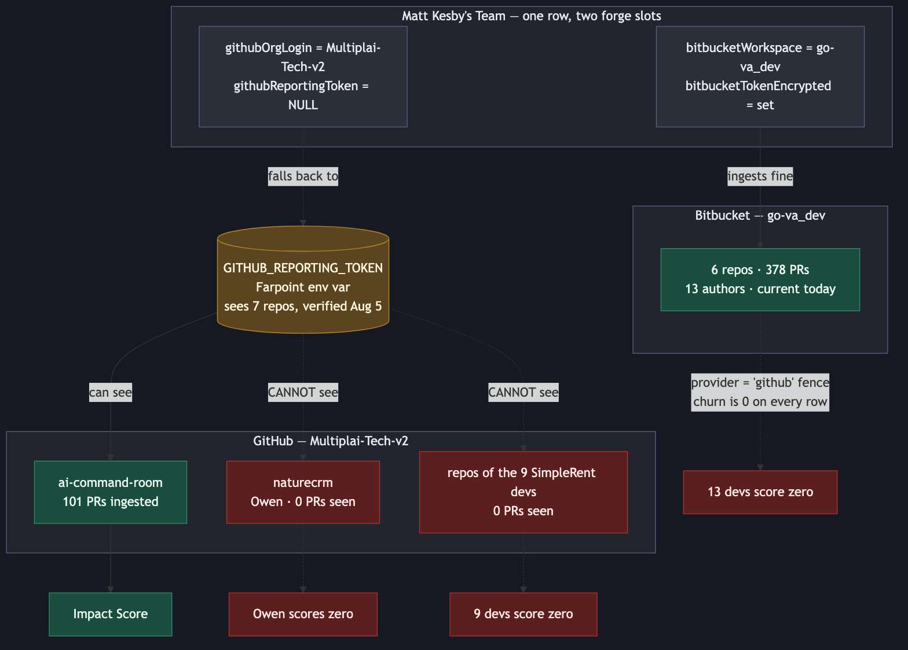
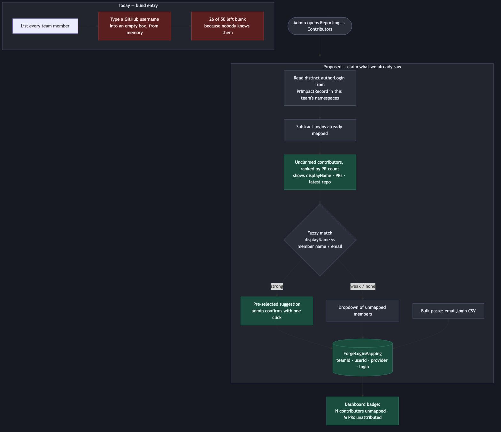
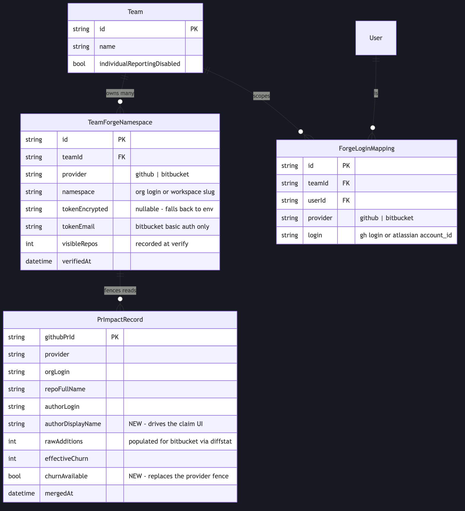

# Reporting: forge coverage and contributor identity

**Status:** proposed, 2026-09-02
**Repo:** `farpointhq/codewithfabric` · all line numbers against `origin/main` (`16095a3`)
**Related:** [Engineering Impact Index v3](impact-score-v3-plan.md) — this plan supplies the inputs v3 scores; it does not change the scoring model.

## Summary

The Enterprise Reporting dashboard tells Matt Kesby's team that 22 of its 24 mapped
developers shipped nothing. That conclusion is an artefact of three plumbing gaps, not a
measurement. This plan closes them.

The trigger was a live question about one developer. Owen Banan was reported as having
consumed ~3 billion tokens with no pull requests to show for it. He is mapped correctly,
his repo `naturecrm` is in the org we already walk, and the hourly ingest is healthy — yet
he has zero rows. The dashboard was not measuring him at all.

Three independent causes, each of which produces a confident zero:

| # | Cause | Who it silences |
|---|---|---|
| 1 | The GitHub token can see 7 repos in an org that has more | Owen, plus 9 newly-mapped SimpleRent devs |
| 2 | Impact is fenced to `provider = 'github'`; Bitbucket carries no churn | 13 Bitbucket authors, 378 merged PRs |
| 3 | Bitbucket authors are raw Atlassian UUIDs with no mapping table | the same 13 |

Cause 1 is operational and is being fixed out-of-band by issuing a correctly-scoped token.
Causes 2 and 3 are code, and are what this plan covers, along with the identity-entry UX
that let 26 of 50 team members go unmapped in the first place.

**The headline: Matt's team merged 378 pull requests in about three and a half weeks. The
dashboard cannot put names on any of them.**

## What is actually true today

Verified against production on 2026-09-02.

- `Team.githubOrgLogin = Multiplai-Tech-v2`, `githubReportingToken = NULL` → GitHub ingest
  falls back to the shared `GITHUB_REPORTING_TOKEN` env var, which recorded
  `githubReportingVisibleRepos = 7` at verify time on 2026-08-05.
- `Team.bitbucketWorkspace = go-va_dev` with its own encrypted token. Healthy: 378 merged
  PRs across 6 repos, 13 distinct authors, most recent merge the morning this was written.
- `ImpactIngestCursor.lastRunStatus = 'ok'` for both forges, last run 02:00 the same day.
  **Nothing is broken. Everything that is missing is out of scope or out of view.**
- Every Bitbucket row carries `rawAdditions = rawDeletions = rawChangedFiles =
  rawCommitCount = 0`. Not null — zero, written deliberately.
- Of 50 people on the team, 24 were mapped before this work, 33 after; 17 have no GitHub
  account at all and legitimately never will.

One structural fact shapes everything below: **SimpleRent and Multiplai are both Matt's
companies, and all their people sit under one enterprise team.** So the answer to
multi-company coverage is more namespaces per team, never more teams.

## Approach

Four workstreams. A and B are the substance; C is largely operational; D is conditional on
information we do not yet have.

### A. Bitbucket into Impact

The fence at `src/app/api/reporting/impact/route.ts:92` — `IMPACT_SCORABLE = { provider:
"github" }` — is **correct as written today** and must not simply be deleted. The schema
comment at `prisma/schema.prisma:707-715` explains why: Bitbucket rows have zero churn, so
an unfenced Impact query would score thirteen named engineers at zero. That is not a
missing number, it is a wrong one, about a person.

So churn has to land first.

- **A1.** Fetch `/2.0/repositories/{ws}/{repo}/pullrequests/{id}/diffstat` per merged PR and
  populate the four raw columns. Same `pullrequest:read` scope the client already exercises
  to list PRs — no new credential, no customer involvement.
- **A2.** Replace the provider fence with a data-driven one: a `churnAvailable` boolean on
  `PrImpactRecord`, set by the writer that knows whether it filled the columns. Impact then
  filters on the property it actually depends on rather than on a proxy for it. A future
  forge, or a Bitbucket PR whose diffstat call failed, is handled without touching the read
  path.
- **A3.** Backfill the 378 existing rows. One request each; trivial against Bitbucket's
  1000/hr authenticated budget.

**Cost.** The ingest already spends one extra request per PR resolving the merge commit,
because Bitbucket reports neither `merged_on` nor a non-null `closed_on`
(`bitbucket-pr-rest.ts:11-33`). Diffstat makes it two. At the observed ~50 merges/night
that is ~100 requests, comfortably inside budget. The 3,714-PR figure quoted in that file
refers to backfilling `go_team_r24`'s entire history, which this plan does not do.

### B. Contributor identity

Two problems wearing one coat: Bitbucket has no mapping table at all, and the GitHub entry
UX is bad enough that admins give up.

- **B1.** Generalise `GithubLoginMapping` → `ForgeLoginMapping` by adding a `provider`
  column, unique on `(teamId, userId, provider)`. Existing rows migrate as
  `provider = 'github'`. One code path for both forges; six read sites move over
  (`route.ts:44`, `impact/route.ts:214`, `productivity/route.ts:143`,
  `projects/[projectId]/route.ts:303`, `reporting/route.ts:93`,
  `users/[userId]/route.ts:142`).
- **B2.** Persist `authorDisplayName`. For Bitbucket this is nearly free: the REST client
  **already requests** `author.display_name` and `author.nickname`
  (`bitbucket-pr-rest.ts:361`) and discards them at line 469, keeping only `account_id`.
  We are receiving the human names and throwing them away.
- **B3.** Invert the mapping UI (below).
- **B4.** Surface incompleteness: an "N contributors unmapped · M PRs unattributed" badge,
  so a partial picture reads as partial instead of as zero.

Today `MappingsEditor` (`reporting-dashboard.tsx:2589-2714`) renders one empty text input
per member, placeholder `github-login`, with a per-row Save button. It asks an admin to
recall 50 usernames from memory. It produced 26 blanks, and closing them required a
customer round-trip and a spreadsheet.

The proposal inverts the direction of the question. We already store every author that has
actually merged something. Rather than asking *"what is this person's login?"*, show the
logins we have observed and ask *"who is this?"* — with a display name, a PR count and a
recent repo attached to each, and a fuzzy-matched suggestion pre-selected. Add a
`email,login` CSV paste for bulk entry. The 13 Bitbucket UUIDs and the remaining GitHub
unknowns become a few minutes of confirming rather than a scavenger hunt.

### C. Credentials

- **C1.** Matt's team should carry its own GitHub token rather than riding Farpoint's env
  var. The field already exists in `TeamTokenField` and is empty; that emptiness is exactly
  why the fallback engaged. Operational, in flight.
- **C2.** **There is no Bitbucket UI at all.** `Team.bitbucketWorkspace`,
  `bitbucketTokenEncrypted` and `bitbucketTokenEmail` exist in the schema
  (`prisma/schema.prisma:240-265`) and `git grep -i bitbucket` over
  `src/components/dashboard/` returns nothing. The live values were set directly in the
  database. Anyone who needs to rotate that token today edits production by hand. This is
  the highest-risk gap in the plan and the least visible.
- **C3.** Longer term, GitHub App installation auth instead of a personal token. An App is
  not capped by any individual's repository access — GitHub's documentation is explicit
  that *"a token cannot grant additional access capabilities to a user"*, which is the root
  cause of the 7-repo view. An App also survives the holder leaving and lets the customer
  revoke it themselves. Follow-on, not a blocker.

### D. Multiple namespaces per team — conditional

`resolveTeamPrScopes` (`team-token.ts:160-173`) is already multi-forge aware and returns a
`TeamPrScope[]`. The single-namespace assumption lives in three places:
`resolveTeamOwnGithubOrg` (`:115`), `resolveTeamGithubOrg` (`:191`) and `ingestAllTeams`'s
selection `where: { githubOrgLogin: { not: null } }` (`impact-ingest.ts:653`).

The shape, should we need it, is a `TeamForgeNamespace` child table — `(teamId, provider,
namespace, token, visibleRepos, verifiedAt)` — replacing the four-column pair on `Team`, so
one enterprise team can span any number of orgs and workspaces.

**This is deliberately last and deliberately conditional.** `naturecrm` turned out to be
inside `Multiplai-Tech-v2`, the org we already walk. It is not yet established that a
second GitHub org exists at all — the SimpleRent reconciliation may have been an audit of
Multiplai-Tech-v2's member list against SimpleRent's staff directory. **If there is exactly
one GitHub org, workstream D is unnecessary and should not be built.** Confirm before
committing to it.

## Files to modify

**Schema** — `prisma/schema.prisma`
`PrImpactRecord` +`authorDisplayName`, +`churnAvailable`; `GithubLoginMapping` →
`ForgeLoginMapping` +`provider`. Migration must be additive-only; see the `db push` warning
in the repo's `CLAUDE.md` and the existing guard test
`prisma/__tests__/mapping-migrations.test.ts`.

**Bitbucket ingest** — `src/lib/reporting/bitbucket-pr-rest.ts` (diffstat fetch; stop
discarding `display_name` at :469), `src/lib/reporting/bitbucket-ingest.ts` (:254-255 write
path).

**Impact fence** — `src/app/api/reporting/impact/route.ts` (:92 constant, :229/:235/:251
queries).

**Mapping reads** — the six sites listed in B1.

**Mapping API** — `src/app/api/reporting/mappings/route.ts` (:44 GET, :92 upsert, :128
delete) + a new unclaimed-contributors endpoint.

**UI** — `src/components/dashboard/reporting-dashboard.tsx`: `MappingsEditor`
(:2589-2714) rebuilt; `TeamTokenField` (:2086-2335) gains a Bitbucket sibling.

**Ingest dispatch** (workstream D only) — `impact-ingest.ts:360,645,653`,
`bitbucket-ingest.ts:151,359,366`, `src/app/api/cron/impact-ingest/route.ts`.

## Test strategy

Written before implementation, testing contracts rather than internals.

**Churn and the fence.** A Bitbucket row with a successful diffstat scores like a GitHub
row of identical size. A row whose diffstat call *failed* is excluded from Impact rather
than scored at zero — this is the regression that matters, and the one a naive
"delete the fence" change would introduce. Assert directly that no engineer with real
merged work can receive a zero Impact score because of a data-availability gap.

**Boundaries.** Zero-line PRs (merge commits, reverts); a PR whose diffstat 404s after a
repo rename; the existing `CHURN_CAP`/`FILE_CAP` truncation flags still set correctly when
the numbers arrive from Bitbucket rather than GitHub.

**Identity.** Migration preserves every existing mapping with `provider = 'github'`.
`(teamId, userId, provider)` uniqueness holds; the same human can hold a GitHub login and
a Bitbucket UUID simultaneously. An unmapped author never silently credits somebody else —
the property that makes a wrong mapping worse than no mapping.

**Privacy.** `individualReportingDisabled` and the k-anonymity floor
(`src/lib/reporting/privacy.ts:48,120-134`) must still suppress per-person rows once
Bitbucket authors are nameable. `privacy-contract.test.ts` already mocks all three
resolvers and is the natural home.

**Regression cover** for the existing suites listed in the file inventory, notably
`impact-ingest.test.ts`'s explicit assertion on the `githubOrgLogin: { not: null }`
selection, which workstream D would change.

## Risks

**Unfencing before churn lands.** Scores thirteen named people at zero. Mitigated by
sequencing A1 before A2, and by making the fence depend on `churnAvailable` rather than on
a provider string.

**Bitbucket rate limits.** Doubling per-PR requests is safe at current volume and is not
safe at backfill scale. The 378-row backfill should run once, deliberately, not inside the
cron's 300-second budget.

**Silent mis-attribution.** A fuzzy-matched suggestion that an admin accepts without
reading is worse than a blank. Suggestions must be confirmed, never auto-applied, and the
UI should show the evidence (display name, PR count, repo) next to each proposal.

**Bitbucket credential has no UI.** Until C2 lands, rotating it means editing production
directly.

**Scope creep into v3.** This plan changes *which* pull requests are visible and *who* they
belong to. It does not change how they are scored. If Impact v3 lands concurrently, the
population it scores will shift underneath it — worth sequencing consciously, because
scores will move for reasons unrelated to v3's model.

**Numbers will get worse before they look better.** Attributing 378 previously-invisible
PRs changes every derived per-capita figure for this team. Anyone who screenshotted the
old dashboard will see a discontinuity. Say so before it lands, not after.

## SOLID analysis

*Second-pass review of the approach above.*

**Single responsibility.** `MappingsEditor` currently renders the mapping table, the token
field and the privacy toggle in one component (`reporting-dashboard.tsx:2683-2686`) — three
unrelated concerns behind one name. The rebuild should split identity from credentials
rather than inherit that. Conversely, folding diffstat into the existing per-PR merge-commit
lookup is *not* a violation: both answer "what else must we know about this PR", and
splitting them would double the request count for nothing.

**Open/closed.** The current design fails this: adding Bitbucket required editing the read
path (`provider = "github"`). Replacing the provider fence with `churnAvailable` closes it —
a third forge that supplies churn works with no read-path change, and one that doesn't is
excluded automatically rather than by a hardcoded name. Same argument for
`ForgeLoginMapping` over a parallel `BitbucketLoginMapping`.

**Liskov.** `PrSource` is already the substitutable abstraction, and GitHub and Bitbucket
implementations sit behind it. The leak is that Bitbucket silently returns zeros where
GitHub returns real numbers — a subtype that doesn't honour the supertype's contract, and
precisely why the fence had to exist. `churnAvailable` makes the difference explicit in the
data instead of implicit in a filter, which is the actual fix.

**Interface segregation.** `resolveTeamOwnGithubOrg` and `resolveTeamGithubOrg` are two
near-identical functions distinguished only by whether an env fallback is permitted — a
read-path/ingest-path safety distinction encoded as duplication. Their doc comments justify
it well (a fallback on a read path is a cross-tenant leak). Workstream D should preserve
that distinction rather than unify them into one function with a boolean flag, which would
put a tenant-isolation guarantee behind a parameter.

**Dependency inversion.** Already good: `impact-ingest.ts` takes an injected `PrSource`, and
`scripts/recompute-impact-records.ts` exercises the pipeline with no network at all.
Diffstat must be fetched *through* that abstraction, not by reaching for the Bitbucket
client directly from the ingest.

**Where SOLID would over-engineer.** `TeamForgeNamespace` (D) is the textbook-correct model
and would be premature if there is only one GitHub org. Keeping the columns on `Team` is
the right call until a second namespace is demonstrated. Noted as conditional above for
exactly this reason.

## Open questions

1. **Is there a second GitHub org?** Decides whether workstream D is built or dropped.
   Blocking for D, irrelevant to A–C.
2. **Does Owen open pull requests at all?** Independent of every fix here. Commits are not
   counted — only merged PRs and closed issues. If his workflow is direct pushes, he reads
   as zero after all of this, for a different reason. Worth knowing before anyone is told
   the dashboard was at fault.
3. **Issues in Bitbucket, or Jira?** The Bitbucket ingest fetches merged PRs only, no
   issues. If they track in Jira, "Closed Issues" can never be non-zero for this team and
   should be hidden rather than shown as a permanent 0.
4. **Which account is Aaron Ignacio's** — `sr-aaron-ignacio` (in the org listing) or
   `aaronignaciogoteam` (what we have mapped)? An overwrite, so it needs a human answer.
5. **Sequencing against Impact v3.** Land this first, v3 first, or together?
