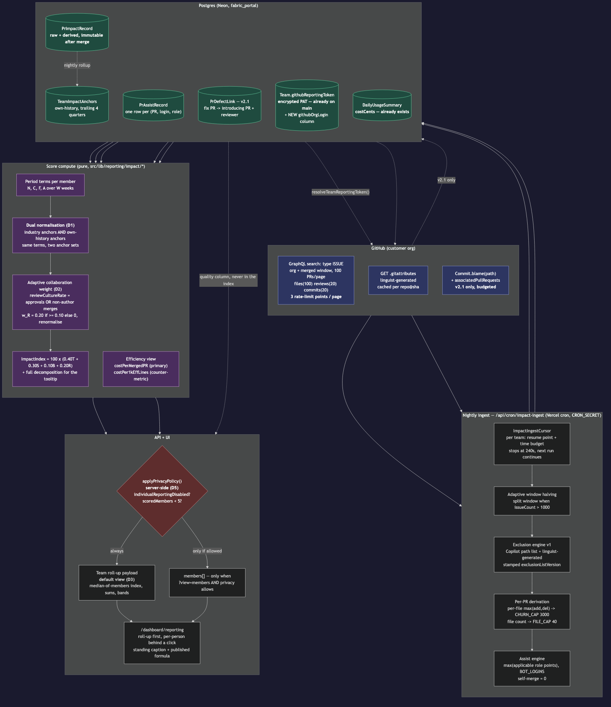
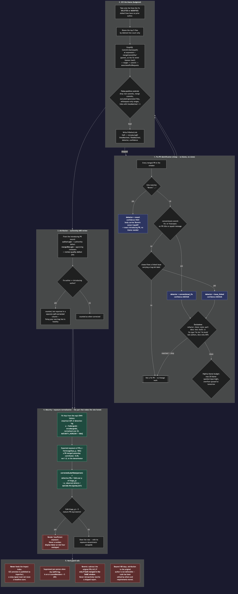
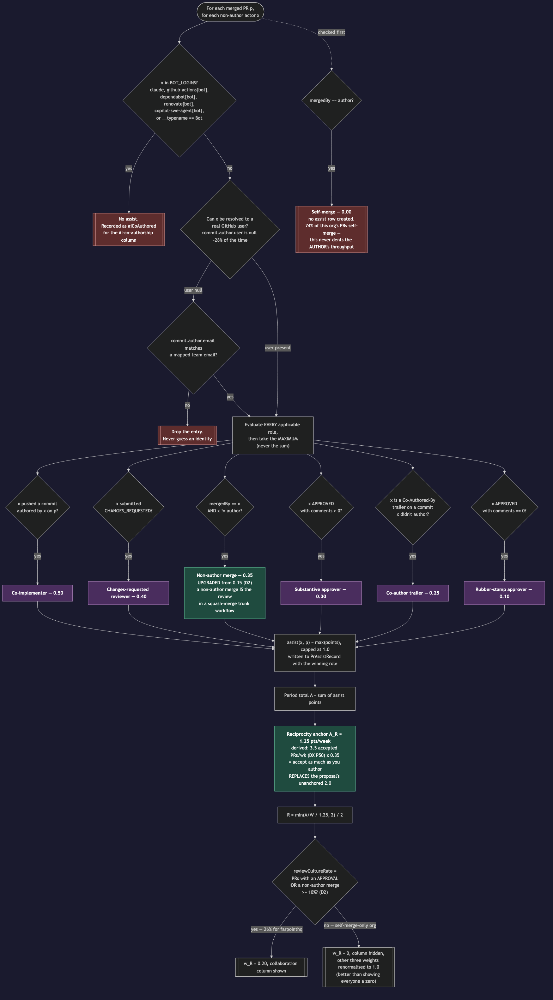

# Engineering Impact Score v2 — implementation plan

**Status:** Draft — awaiting approval
**Date:** 2026-08-01
**Repo:** `codewithfabric` (portal only; no Fabric desktop work)
**Source of record:** the approved research proposal (formulas, anchors, caps, exclusion list, assist table, GraphQL shapes, API-cost math). This plan does not re-argue the research; it turns it into code, and it records the five decisions Ryan made on 2026-08-01 that override the proposal where they differ.

---

## Summary

Replace `productivityScore` — a ratio with tokens in the denominator, which currently rates the org's heaviest shippers at 4/100 and a developer who merged one PR at 100/100 — with two independent views:

1. **Impact Index** — a four-term composite (throughput, substance, breadth, collaboration) built only from GitHub signal, with tokens nowhere in it, every term normalised against a published benchmark and every term individually displayed.
2. **Efficiency** — `cost per merged PR` in real dollars (DORA's own phrase), plus `cost per 1k effective lines` as the split-proof counter-metric. `DailyUsageSummary.costCents` already exists and is currently ignored by the route.

The engine that makes this affordable is a new immutable per-PR table, `PrImpactRecord`, filled by a nightly GraphQL ingest. A merged PR's stats never change, so the dashboard reads Postgres instead of GitHub, and re-tuning weights, caps, anchors or the exclusion list becomes a pure compute job with zero API calls.

This is written against `origin/main @ 8fcc4a3` and leans on what PRs #331–#334 landed on 2026-07-31: per-team encrypted GitHub PATs with a fail-closed resolver, a superadmin-only token endpoint, token-fingerprint cache namespacing, per-team `GithubLoginMapping`, and the safety-belt reporting denial. The only new plumbing v2 needs is **which GitHub org a team maps to** — three nullable columns and one widened endpoint.

Five decisions from Ryan are baked in throughout: **D1** dual benchmarks (industry *and* own-history, side by side); **D2** a non-author merge counts as a review-tier assist because this org's review *is* the merge; **D3** team roll-up is the default view and the per-person table is behind a click; **D4** revert detection plus bug-fix lineage with exposure-normalised "corrected-later" rates; **D5** a superadmin-only per-enterprise switch that disables all per-individual reporting, enforced server-side.

---

## Baseline — what `origin/main` already gives us

This plan is written against **`origin/main` at `8fcc4a3`** (PRs #331–#334, merged 2026-07-31), not against any feature branch. Several things landed that this plan builds on rather than rebuilding:

| Already on `main` | Where | What v2 does with it |
|---|---|---|
| **Per-team encrypted GitHub PAT.** `Team.githubReportingToken String?` (migration `20260731090000_add_team_github_reporting_token`), with `resolveTeamReportingToken(teamId) → { token, source }`, `encryptReportingToken`, `isPlausibleGithubToken`, `tokenLast4`. Fails **closed** on an undecryptable token rather than silently borrowing the env PAT. | `src/lib/reporting/team-token.ts` | The v2 ingest calls `resolveTeamReportingToken(team.id)` verbatim. No new credential storage, no new crypto path. |
| **Superadmin-only token endpoint.** `GET/PUT/DELETE /api/reporting/team-token?teamId=…`, deliberately *not* on the shared reporting gate — an enterprise owner must never read back or overwrite a PAT. Expires `PRODUCTIVITY_TAG` on write. | `src/app/api/reporting/team-token/route.ts` | **Extended, not replaced**, to also carry the GitHub org login and `visibleRepoCount`. |
| **Token-fingerprint cache namespacing.** `sharedActivityKey(fingerprint, login, start, end)` keyed on `tokenFingerprint(token)`, so two teams with different PATs cannot inherit each other's counts for the same login. | `src/lib/reporting/github-activity.ts` | The same `tokenFingerprint` helper is stamped onto `PrImpactRecord` — see the cross-tenant note in the Data model. |
| **`GithubLoginMapping` is per-team**: `teamId` FK, `@@unique([teamId, userId])`, `@@index([teamId])`. Mutations take `teamId` **in the request body**; reads gate through `resolveTeamAccess` + `isTeamMemberUser`. | `prisma/schema.prisma`, `src/app/api/reporting/mappings/route.ts` | Member resolution is already correctly team-scoped. `unmappedOrgAuthors` is computed against the team's own mapping set. |
| **Safety-belt reporting denial** — `canViewerAccessTeam` now takes `enterpriseAssignedBy` and denies any team minted by `ensureEnterpriseAccess` as an emergency solo grant. `isTeamMemberUser` is exported; `canViewerManageUser` is gone. | `src/lib/reporting/scope.ts` | v2 routes inherit this by going through `resolveReportingScope` / `resolveTeamAccess`. Nothing to re-derive. |
| **`memberDisplayName` / `memberFirstName`** replace bare `userNameFromEmail` at the call sites. | `src/lib/reporting/productivity.ts` | v2 payloads use `memberDisplayName` so names match the rest of the dashboard. |
| **`Usage` composite index** `@@index([userId, createdAt])` (migration `20260730120000_add_usage_user_created_idx`). | `prisma/schema.prisma` | Not on the impact path — the index view reads `DailyUsageSummary` — but relevant if the efficiency view ever needs sub-daily grain. |

Also confirmed: `DailyUsageSummary.costCents` exists and the productivity route still does not select it; `prisma/migrations/` now holds **five** hand-applied migrations; Vercel crons already run here (`vercel.json` → `publish-scheduled`, `usage-freshness`).

### The one genuine gap

The v2 fetcher queries GitHub by **org and time window** rather than per author — that is what turns a ~60s, 30-request-per-minute REST Search fan-out into three GraphQL points per 100 PRs. Nothing on `main` records **which GitHub org a team maps to**: the token is stored, the org is not.

The minimal delta is exactly that, and nothing more — three nullable columns on `Team`:

```prisma
// on Team, alongside the existing githubReportingToken
githubOrgLogin              String?    // e.g. "farpointhq" — the org v2 ingests
githubReportingVisibleRepos Int?       // recorded at token-verify time
githubReportingVerifiedAt   DateTime?
```

plus a widening of the **existing** `/api/reporting/team-token` route to accept and return `orgLogin`, and to record `visibleRepoCount` from a verification call. Same superadmin gate, same encryption, same `PRODUCTIVITY_TAG` invalidation, and the UI field already exists (`TeamTokenField` in `reporting-dashboard.tsx`, superadmin-gated).

> An earlier draft of this plan proposed a full `TeamGithubConnection` model. Against `main` that is over-scoped — it would duplicate credential storage that already exists, works, and fails closed correctly. Three nullable columns and one widened endpoint is the whole prerequisite.

**Multi-org teams are explicitly out of scope for v2.0.** One org per team. If a customer needs several, promote `githubOrgLogin` to a `TeamGithubOrg` join table later — the ingest loop is already written per-org, so that is an additive change, not a redesign.

### One real gap that #333/#334 did *not* close

`GithubLoginMapping` is unique on `(teamId, userId)` — one mapping per user per team, which is right. But there is still **no constraint on `githubLogin`**, so two different users *in the same team* can map to the same GitHub login and both are credited for every PR that login authored. Under v1's count scoring this quietly inflates two people; under v2 it double-counts into `N`, `C`, `F`, the assist totals **and** the roll-up sums. Guard proposed in Risks #2.

---

## Ryan's decisions, and exactly how each lands in code

### D1 — dual benchmarks, both displayed

Compute the index **twice** over identical period terms, once against published industry anchors and once against the team's own trailing-4-quarter anchors. The scoring function already takes anchors as a parameter, so this is one extra call, not a second implementation.

- **Industry anchors** (proposal §3.3): `A_T = 3.5` merged PRs/week (DX Core 4 P50), `A_S = 400` effective lines/week, `A_B = 25` effective files/week, `A_R` — see D2 below.
- **Own-history anchors**: the **median across scored members** of each per-week rate, computed over the four quarters **strictly preceding** the reporting period's `start`. Strictly preceding matters — a benchmark that includes the period it is scoring is circular.
- Availability gate: own-history requires ≥ 26 weeks of ingested history **and** ≥ 5 scored members in the history window. Otherwise `ownHistory.available = false` and only the industry column renders.
- **The caption must state the tautology out loud:** on the own-history benchmark the median member scores exactly 50 by construction. Without that sentence a team reads "50" as "we are mediocre" when it means "you are your own median".

Payload shape carries both under `benchmarks` and both indices under `impactIndex: {industry, ownHistory}`, so removing whichever one loses is a UI-only deletion later.

### D2 — a non-author merge is a review

Ryan's org never uses formal GitHub approvals. Measured in the proposal: **0/100** merged PRs carried an `APPROVED` review; **26/100** were merged by someone other than the author. In that workflow the merge button *is* the accept gate — it is the only act that puts someone else's judgement between a branch and trunk.

**Change 1 — reweight.** `merger-assist` is renamed `non_author_merge` and moves from **0.15 → 0.35**.

Why 0.35 and not something else:

- It sits above `substantive_approver` (0.30) and below `changes_requested` (0.40). A merge is a **decision** and carries accountability for trunk state; an approval is an **opinion** and carries none. Where both signals exist, the merge is the binding act — so it should outrank a comment-bearing approval, and still sit below the strongest evidence of critical reading, which is asking for changes.
- It is **structurally unfarmable in the way approvals are not.** Self-merge is scored 0 by construction, and only one person can merge a PR. A rubber-stamp approval ring can mint unlimited 0.10s; a merge ring costs one real merge each and is capped by the team's actual PR volume.
- Keeping it at 0.15 would leave `R̂` floor-pinned for exactly the org type Ryan runs, which is the thing D2 exists to fix.

**Change 2 — re-anchor `A_R`.** The proposal set `A_R = 2.0` assist points/week and flagged it as unanchored guesswork. Reweighting without re-anchoring does almost nothing, so replace it with a derived anchor:

```
A_R = A_T × w(non_author_merge) = 3.5 × 0.35 = 1.225  →  A_R = 1.25 points/week
```

Read in English: **at-benchmark collaboration means accepting about as much of other people's work as they accept of yours.** Reciprocity 1.0. It inherits its provenance from `A_T`, which is DX's published P50 over 500+ companies, so it is derived rather than invented — but it is still a design choice, not a measurement, and is flagged as such in-product.

Effect on the proposal's worked developer (§3.7): assists rise from `20 × 0.15 + 5 × 0.50 = 5.5` to `20 × 0.35 + 5 × 0.50 = 9.5` points, `A/W` from 0.423 to 0.731, `R̂` from 0.106 to **0.292**, and the index from **74 → 78**.

Effect on the org as a whole, projected from the measured 26% non-author-merge and 17% co-implementer rates at 3.5 PRs/week: roughly **0.62 assist points/week/dev → `R̂ ≈ 0.25`** (versus ≈ 0.11 under the old weight and anchor). Honest reading: the collaboration term is now *live and informative* rather than floor-pinned, but it is still well under 0.5 — because 74% of this org's PRs genuinely have no second human on them. The metric is right to say so, and that is a finding worth surfacing, not a calibration bug to weight away.

**Change 3 — adaptive weight signal.** The §4.6 review-culture detector switches from approvals-only to **approvals OR non-author merges**:

```
reviewCultureRate = |{ PRs with ≥1 APPROVED review OR mergedBy ≠ author }| / |merged PRs|
w_R = 0.20  if reviewCultureRate ≥ 0.10
w_R = 0     otherwise → hide the column, renormalise T/S/B to sum to 1.0
```

Farpoint scores 0.26 on this, so the collaboration term is live and **no weight-dropping happens for Ryan's org**. The fallback stays for a customer org where even merges are self-only — showing every member a hard zero on a scored term is worse than not scoring it.

### D3 — team roll-up is the default

- `GET /api/reporting/impact` returns the roll-up **always**; the `members[]` array only when `?view=members` is passed *and* the privacy gate allows it.
- The roll-up index is the **median across scored members**, not the mean (Graphite precedent; the current route uses a mean at `route.ts:200-204`, which one outlier distorts). Counts (`mergedPRs`, `effectiveChurn`, spend) are sums.
- The dashboard opens on roll-up tiles + the roll-up decomposition. "Show per-person breakdown" is a button. The two-axis scatter (Impact Index × cost per merged PR) lives on the per-person view, not the default.

### D4 — revert detection and bug-fix lineage (designed now, shipped in v2.1)

Full design in the *Bug-fix lineage* diagram and the *Data model* section. The load-bearing decisions:

- **Fix PRs are identified cheaply and conservatively** — revert titles, conventional-commit `fix:` prefixes, or a linked bug-labelled issue. `refactor:`/`chore:`/`style:`/`perf:`/`docs:`/`test:`/`build:`/`ci:` prefixes are excluded outright, as are `fix typo`/`fix lint`/`fix build` and docs-only diffs. No blame work happens for a PR that fails this gate.
- **SZZ-lite blame runs only on lines the fix deleted or modified** — added lines have no prior author — against `Commit.blame(path)` at `mergeCommitSha^`, so a fix can never blame itself. Top 5 files by deleted-line count only, budgeted at 20 blame queries per repo per night with overflow queued.
- **Attribution is two-sided (Ryan's explicit ask):** the introducing PR's `authorLogin` takes an authorship defect, and its `mergedByLogin` plus any approving reviewers take a **review-quality** defect. The assist that earned collaboration credit is the same act that earns review accountability — that symmetry is the point.
- **Exposure normalisation is mandatory.** Fresh code has not had time to reveal defects, so a raw defects-per-PR rate rewards shipping recently. Fit `H(a)`, the empirical CDF of detection lag over the org's own history, normalised over `[0, MATURITY_HORIZON = 180 days]`. Then

  ```
  correctedLaterRate(person) = defectivePRs / Σ_p H(min(ageDays_p, 180))
  ```

  The denominator is **mature-PR-equivalents**, not PR count: a PR merged yesterday contributes ≈ 0.05, not 1.0. Below **5 mature-PR-equivalents** the rate is not rendered at all — "insufficient exposure", the honest analogue of a survival-analysis at-risk floor.
- **Never feeds the Impact Index.** SZZ-family detectors have published precision problems; folding a noisy signal into a headline score is the exact failure the research warns about. It is a separate quality column with its own exposure denominator shown next to it.
- **Reverts never rewrite a shipped report.** If a revert and its original merged in the same reporting window, the original's `N/C/F` contribution is subtracted. If the original merged in an earlier window, the earlier period's numbers stand and the revert shows up in the quality column only. Retroactively changing a number someone screenshotted destroys trust in the whole dashboard.
- **Self-corrected is reported separately** from other-corrected. A developer fixing their own bug in two days is a healthy signal, not a quality problem, and collapsing the two would punish it.

### D5 — per-enterprise privacy switch, superadmin-only, enforced server-side

- New `Team.individualReportingDisabled` (+ `…At`, `…By`). Default `false`.
- Settable **only** via `PATCH /api/reporting/privacy` gated on `isSuperAdmin(session.user.email)`. A team owner or team ADMIN gets **403** — this is deliberate, per Ryan: the customer asks, Ryan flips it.
- Enforcement lives in **one** function, `applyPrivacyPolicy(payload, team, scoredMemberCount)` in `src/lib/reporting/privacy.ts`, and **every** reporting route pipes its payload through it before `NextResponse.json`. Nothing is "hidden in the UI" — the fields are absent from the wire.
- With the flag on: `members` is `null`; alerts lose `userId`/`userName` and become team-scoped counts; the mappings API is superadmin-only; and the **roll-up itself requires ≥ 5 scored members** (k-anonymity — a roll-up over 2 people is two people's numbers).
- Independently of the flag, the proposal's **≥ 5 scored members** floor gates any cross-person ranking view, and the standing caption ships on every view:

  > *Impact Index measures shipped change volume and collaboration visible on GitHub. It does not measure code quality, design work, mentoring, incident response, or work done outside pull requests. It is a conversation starter, not a performance rating.*

- The **legacy** `/api/reporting/productivity` route must be piped through the same helper, or it becomes a trivial bypass of the flag. This is a named test case.

---

## Approach

**Storage first, compute second, UI third.** The reason v2 is cheaper than what ships today (measured: one GraphQL page = 100 PRs with files, reviews, commits and `mergedBy` for 3 rate-limit points, against a 5,000/hour budget; versus today's 30-requests-per-*minute* REST Search budget and a ~60s cold run) is that a merged PR is immutable. Ingest it once, store raw *and* derived, and every subsequent question is a Postgres query.

Four layers, each independently testable:

1. **Connection + fetch** (existing `team-token.ts` + new `github-pr-graphql.ts`) — the token comes from `resolveTeamReportingToken(team.id)`, which already exists and already fails closed; the only new input is `Team.githubOrgLogin`. Org-and-window GraphQL search with adaptive window halving when `issueCount > 1000`, `files(first:100)`, `reviews(first:20)`, `commits(first:20)`. Truncation is *recorded*, never paginated (the proposal measured `commits(first:100)` at a 52-point cliff).
2. **Derivation** (`exclusion.ts`, `derive.ts`, `assists.ts`) — pure functions, no I/O. Path exclusion + `linguist-generated`, per-file `max(add, del)`, `CHURN_CAP = 3000`, `FILE_CAP = 40`, assist roles with `max()` not `sum()`, `BOT_LOGINS` including `claude`. These write `PrImpactRecord` / `PrAssistRecord`.
3. **Scoring** (`index-score.ts`, `efficiency.ts`, `anchors.ts`) — pure functions over period terms and an anchor set. Called twice per member (D1). Emits the full decomposition, never just the number.
4. **Presentation** (`/api/reporting/impact`, `privacy.ts`, dashboard) — roll-up by default, decomposition tooltips mandatory, formula published in-product.

Everything derived is stamped with `exclusionListVersion` and `derivationVersion`, so a recompute is a background job with zero GitHub calls and a shipped report can always explain which rules produced it.



---

## Phased delivery

### Phase v2.0 — the index, the efficiency view, and the privacy gate

| # | Deliverable | Notes |
|---|---|---|
| 1 | **Org login on `Team`** + widen `/api/reporting/team-token` | The only genuine prerequisite. Three nullable columns (`githubOrgLogin`, `githubReportingVisibleRepos`, `githubReportingVerifiedAt`); the existing superadmin endpoint and `TeamTokenField` grow an org-login input and a "verify" action that records `visibleRepoCount`, so a missing repo is diagnosable rather than silent. Reuses `resolveTeamReportingToken` / `encryptReportingToken` unchanged. |
| 2 | GraphQL org-window fetcher | `github-pr-graphql.ts`. Adaptive halving, truncation flags, point accounting logged per run. |
| 3 | Exclusion engine v1 | GitHub's own Copilot-code-review path list + `.gitattributes` `linguist-generated`, cached per `repo@defaultBranchSha`. Versioned string, not a constant. |
| 4 | Per-PR derivation | `C_p`, `F_p`, per-file `max`, caps, `excludedChurn` recorded for the "excluded from churn: X%" tooltip line. |
| 5 | Assist engine incl. **D2** | Roles, `max()` semantics enforced by a `@@unique([prRecordId, login])` constraint, `BOT_LOGINS`, null-safe `commit.author.user` with email fallback then drop. |
| 6 | `PrImpactRecord` + `PrAssistRecord` + nightly ingest | Cron + resumable cursor. Initial history load via a local script. |
| 7 | Dual benchmarks (**D1**) | `TeamImpactAnchors` rollup + `anchors.ts`. Both indices in the payload. |
| 8 | Impact Index + mandatory decomposition | `index-score.ts`. Adaptive `w_R` per D2. |
| 9 | Cost-per-PR efficiency view | `costCents` into the select; `costPerMergedPRCents` primary, `costPer1kEffLinesCents` counter-metric; percentile bands against the team's own trailing-4-quarter distribution, never absolute thresholds. |
| 10 | Team-roll-up-default UI (**D3**) | Roll-up tiles, decomposition panel, per-person behind a click, scatter on the per-person view. |
| 11 | GDPR flag (**D5**) | `privacy.ts` + `PATCH /api/reporting/privacy` + superadmin toggle in the dashboard. |
| 12 | Alert rewrite | Three rules retargeted, one added. The string *"token usage doesn't reflect productivity"* is deleted. |
| 13 | Deprecation shim | `productivityScore` stays in the payload for one release as a duplicate of nothing meaningful — see Risks; UI stops saying "productivity" immediately. |

### Phase v2.1 — quality lineage

| # | Deliverable |
|---|---|
| 14 | Revert detection: `^Revert "` titles, `Reverts owner/repo#N` body parse, `revertedByPrNumber` / `revertsPrNumber` on `PrImpactRecord`, same-window subtraction only |
| 15 | Fix-PR classification (conventional `fix:`, linked bug issue) with the exclusion list |
| 16 | SZZ-lite blame worker + `PrDefectLink`, budgeted, false-positive controls |
| 17 | Maturity window: `H(a)` fitting, exposure-normalised `correctedLaterRate`, ≥5 mature-PR-equivalents floor, self- vs other-corrected split |
| 18 | Review-quality attribution (introducing PR's merger + approvers) |
| 19 | AI-co-authorship column (`% of PRs AI-co-authored`) — data already captured in v2.0 via `aiCoAuthored` |



---

## Files to Modify

Line references are against `origin/main @ 8fcc4a3`.

| File | Change |
|---|---|
| `prisma/schema.prisma` | Add `PrImpactRecord`, `PrAssistRecord`, `TeamImpactAnchors`, `ImpactIngestCursor`, `PrDefectLink` (v2.1). On `Team`: three `individualReportingDisabled*` columns, three `github*` org columns, and back-relations. **All additive, all defaulted or nullable.** |
| `src/lib/reporting/team-token.ts` | Add `resolveTeamGithubOrg(teamId) → { orgLogin, token, source }` next to the existing `resolveTeamReportingToken`, so the ingest gets org + credential in one call. Nothing existing changes. |
| `src/app/api/reporting/team-token/route.ts` | Accept `orgLogin` in the `PUT` body and return it from `GET`; add a verification step that records `githubReportingVisibleRepos` / `githubReportingVerifiedAt`. Keep the superadmin gate, the never-return-the-token rule, and the `runtimeCacheExpireTag(PRODUCTIVITY_TAG)` invalidation exactly as they are. `DELETE` should clear the org login too. |
| `src/lib/reporting/productivity.ts` | Keep `computeScore` / `efficiencyRating` exported and unused for one release. Rewrite the three alert rules; delete both `"token usage doesn't reflect productivity"` strings. Add `ingestStaleRule`. `memberDisplayName` is reused as-is. |
| `src/app/api/reporting/productivity/route.ts` | Add `costCents: true` to the `dailyUsageSummary.select`. Change `avgProductivity` from mean to median. Pipe the payload through `applyPrivacyPolicy`. Mark deprecated in favour of `/api/reporting/impact`. The `resolveTeamReportingToken` + `getActivityBatch(logins, start, end, token)` call it already makes stays untouched — v1 and v2 coexist for one release. |
| `src/app/api/reporting/route.ts`, `/sessions/route.ts`, `/hour-of-day/route.ts` | Pipe payloads through `applyPrivacyPolicy` — all three carry per-member rows and would otherwise bypass D5. |
| `src/app/api/reporting/mappings/route.ts` | `GET` (query `teamId`) and both mutations (`teamId` + `userId` **in the JSON body**, gated by `requireManageableMapping` → `resolveTeamAccess` + `isTeamMemberUser`) become superadmin-only when `individualReportingDisabled` is set. The gate helper stays; only an extra privacy check is inserted. |
| `src/lib/reporting/scope.ts` | Extend the `select` in `resolveTeamAccess` (which already pulls `enterpriseAssignedBy` for the safety-belt check) to include `individualReportingDisabled` and `githubOrgLogin`, and surface them on `ReportingScope.team` so no route re-queries. Add `resolveScoredMemberCount`. `canViewerAccessTeam` / `isTeamMemberUser` are **not** modified. |
| `src/lib/reporting/github-activity.ts` | No functional change. Referenced only because `tokenFingerprint` is imported from `team-token.ts` here and v2 reuses the same helper. |
| `src/components/dashboard/reporting-dashboard.tsx` | Roll-up-first restructure; new decomposition panel; rename every "Productivity"/"Score" label; replace the footer formula string (`score = log10(...)`, ~line 950); scatter axes become Impact Index × cost per merged PR (the `ProductivityScatter` component and its `SCATTER_TIERS` already exist, ~line 964). Add the org-login input to the existing `TeamTokenField` (~line 1587) and the D5 toggle beside it — both already inside the `isSuperAdmin &&` branch (~line 1779). |
| `vercel.json` | Add the `/api/cron/impact-ingest` cron entry. |
| `.env.example` | `GITHUB_REPORTING_TOKEN` is already documented as the fallback; add `GITHUB_REPORTING_ORG` as the matching env-level default for teams with no `githubOrgLogin`. |

## New Files

**Domain (pure, no I/O — all unit-testable without mocks):**

- `src/lib/reporting/impact/constants.ts` — `CHURN_CAP`, `FILE_CAP`, `INDUSTRY_ANCHORS`, `ASSIST_POINTS`, `BOT_LOGINS`, `EXCLUSION_PATHS`, `EXCLUSION_LIST_VERSION`, `DERIVATION_VERSION`, `MATURITY_HORIZON_DAYS`
- `src/lib/reporting/impact/exclusion.ts` — `isExcluded(path, gitattributes)` + version stamping
- `src/lib/reporting/impact/derive.ts` — `derivePr(rawPr) → { effectiveChurn, effectiveFiles, excluded…, truncation flags }`
- `src/lib/reporting/impact/assists.ts` — `deriveAssists(rawPr) → AssistRow[]`, role table, `max()` semantics
- `src/lib/reporting/impact/anchors.ts` — `INDUSTRY_ANCHORS`, `deriveOwnHistoryAnchors(records, window)`
- `src/lib/reporting/impact/index-score.ts` — `computeImpactIndex(terms, anchors, weights) → { index, decomposition }`, `resolveWeights(reviewCultureRate)`
- `src/lib/reporting/impact/efficiency.ts` — cost-per-PR, cost-per-1k-effective-lines, percentile banding
- `src/lib/reporting/impact/rollup.ts` — member terms → team roll-up (median for the index, sums for counts)
- `src/lib/reporting/impact/lineage.ts` *(v2.1)* — fix-PR classification, blame-range filtering, `H(a)` fitting, exposure-normalised rates

**Infrastructure:**

- `src/lib/reporting/github-pr-graphql.ts` — GraphQL client, org-window search, adaptive halving, point accounting
- `src/lib/reporting/github-blame.ts` *(v2.1)* — `Commit.blame` + `associatedPullRequests`, budgeted
- `src/lib/reporting/impact-ingest.ts` — the ingest orchestrator (cursor, time budget, upsert, recompute mode)

> No `team-github-connection.ts`. Credential resolution already lives in `src/lib/reporting/team-token.ts` on `main`; v2 adds one function to it rather than a parallel module.
- `src/lib/reporting/privacy.ts` — `applyPrivacyPolicy()`, the single D5 enforcement point

**Routes:**

- `src/app/api/reporting/impact/route.ts`
- `src/app/api/reporting/privacy/route.ts` (PATCH, superadmin-only)
- `src/app/api/cron/impact-ingest/route.ts`

> No `/api/reporting/connection` route. The org login rides on the existing superadmin-only `/api/reporting/team-token` endpoint, which already has the right gate and the right cache invalidation.

**Scripts:**

- `scripts/backfill-impact-records.ts` — initial multi-quarter history load, run locally (no Vercel timeout)
- `scripts/recompute-impact-records.ts` — re-derive from stored raw stats after a rules change; asserts zero GitHub calls

**Components:**

- `src/components/dashboard/impact-rollup.tsx`, `impact-decomposition.tsx`, `impact-members-table.tsx`, `impact-scatter.tsx`, `impact-privacy-toggle.tsx`

---

## Data model

### Columns added to `Team`

No new credential model. `Team.githubReportingToken` (encrypted, added by PR #334) is reused as-is; the only additions are the org login, its verification metadata, and the D5 switch.

```prisma
  // --- v2 GitHub org (the one genuine gap; see Baseline above) ---
  githubOrgLogin              String?    // the org the v2 ingest walks, e.g. "farpointhq"
  githubReportingVisibleRepos Int?       // recorded when the PAT is verified — diagnosability
  githubReportingVerifiedAt   DateTime?

  // --- D5: per-enterprise privacy switch. Superadmin-only; disables ALL
  //     per-individual reporting for this team, enforced server-side. ---
  individualReportingDisabled   Boolean   @default(false)
  individualReportingDisabledAt DateTime?
  individualReportingDisabledBy String?

  // back-relations
  impactAnchors      TeamImpactAnchors[]
  impactIngestCursor ImpactIngestCursor?
```

### New Prisma models

```prisma
model PrImpactRecord {
  id                   String   @id @default(cuid())
  repoFullName         String
  prNumber             Int
  orgLogin             String
  authorLogin          String
  authorIsBot          Boolean  @default(false)
  mergedAt             DateTime
  mergedByLogin        String?
  title                String

  // RAW — the whole point of this table. Lets the formula change without re-fetching.
  rawAdditions         Int
  rawDeletions         Int
  rawChangedFiles      Int
  rawCommitCount       Int

  // DERIVED
  effectiveChurn       Int      // C_p, post-exclusion, post-cap
  effectiveFiles       Int      // F_p
  excludedChurn        Int      // max()-churn dropped by the exclusion engine
  excludedFiles        Int
  churnCapped          Boolean  @default(false)
  filesCapped          Boolean  @default(false)
  filesTruncated       Boolean  @default(false)   // files.totalCount > 100
  commitsTruncated     Boolean  @default(false)   // commits.totalCount > 20
  aiCoAuthored         Boolean  @default(false)
  hasApproval          Boolean  @default(false)
  nonAuthorMerge       Boolean  @default(false)

  // v2.1
  revertedByPrNumber   Int?
  revertsPrNumber      Int?
  isFixPr              Boolean  @default(false)
  fixDetector          String?  // revert | conventional_fix | issue_linked

  exclusionListVersion String
  derivationVersion    String
  // Which PAT this row was ingested under. Reuses tokenFingerprint() from
  // team-token.ts — the same helper that namespaces the count cache on main.
  // See the cross-tenant note below.
  ingestTokenFingerprint String
  ingestedAt           DateTime @default(now())

  assists              PrAssistRecord[]
  defectsCaused        PrDefectLink[]  @relation("IntroducingPr")
  defectsFixed         PrDefectLink[]  @relation("FixPr")

  @@unique([repoFullName, prNumber])
  @@index([orgLogin, mergedAt])
  @@index([authorLogin, mergedAt])
  @@index([mergedByLogin, mergedAt])
}

model PrAssistRecord {
  id         String         @id @default(cuid())
  prRecordId String
  prRecord   PrImpactRecord @relation(fields: [prRecordId], references: [id], onDelete: Cascade)
  login      String
  role       String   // co_implementer | changes_requested | non_author_merge
                      // | substantive_approve | co_author_trailer | rubber_stamp
  points     Float
  mergedAt   DateTime // denormalised so period queries need no join

  // Enforces "max, not sum" in the schema, not just in code.
  @@unique([prRecordId, login])
  @@index([login, mergedAt])
}

model TeamImpactAnchors {
  id            String   @id @default(cuid())
  teamId        String
  team          Team     @relation(fields: [teamId], references: [id], onDelete: Cascade)
  windowStart   DateTime
  windowEnd     DateTime // exclusive; always <= the scored period's start
  throughput    Float
  substance     Float
  breadth       Float
  collaboration Float
  memberCount   Int
  computedAt    DateTime @default(now())

  @@unique([teamId, windowStart, windowEnd])
}

model ImpactIngestCursor {
  id                String    @id @default(cuid())
  teamId            String    @unique
  team              Team      @relation(fields: [teamId], references: [id], onDelete: Cascade)
  ingestedThrough   DateTime?          // exclusive upper bound of fully-ingested merges
  backfillCursor    DateTime?          // walks backwards during the historical load
  lastRunAt         DateTime?
  lastRunStatus     String?            // ok | partial | error
  lastError         String?
  graphqlPointsLast Int?               // observability on the rate-limit budget
  blameBudgetDate   DateTime?          // v2.1
  blameQueue        Json?              // v2.1: fix-PR ids awaiting blame
}

// v2.1
model PrDefectLink {
  id              String         @id @default(cuid())
  fixPrRecordId   String
  fixPr           PrImpactRecord @relation("FixPr", fields: [fixPrRecordId], references: [id], onDelete: Cascade)
  introPrRecordId String
  introPr         PrImpactRecord @relation("IntroducingPr", fields: [introPrRecordId], references: [id], onDelete: Cascade)
  detector        String   // revert | conventional_fix | issue_linked
  confidence      String   // high | medium
  filesMatched    Int
  linesMatched    Int
  lagDays         Int      // fix.mergedAt - intro.mergedAt — the H(a) input
  selfCorrected   Boolean  @default(false)
  createdAt       DateTime @default(now())

  @@unique([fixPrRecordId, introPrRecordId])
  @@index([introPrRecordId])
}
```

### Cross-tenant note: why `PrImpactRecord` is not partitioned by team

`PrImpactRecord` is keyed on `(repoFullName, prNumber)` — a merged PR is objective fact, not a per-team opinion, so two teams connected to the same org share rows rather than duplicating them. Records are partitioned by `orgLogin`, and a team is only ever scored over the org named in its own `githubOrgLogin`.

The residual case is two teams on the **same** org whose PATs see **different repo subsets**. `main` already treats this as a real hazard — `sharedActivityKey` is namespaced by `tokenFingerprint` precisely so one team's counts can't leak into another's. v2 handles it differently on purpose:

- `ingestTokenFingerprint` is stamped on every row, so it is always answerable *which* PAT produced a record.
- Scoring is per **mapped member**, and a member is only credited for PRs they authored or assisted on — so a repo one team's PAT cannot see never appears in that team's per-person numbers regardless of who ingested it.
- The exposure is confined to **coverage counts** (`prsIngested`, `unmappedOrgAuthors`) potentially reflecting a wider repo set than the reader's own PAT. When two distinct fingerprints are observed for one `orgLogin`, raise a coverage warning rather than silently reporting the union.

Partitioning records per team was rejected: it would multiply storage by the number of teams on an org and make the recompute path re-derive identical rows N times, for a leak surface that is a count, not a name.

### Migration posture — non-negotiable

The Neon `fabric_portal` database is **shared with a separate community/remix application**. Per the repo's `CLAUDE.md`, `prisma db push` has previously been one command away from emitting `DROP TABLE` for live tables, and it re-arms every time a model lands on another branch.

1. **Never** run `prisma db push` or `prisma migrate dev` against production.
2. Before generating any SQL, run and read:
   ```bash
   npx prisma migrate diff --from-url "$DATABASE_URL" \
     --to-schema-datamodel prisma/schema.prisma --script
   ```
   Any `DROP TABLE`, `DROP COLUMN` or `DROP TYPE` in the output means the branch is stale — merge `main` and re-check. A clean run emits only `CREATE TABLE` / `CREATE INDEX` / `ALTER TABLE … ADD COLUMN … DEFAULT …`.
3. Hand-write the migration SQL from that diff into `prisma/migrations/<ts>_add_impact_records/migration.sql`, matching the **five** existing hand-applied folders (the most recent, `20260731090000_add_team_github_reporting_token`, is the closest template — it is a plain additive `ALTER TABLE "Team" ADD COLUMN`).
4. Apply **out-of-band** with `psql` against the Neon pooler URL (production has no `_prisma_migrations` table, so `migrate deploy` will not work until someone baselines it — do not attempt that as part of this work).
5. Every column added to `Team` carries a `DEFAULT`, so the deploy is order-independent with respect to the code rollout.
6. Deploy the schema **before** the code. Reading a column that does not exist yet is a 500; a column nothing reads yet is inert.

---

## Backfill and cron design

**Where it runs:** Vercel Cron, same pattern as the existing `/api/cron/usage-freshness` — `Authorization: Bearer $CRON_SECRET`, checked in production. New entry in `vercel.json`:

```json
{ "path": "/api/cron/impact-ingest", "schedule": "0 7 * * *" }
```

07:00 UTC ≈ midnight Pacific, after the day has closed everywhere the customers are.

**Steady state.** Per team: read `ImpactIngestCursor.ingestedThrough`, fetch `org:<login> is:pr is:merged merged:<through>..<yesterday>` in weekly windows, halving any window whose `issueCount > 1000`, derive, upsert on `@@unique([repoFullName, prNumber])`, advance the cursor. A day's worth of merges for a 100-developer org is a handful of GraphQL points against a 5,000/hour budget.

**Resumability is a hard requirement, not a refinement.** The existing productivity route already sets `maxDuration = 300`, and a multi-team ingest can plainly exceed that. So the orchestrator:

- carries a **soft time budget of 240s**; when it trips, it persists the cursor, records `lastRunStatus = "partial"`, and returns 200 with `{ resumed: false, completed: [...], remaining: [...] }`;
- is **idempotent** — a window re-ingested after a timeout upserts identical rows;
- rotates the team order so a slow team at the head cannot starve the tail across consecutive nights;
- logs `graphqlPointsLast` per team so budget consumption is observable before it becomes a rate-limit incident.

**Initial history load.** The four-quarter own-history benchmark (D1) needs ≥ 26 weeks before it can render, so the first load is 4–5 quarters deep. That is *not* a cron job: run `scripts/backfill-impact-records.ts --team <id> --from 2025-07-01` locally, where there is no function timeout, walking `backfillCursor` backwards a week at a time with the same derivation code. The cron picks up from `ingestedThrough` afterwards.

**Anchor rollup.** After ingest, recompute `TeamImpactAnchors` for the trailing-4-quarter window ending at yesterday. Cheap — a grouped aggregate over `PrImpactRecord`.

**Recompute path (the reason the raw columns exist).** Changing `CHURN_CAP`, the anchors, the weights or the exclusion list is `scripts/recompute-impact-records.ts`: bump `EXCLUSION_LIST_VERSION` / `DERIVATION_VERSION`, re-derive from stored raw stats, **zero GitHub calls**. The script asserts the GitHub client was never constructed, and a test enforces that assertion.

**Live partial day.** The dashboard reads Postgres for every fully-elapsed day and makes at most one small GraphQL call for today's partial day, flagged as `coverage.livePartialDay`. The existing L1/L2 runtime cache and its 300s summary TTL stay exactly as they are.

**v2.1 blame budget.** The blame worker runs inside the same cron after ingest, capped at 20 blame queries per repo per night, with overflow persisted to `ImpactIngestCursor.blameQueue`. Lineage is allowed to lag; the maturity window means a fix found three nights late changes nothing.

---

## API contracts

### `GET /api/reporting/impact`

Query: `teamId` (required), `period` | `range` (existing `scope.ts` semantics, including `period=custom&start=&end=`), `view=rollup|members` (default `rollup`), `benchmark=both|industry|ownHistory` (default `both`).

```jsonc
{
  "period":  { "key": "prev_quarter", "label": "Previous quarter", "start": "...", "endExclusive": "..." },
  "team":    { "id": "...", "name": "..." },

  "coverage": {
    "connectedOrgs": ["farpointhq"],
    "visibleRepoCount": 41,
    "mappedMembers": 12,
    "scoredMembers": 9,
    "unmappedOrgAuthors": 4,          // authors seen in PR data with no portal mapping
    "ingestedThrough": "2026-07-31T00:00:00.000Z",
    "livePartialDay": true,
    "prsIngested": 318,
    "prsWithTruncatedFiles": 9,
    "prsWithTruncatedCommits": 2
  },

  "config": {
    "weights":  { "throughput": 0.40, "substance": 0.30, "breadth": 0.10, "collaboration": 0.20 },
    "caps":     { "churnPerPr": 3000, "filesPerPr": 40, "termCeilingMultiple": 2 },
    "reviewCulture": {
      "rate": 0.26,
      "signal": "approvals_or_non_author_merges",
      "threshold": 0.10,
      "collaborationWeightActive": true
    },
    "exclusionListVersion": "copilot-2026-08",
    "derivationVersion": "v2.0.0"
  },

  "benchmarks": {
    "industry": {
      "available": true,
      "anchors": { "throughput": 3.5, "substance": 400, "breadth": 25, "collaboration": 1.25 },
      "provenance": {
        "throughput": "DX Core 4 published P50 diffs/engineer/week, 500+ companies",
        "substance": "3.5 PRs/wk x ~115 lines (LinearB 'Good' PR-size band)",
        "breadth": "3.5 PRs/wk x ~7 files",
        "collaboration": "derived: 3.5 x 0.35 reciprocity — NOT externally published"
      }
    },
    "ownHistory": {
      "available": true,
      "windowStart": "2025-07-01T00:00:00.000Z",
      "windowEnd":   "2026-07-01T00:00:00.000Z",   // always <= period.start
      "quartersCovered": 4,
      "memberCount": 9,
      "anchors": { "throughput": 4.1, "substance": 512, "breadth": 31, "collaboration": 0.9 },
      "note": "Median member scores exactly 50 on this benchmark by construction."
    }
  },

  // Illustrative but internally consistent: 9 scored members, W = 13 weeks.
  // Every "rate" is the MEDIAN member's per-week rate; every "total" is a sum.
  "rollup": {
    "impactIndex": { "industry": 48, "ownHistory": 50 },
    "terms": {
      "industry": {
        "throughput":    { "rate": 2.8,  "anchor": 3.5, "normalised": 0.400, "weight": 0.40, "contribution": 0.160 },
        "substance":     { "rate": 620,  "anchor": 400, "normalised": 0.775, "weight": 0.30, "contribution": 0.233 },
        "breadth":       { "rate": 19.0, "anchor": 25,  "normalised": 0.380, "weight": 0.10, "contribution": 0.038 },
        "collaboration": { "rate": 0.62, "anchor": 1.25,"normalised": 0.248, "weight": 0.20, "contribution": 0.050 }
      },
      "ownHistory": { /* identical shape; median member lands on 50 by construction */ }
    },
    "totals": { "mergedPRs": 318, "effectiveChurn": 68000, "effectiveFiles": 2210, "assistPoints": 72.5 },
    "excludedChurnPct": 0.118,
    "efficiency": {
      "spendCents": 812300,
      "costPerMergedPRCents": 2554,        // null when mergedPRs === 0
      "costPer1kEffLinesCents": 11946,     // null when effectiveChurn === 0
      "tokensPerMergedPR": 21400000,
      "spendPerWeekCents": 62485,
      "band": "typical",                   // efficient | typical | heavy | outlier
      "bandBasis": "ownHistoryPercentile"  // never absolute thresholds
    },
    "aiCoAuthoredPct": 0.42
  },

  "members": [
    {
      "userId": "...", "userName": "...", "email": "...", "githubLogin": "...",
      "impactIndex": { "industry": 78, "ownHistory": 66 },
      "decomposition": { "industry": { /* four terms, same shape as rollup.terms */ },
                         "ownHistory": { /* ... */ } },
      "counts": {
        "mergedPRs": 77, "effectiveChurn": 32340, "effectiveFiles": 539,
        "assistPoints": 9.5,
        "assistsByRole": { "non_author_merge": 20, "co_implementer": 5 }
      },
      "efficiency": { "spendCents": ..., "costPerMergedPRCents": ..., "costPer1kEffLinesCents": ..., "band": "heavy" },
      "quality": {                                  // v2.1; null in v2.0
        "correctedLaterRate": 0.06,
        "exposureEquivalents": 18.4,
        "sufficientExposure": true,
        "selfCorrected": 2,
        "otherCorrected": 1,
        "reviewCorrectedLaterRate": 0.04
      },
      "flags": { "filesTruncatedPrs": 3, "commitsTruncatedPrs": 1 }
    }
  ],

  "privacy": {
    "individualReportingDisabled": false,
    "suppressionFloor": 5,
    "membersSuppressed": false,
    "suppressionReason": null            // "enterprise_policy" | "below_member_floor" | null
  },

  "alerts": [ /* see below */ ],
  "caption": "Impact Index measures shipped change volume and collaboration visible on GitHub. …"
}
```

### How the GDPR flag reshapes the payload

`applyPrivacyPolicy` is the only place any of this happens, and every reporting route calls it.

| Condition | Effect |
|---|---|
| `individualReportingDisabled === true` | `members: null` regardless of `?view=members` (**200, not 403** — the UI degrades, it does not error). Every alert loses `userId` and `userName` and becomes `{ scope: "team", category, count, message }` with no name in the message string. `coverage` keeps counts only. `privacy.suppressionReason = "enterprise_policy"`. |
| `individualReportingDisabled === true` **and** `scoredMembers < 5` | `rollup: null` as well — a roll-up over fewer than five people is those people's numbers. `suppressionReason = "enterprise_policy_k_anonymity"`. |
| `individualReportingDisabled === false` **and** `scoredMembers < 5` | `rollup` renders; `members: null`; `suppressionReason = "below_member_floor"`. |
| Any condition | `/api/reporting/productivity`, `/api/reporting`, `/sessions`, `/hour-of-day` receive the identical treatment. `/api/reporting/mappings` GET/PUT becomes superadmin-only. |

The helper takes the **assembled payload object** and returns a new one, so it cannot be partially applied and cannot be bypassed by adding a field to a route — a route that forgets to call it fails the shared contract test.

### `PATCH /api/reporting/privacy`

```jsonc
// request
{ "teamId": "...", "individualReportingDisabled": true }
// 200
{ "teamId": "...", "individualReportingDisabled": true,
  "changedAt": "2026-08-01T...", "changedBy": "ryan@farpointhq.com" }
```

`isSuperAdmin(session.user.email)` only. Team owners and team ADMINs get **403** — deliberate per D5. The change is logged through `src/lib/logger.ts` and stamped into `individualReportingDisabledAt/By`.

### `GET|PUT|DELETE /api/reporting/team-token` — widened, not replaced

The route already exists on `main` with the correct posture: hard `isSuperAdmin` gate (deliberately *not* `resolveTeamAccess`, because a PAT belongs to whoever issued it and an enterprise owner must never read one back), `teamId` as a query param, `runtimeCacheExpireTag(PRODUCTIVITY_TAG)` on every write, and **no response on any path containing the decrypted token**. v2 keeps all of that and adds the org login.

```jsonc
// GET /api/reporting/team-token?teamId=…   (unchanged fields + 3 new)
{ "set": true, "source": "team", "last4": "9fA2",
  "orgLogin": "farpointhq",              // NEW
  "visibleRepoCount": 41,                // NEW
  "verifiedAt": "2026-08-01T07:00:00Z" } // NEW

// PUT body — token optional now, so the org can be set without re-entering the PAT
{ "token": "ghp_…", "orgLogin": "farpointhq" }
// → { "set": true, "source": "team", "last4": "9fA2",
//     "orgLogin": "farpointhq", "visibleRepoCount": 41, "verifiedAt": "…" }
```

`PUT` verifies the PAT against the named org before storing and records `visibleRepoCount` + `verifiedAt`, so "why is my repo missing" has an answer instead of a silent zero. `DELETE` clears the org login alongside the token. The existing `isPlausibleGithubToken` shape check is joined by a `^[A-Za-z0-9-]{1,39}$` org-login check, matching the `GITHUB_LOGIN_RE` already used in the mappings route.

### Alert rewrite

| Old | New | Fires on |
|---|---|---|
| `zeroOutputRule` (tokens > 1M, 0 PRs, 0 issues) — 1M tokens is roughly one agent-user working day, so it fires constantly | `noShippedWorkRule` | `tokens > teamMedianTokens` **and** `mergedPRs === 0`, only for periods ≥ 14 days. Severity `warning`, not `critical`. |
| `lowProductivityRule` (score < 25) — fires on the artefact; the median AI developer trips it by construction | `costOutlierRule` | `costPerMergedPR > teamP90` **and** `mergedPRs > 0`. Message is an observation: *"X's cost per merged PR is in the top decile for this team."* |
| `highTokensRule` (spend with no GitHub mapping) | kept, renamed `unmappedSpendRule` | unchanged — it is about data coverage, not people |
| — | `ingestStaleRule` (new) | `coverage.ingestedThrough` older than 48h. Team-scoped, mirrors the `usage-freshness` precedent that exists because an eight-day silent data blackout went unnoticed in July. |

Both occurrences of the string `"token usage doesn't reflect productivity"` are deleted.

---

## Test strategy

Tests are written **before** implementation. The derivation and scoring layers are pure functions over fixtures, so almost all of this needs no mocking. Fixtures come from the shapes measured in the proposal, including the awkward real ones: a 59,544-line PR, a PR with 100+ files, a commit whose `author.user` is `null`, and a `Co-Authored-By: Claude` trailer.

### Anti-gaming (proposal §5)

1. **Split-neutrality:** 1×2000-line PR vs 10×200-line PRs over one week → `effectiveChurn` and `effectiveFiles` identical to the float; only `T̂` moves.
2. **Split dies:** 10×200 vs 40×50 over the same week → index delta is exactly `0`. `T̂` is already at ceiling.
3. **PR-count farming loses:** 40×5-line PRs scores strictly below 10×200-line PRs.
4. **Generated-file exclusion:** the proposal's PR C fixture (24k lockfile + pnpm-lock + generated + dist + 2 real files) → `C_p === 11`, `F_p === 2`, exactly.
5. **Per-file `max`:** a file at `+100 / −100` contributes `100`, not `200`.
6. **Caps bind:** churn 3001 → 3000 with `churnCapped: true`; 41 eligible files → 40 with `filesCapped: true`.
7. **Term ceiling:** 4× anchor throughput → `T̂ === 1.0` exactly; no runaway.
8. **Self-merge:** `mergedBy === author` → zero `PrAssistRecord` rows, and the author's `mergedPRs` is unaffected (74% of this org self-merges; docking them would be worthless).
9. **Assist is max, not sum:** one actor who requests changes, pushes a commit, and merges → exactly one row, `points === 0.50`, `role === "co_implementer"`. Enforced twice: in code and by `@@unique([prRecordId, login])`.
10. **Rubber-stamp ring:** five members approve each other's PRs with zero comments → 0.10 each; assert the resulting index gain is strictly less than the same five doing comment-bearing reviews.
11. **Bot exclusion:** a `Co-Authored-By: Claude` commit → no assist row, `aiCoAuthored: true`. Regression-guards the own goal of crediting a nonexistent teammate on a Fabric-sold dashboard.
12. **Null identity:** `commit.author.user === null` with an unrecognised email → entry dropped, no assist, no throw.
13. **Numeric edges:** `spanDays = 3` → `W = 1` (not 0.43); `mergedPRs = 0` → `costPerMergedPRCents === null`, never `Infinity` or `NaN`; zero-token member → no divide-by-zero anywhere.

### D1 / D2 mechanics

14. Anchors equal ⇒ `industry` and `ownHistory` indices identical to the integer.
15. `ownHistory.windowEnd <= period.start` always — a property test over random period keys, guarding against a self-referential benchmark.
16. `< 26` weeks of history or `< 5` members ⇒ `ownHistory.available === false` and the industry column still renders.
17. `reviewCultureRate = 0.09` ⇒ `w_R === 0` and `0.40 + 0.30 + 0.10` renormalised to sum to `1.0` within float tolerance; `0.10` ⇒ `w_R === 0.20`.
18. The review-culture signal counts a PR with a non-author merge **and no approval**. Regression guard for D2 — with the old approvals-only signal, farpointhq scores 0.00 and the column disappears.
19. Golden case: the proposal's §3.7 developer under D2 weights and `A_R = 1.25` → index `78` (was `74`). Pins the whole D2 change to one assertion.

### D5 — GDPR enforcement is server-side

20. Flag on + `?view=members` → **200** with `members === null`. Then **string-scan the serialised response body** against every member email, display name and GitHub login in the fixture and assert zero occurrences. Key-presence checks alone would miss a name leaking through an alert message.
21. Flag on → no alert carries `userId` or `userName`, and no alert `message` contains a fixture name.
22. Flag on + 4 scored members → `rollup === null`, `suppressionReason === "enterprise_policy_k_anonymity"`.
23. Flag off + 4 scored members → `rollup` present, `members === null`, `suppressionReason === "below_member_floor"`.
24. **Bypass guards:** the same scan against `/api/reporting/productivity`, `/api/reporting`, `/api/reporting/sessions`, `/api/reporting/hour-of-day` with the flag on. A shared parameterised test over every reporting route, so a *new* route that forgets `applyPrivacyPolicy` fails immediately.
25. `PATCH /api/reporting/privacy` as the enterprise team's **owner** → 403. As a team **ADMIN** → 403. As superadmin → 200 and the columns are stamped.
26. Flag on → `GET /api/reporting/mappings?teamId=…` is 403 for a team admin, 200 for a superadmin. The mutations (`teamId` + `userId` in the **body**, gated by `requireManageableMapping`) behave identically.
27. **Safety-belt regression guard:** a team with `enterpriseAssignedBy === SAFETY_BELT_ASSIGNED_BY` gets 403 from `/api/reporting/impact` for its own owner and 200 for a superadmin — asserting v2's new route inherits `canViewerAccessTeam` rather than re-implementing the gate.

### Connection and mapping integrity (new on top of `main`)

28. `PUT /api/reporting/team-token` with `orgLogin` only (no `token`) sets the org and leaves the stored PAT untouched — `last4` unchanged.
29. Neither `GET` nor `PUT` nor `DELETE` ever returns the decrypted token; assert on the serialised body, not the parsed object.
30. `PUT` as an enterprise team **owner** → 403 (the route is superadmin-only by design, unlike the rest of the reporting surface).
31. An invalid `orgLogin` (`"my org"`, `"a/b"`, 40 chars) → 400, matching the mappings route's `GITHUB_LOGIN_RE`.
32. Every write path calls `runtimeCacheExpireTag(PRODUCTIVITY_TAG)` — otherwise counts cached under the previous org/token are silently wrong.
33. A team with a `githubReportingToken` that will not decrypt → the ingest **skips the team and records `lastRunStatus: "error"`**; it must never fall back to `GITHUB_REPORTING_TOKEN` and ingest a different org's PRs under this team. Mirrors the fail-closed rule already in `resolveTeamReportingToken`.
34. **Duplicate-login guard:** `POST /api/reporting/mappings` mapping `octocat` to user B when user A in the same team already has it → **409**, message names the existing holder. Mapping `octocat` to the same user twice → 200 (idempotent upsert). Mapping `octocat` in a *different* team → 200 (per-team by design).
35. Pre-existing duplicate rows (inserted directly, bypassing the API) → ingest emits a `duplicateLoginMapping` coverage alert and does **not** double-count: the PR is credited once, to the lexicographically-first `userId`, deterministically.

### v2.1 — SZZ false positives and maturity

36. A `refactor:` PR deleting 200 lines → no `PrDefectLink`.
37. `fix: typo in README` → excluded (low-signal phrase **and** docs-only diff).
38. Blame hit landing in an excluded/generated file → dropped.
39. Blame hit of 2 lines → below `linesMatched >= 3` → no link.
40. Blame is taken at `mergeCommitSha^` — assert the fix's own added lines are never attributed to the fix author.
41. Revert PR whose body says `Reverts owner/repo#123` → exact link, `confidence: "high"`, and **assert the blame client was never called**.
42. Revert of a PR merged in a *previous* period → the earlier period's index is byte-identical before and after; the revert appears only in the quality column.
43. Maturity floor: 30 PRs all merged within 3 days → `sufficientExposure: false`, `correctedLaterRate` not rendered.
44. **Freshness cannot launder quality:** two members with identical defect counts, one whose code is six months old and one whose code is one week old → the fresh-code member's rate is **not lower**. This is the test that makes D4's exposure normalisation real.
45. `H(a)` is monotone non-decreasing and `H(180) === 1.0` by construction.
46. Blame budget: 25 eligible fix PRs, budget 20 → 20 processed, 5 persisted to `blameQueue`, none silently dropped.

### Ingest, cron and recompute

47. `issueCount > 1000` → the window halves; recursion terminates; every PR appears exactly once.
48. Cursor resume: simulated 240s budget trip mid-window → `lastRunStatus: "partial"`, next invocation resumes from `ingestedThrough` and produces **zero** duplicate rows.
49. Re-ingesting an unchanged PR does not alter `effectiveChurn` unless `derivationVersion` changed.
50. Cron without `Bearer $CRON_SECRET` in production → 401.
51. `scripts/recompute-impact-records.ts` with a bumped `EXCLUSION_LIST_VERSION` changes `effectiveChurn` while the GitHub client is **never constructed** — asserted with a module mock that throws on instantiation.

### UI (Playwright, per the global testing rule)

52. Roll-up renders first; the per-person table is absent from the DOM until the button is clicked (D3).
53. Decomposition tooltip shows all four terms with rate, anchor, normalised value, weight and contribution — the mandatory answer to "why 74".
54. With the flag on, no per-member row exists anywhere in the DOM, and the toggle is visible only to a superadmin.
55. 375px viewport: tiles, decomposition panel and scatter all render without horizontal overflow; screenshots at top, mid and bottom scroll positions; zero console errors.

---

## Risks

| # | Risk | Mitigation |
|---|---|---|
| 1 | **No org login per team.** Credential storage is solved on `main`; the org the ingest walks is not recorded anywhere. Without it the org-window fetcher — the entire cost argument for v2 — cannot run. | Three nullable `Team` columns + a widened `/api/reporting/team-token`, sequenced first in Phase v2.0. `GITHUB_REPORTING_ORG` as an env fallback so Farpoint's own team is ingestible before any customer is onboarded. Small, but it genuinely blocks everything after it. |
| 2 | **`githubLogin` has no uniqueness constraint.** `@@unique([teamId, userId])` (PR #333) stops one user holding two mappings in a team; it does **not** stop two users in the same team mapping to the *same* login. Both would be credited for every PR that login authored — inflating `N`, `C`, `F`, assists and the roll-up sums. | Two-part guard: (a) **write-time** — `POST /api/reporting/mappings` rejects with 409 when the login is already mapped to a *different* `userId` in the same team, with an explicit "already mapped to <name>" message; (b) **read-time** — the ingest raises a `duplicateLoginMapping` coverage alert, since (a) cannot fix rows that already exist. Do **not** add a `@@unique([teamId, githubLogin])` constraint blind: production data may already violate it and the migration would fail mid-deploy. Run a detection query first, resolve any hits by hand, and only then consider the constraint. |
| 3 | **Shared Neon database.** `prisma db push` on a stale branch emits `DROP TABLE` for the community app's tables. | The `migrate diff` gate in *Migration posture* is mandatory and named in the PR checklist. |
| 4 | **PAT visibility is invisible.** GraphQL search only returns what the token can see; a missing repo looks like a quiet person. | `coverage.visibleRepoCount` and `coverage.unmappedOrgAuthors` are surfaced in the UI, not buried in logs. |
| 5 | **GraphQL search 1,000-result cap and secondary limits** (2,000 points/minute, 100 concurrent). | Adaptive window halving; the proposal's worst case is 390 points, ~7.8% of an hour's budget. Log `graphqlPointsLast` per run so drift is visible before it is an incident. |
| 6 | **Vercel cron limits and function duration.** The count and duration ceilings depend on the account's current plan, which this plan has not verified. | The ingest is resumable by design, so a shorter ceiling costs extra nights, not correctness. **Verify the plan's cron and duration limits against the live Vercel account before merging `vercel.json`.** |
| 7 | **Own-history benchmark is tautological.** The median member always scores 50. | Stated in the payload (`benchmarks.ownHistory.note`) and in the caption. This is the single most likely misreading of D1. |
| 8 | **Dual display doubles the numbers on screen** — the exact "why is this 24 and that 37" complexity the research warns about. | One benchmark is visually primary; the other renders as a small "vs" chip. Ryan picks which is primary at review time. |
| 9 | **`0.35` for a non-author merge is a judgement call**, and `A_R = 1.25` is derived rather than measured. | Both are config, not constants; both are re-tunable by recompute with zero API calls; the derivation is published in-product next to the number. |
| 10 | **SZZ precision.** Every SZZ-family detector produces false attributions. | Never enters the index; confidence tiers on every link; conservative detectors; `linesMatched >= 3`; suppression under D5 and the member floor. |
| 11 | **`Commit.blame` cost is unmeasured.** The proposal measured search-query costs precisely; it did **not** measure blame. It could be materially more expensive per call. | **Spike and measure before committing v2.1 to the GraphQL path.** The documented fallback is a partial clone (`--filter=blob:none`, *not* `--depth 1` — a shallow clone cannot blame history), which is a different cost profile entirely. Do not size v2.1 until this is measured. |
| 12 | **Superadmin-only privacy toggle is a support burden** — an enterprise customer with a works council cannot self-serve. | Accepted per D5. If it becomes friction, the follow-up is a request flow, not a permission widening. |
| 13 | **Legal exposure of per-person output reporting** in EU/works-council jurisdictions is still unresearched. | D5 gives the mechanism to switch it off per enterprise. It does not answer the legal question — that still needs a real read before selling into an EU account. |
| 14 | **Deprecating `productivityScore`** breaks anything reading it — the dashboard, Matt's GoTeam view, and Samit's `goteam-micro-site`. | Keep the field for one release; change the UI label immediately; tell Matt before the number moves, because the same person's score is about to go from 4 to 78 and an unannounced 20× change reads as a bug. |
| 15 | **Recompute silently changes history.** Re-tuning weights rewrites numbers people screenshotted. | `derivationVersion` and `exclusionListVersion` are on every payload and displayed in the dashboard footer. A recompute bumps the version, so two different numbers can always be explained. |
| 16 | **Storage growth.** Roughly one `PrImpactRecord` and ~1.5 `PrAssistRecord` per merged PR. A 100-developer org at ~4,500 PRs/quarter is ~18k rows/year. | Negligible against the existing `Usage` table. No partitioning needed. |
| 17 | **Two teams on one org with different-scope PATs** share `PrImpactRecord` rows, so coverage counts can reflect a wider repo set than the reader's own PAT sees. | `ingestTokenFingerprint` on every row; a coverage warning when one `orgLogin` shows two fingerprints; per-person numbers are unaffected because scoring is per mapped member. Full reasoning in *Cross-tenant note*. |
| 18 | **v1 and v2 read GitHub differently for one release.** `/api/reporting/productivity` keeps its REST Search fan-out while `/api/reporting/impact` reads Postgres, so the two can disagree on merged-PR counts for the same window — v1 counts a member's PRs *anywhere on GitHub*, v2 counts them *within the connected org only*. | This is a genuine behaviour change, not a bug: org-scoping is the correct answer and was flagged as a Stage-1 limitation when the current fetcher shipped. Call it out in the release note and in the UI during the overlap release, or the first person to compare the two columns will file it as a regression. |

---

## SOLID analysis

**Single Responsibility — one real violation found in the current code, fixed by the split.**
`/api/reporting/productivity/route.ts` currently does six jobs in one handler: auth/scope, usage aggregation, mapping lookup, GitHub fetching, scoring, and alert assembly, plus caching. v2 splits these into (a) fetch — `github-pr-graphql.ts`, (b) derive — `derive.ts` / `assists.ts` / `exclusion.ts`, (c) persist — `impact-ingest.ts`, (d) score — `index-score.ts` / `efficiency.ts` / `anchors.ts` / `rollup.ts`, (e) redact — `privacy.ts`, (f) serve — the route. Layers (b) and (d) are pure and have no imports from Prisma or `fetch`, which is what makes the anti-gaming test suite fixture-driven rather than mock-driven.

A second, subtler violation exists in the *current* design and v2 removes it: `computeScore` conflates output measurement with cost measurement in one expression. Splitting the Impact Index from the efficiency view is a Single-Responsibility fix at the formula level, not just the file level.

**Open/Closed.**
- Assist roles are a **table** (`ASSIST_POINTS`), not a chain of `if`s — D2's reweight is a one-line data edit, and a future role is an added entry.
- Alert rules keep the existing `AlertRule = (metrics, config, now) => Alert | null` array shape, so `ingestStaleRule` is an append.
- The exclusion list is data plus a version string; adding `.gitattributes` support in v2.1 does not modify `derive.ts`.
- **Anchors are a parameter, which is what makes D1 nearly free.** `computeImpactIndex(terms, anchors, weights)` is called twice with different anchor objects. Had anchors been module constants — as the proposal sketched them — dual benchmarks would have been a rewrite.

**Liskov.**
No inheritance. The one substitutability contract that matters is `AnchorSet` — industry anchors and own-history anchors must be interchangeable at every call site with no branching. A test asserts the scorer produces identical output when handed two structurally identical anchor sets from different sources; any `if (source === "industry")` inside the scorer would be a violation and is banned by that test.

**Interface Segregation.**
Two narrow ports, matching the shape the Stage-1 plan already established:
- `PrSource` — `fetchMergedPrs(org, window) → RawPr[]`. GitHub GraphQL implements it today; a future Fabric-client telemetry source implements the same interface without touching scoring.
- `SpendSource` — `spendCentsByUser(memberIds, window)`. `DailyUsageSummary` implements it.

The scorer depends on neither. It takes `PeriodTerms` — four numbers and a week count — which is deliberately the smallest interface that can produce an index. **Consciously rejected:** a general `MetricProvider` abstraction. Two sources do not justify a registry.

**Dependency Inversion.**
- Routes depend on `impact/*` and `privacy.ts`, never on `github-pr-graphql.ts` directly.
- `impact-ingest.ts` receives a `PrSource` rather than importing the GraphQL client, which is how `recompute-impact-records.ts` can assert zero GitHub calls: it passes a source that throws on construction.
- UI components depend only on the `/api/reporting/impact` response shape.

**Trade-off taken deliberately.** No DI container, no plugin registry, no strategy pattern for benchmarks. Anchors are a plain object passed down; privacy is one pure function; the ports are two hand-written TypeScript interfaces. Anything more ceremonial would be over-engineering for a system with two data sources and one consumer — and the research's own warning about composite opacity applies to code as much as to formulas: the person debugging "why is this 74" should be able to read the whole path in four files.

**One place where SOLID loses on purpose.** `applyPrivacyPolicy` takes the *entire assembled payload* and returns a redacted copy — a deliberately wide interface, which Interface Segregation would frown at. It is wide on purpose: a narrow, per-field redactor can be partially applied and therefore partially forgotten, and D5 is a legal control where "someone forgot a field" is the failure mode that matters. One choke point that sees everything is the safer design here, and the parameterised cross-route test exists to keep it that way.

---

## Open questions for Ryan

1. **Which benchmark is visually primary?** D1 says show both, and both are in the payload. But one has to be the big number and one the small "vs" chip. Recommendation: **own-history primary, industry as the chip** — it is the comparison the literature endorses and the one a team can act on. Easy to flip; it is a UI constant.
2. **`non_author_merge = 0.35` and `A_R = 1.25` are judgement, not measurement.** The reasoning is written above and both are config. Worth a sanity read before the numbers go in front of Matt, because they move the collaboration term for every customer.
3. **Does `costPerMergedPR` ship to enterprise customers, or stay superadmin-only at first?** It exposes Fabric's per-PR margin story in a way the current dashboard does not. This is commercial, not technical.
4. **Retiring `productivityScore`:** one release of overlap, or a hard cut? Matt is calibrated to the old numbers and the same engineer moves from 4/100 to 78/100. Recommendation: overlap one release *and* a heads-up message to Matt before deploy.
5. **v2.1 blame path — GraphQL `Commit.blame` or partial clones?** Cannot be answered without the cost spike in Risk #11. Flagged so v2.1 is not sized on an unmeasured assumption.
6. **Legal read for EU-exposed enterprise accounts.** D5 provides the switch; it does not answer whether per-person output reporting is lawful in a given jurisdiction. Still unresearched, still flagged.

---

## Diagrams





