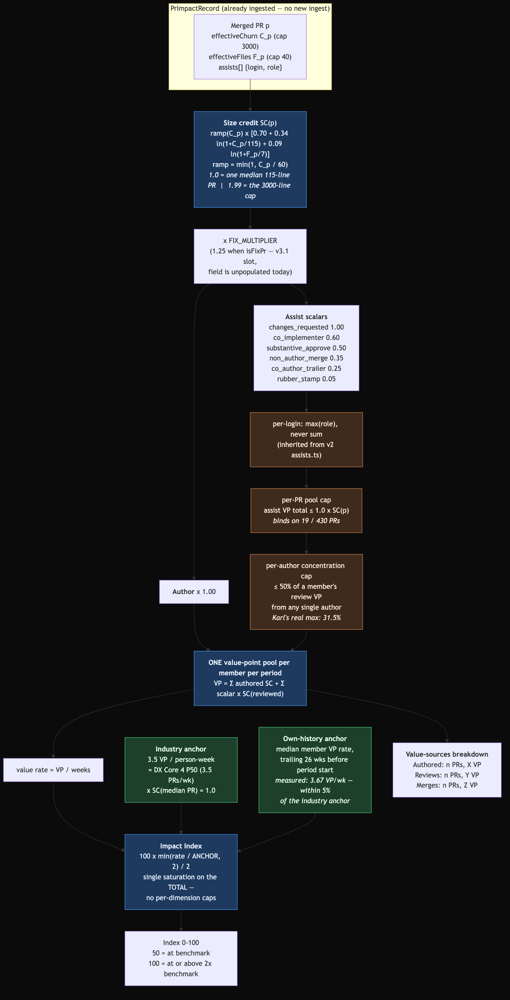

# Engineering Impact Index v3 — unified value-points scoring

**Status:** Proposal — awaiting approval
**Date:** 2026-08-04
**Repo:** `codewithfabric` (portal only)
**Scope:** a calibration redesign of one module — the index math, assist sizing, and the payload's decomposition display. **Not** a new ingest. `PrImpactRecord` already stores everything v3 needs; every number in this document was computed from the live production table, read-only.
**Supersedes the scoring layer of:** [impact-score-v2-plan.md](./impact-score-v2-plan.md). D1 (dual benchmarks), D3 (roll-up default), D4 (lineage), D5 (privacy) are untouched.

---

## Summary

v2 scores four normalised rate terms — throughput, substance, breadth, collaboration — against fixed anchors, weighted `.40/.30/.10/.20`. Two things about that are wrong, and Ryan named both:

1. **Collaboration is a fixed 20% slice.** A person whose entire job is review can earn at most 20 of 100 points for it. Measured on production data: the org's one pure reviewer contributed to **25 merged PRs covering 46,531 effective lines** in the last 90 days and scored **8/100**.
2. **Assists are flat per-role points, blind to what was reviewed.** Merging a 3,000-line PR and merging a 30-line PR both earn 0.35.

v3 replaces the four-term composite with **one currency**. Every unit of GitHub-visible work — authoring, reviewing, merging — produces **value points**: a role scalar multiplied by the size credit of the PR involved. One pool per member per period, one saturation on the total, no per-dimension caps. Any specialisation can reach 100.

The calibration is driven by Ryan's stated philosophy, quoted in full below: **line volume is cheap, finding and fixing problems in generated code is expensive.** So size credit is deliberately a weak, logarithmic currency, and the review roles carry the highest scalars in the table.

---

## Design philosophy — Ryan's words

> "I don't understand why reviewing should only be worth 15 points. Shouldn't reviewing be worth 100 points if your full-time job is reviewing and you review hundreds of thousands of lines of code and test the app and do QA and all this other work. Like what I'm really trying to score is how much work you shipped in the 90 day period and different work should have a different weight to it. I'd want some scalar multiplied by the weight of the value of that work and that gives you a score."

> "Code generation now has become incredibly cheap, right? Anyone can generate hundreds of thousands of lines of code with AI. But generating high-quality code, that's the real hard work."

> "Finding issues and errors in generated code and fixing them that is super high quality work or high value work today."

Four design consequences, each traceable to a specific number later in this document:

| Philosophy | Mechanism | Consequence |
|---|---|---|
| Lines are cheap | Size credit is logarithmic and hard-capped: a 3,000-line PR is worth **1.99×** a 115-line PR, not 26× | Churn padding costs **7.7× more** per index point than under v2 |
| Accepted units of change are the throughput signal | A base constant per merged PR carries most of the credit | PR count, not line count, drives the score |
| Review is the premium work | `changes_requested` scalar is **1.00** — equal to authoring the PR being reviewed | Review can carry a member to 100 with no authored PRs |
| Fixing generated code is high value | `FIX_MULTIPLIER` slot on `isFixPr` | Designed in; **inert today** — see the data findings |

Two standing constraints from Ryan, preserved verbatim from v2: **not being reviewed must never penalise the author** (self-merge stays worth zero to everybody and costs the author nothing), and **no FTE mechanics** — Karl works 50% time and his absolute numbers are allowed to read lower.

---

## The model



### 1. Per-PR size credit

Reuses v2's derivation unchanged: effective churn `C_p` (post-exclusion, per-file `max(add, del)`, capped at 3,000) and effective files `F_p` (capped at 40) are already columns on `PrImpactRecord`. v3 only changes what is done with them.

```
SC(p) = ramp(C_p) × [ BASE + kC · ln(1 + C_p/C0) + kF · ln(1 + F_p/F0) ]

  BASE = 0.70      C0 = 115      kC = 0.34
  ramp(C) = min(1, C / 60)       F0 = 7        kF = 0.09
```

**Calibration.** Two anchor points fix the three coefficients:

- `SC(115 lines, 7 files) = 1.00` — one **median PR** is one value point. 115 lines is LinearB's "Good" PR-size band, already used as v2's substance anchor (`A_S = 400 ≈ 3.5 × 115`); 7 files is v2's breadth anchor (`A_B = 25 ≈ 3.5 × 7`).
- `SC(3000, 40) = 1.99` — a PR at both caps is worth **two** median PRs, not twenty-six.

Solving: `0.70 + 0.6931(kC + kF) = 1.00` and `0.70 + 3.2990·kC + 1.9042·kF = 2.00` gives `kC = 0.341`, `kF = 0.092`, rounded to `0.34` / `0.09`.

**The ramp** pro-rates the base constant below 60 effective lines — half a median PR. It exists so that a one-line PR is not worth 70% of a real one, and it creates a hard optimum that bounds split-farming (see §"the one unavoidable trade-off").

The curve, and where the org's real PRs sit:

| `C_p` | `F_p` | `SC(p)` | 90-day PR count |
|---|---|---|---|
| 1 | 1 | 0.013 | — |
| 30 | 1 | 0.395 | 77 PRs under 30 lines |
| 60 | 2 | 0.865 | 25 PRs in 30–59 |
| **115** | **7** | **1.000** | 28 PRs in 60–114 |
| 434 (org p50) | 8 | 1.300 | 96 PRs in 115–499 |
| 800 | 12 | 1.495 | 138 PRs in 500–2,999 |
| 3000 (cap) | 40 | 1.993 | 66 PRs at the cap |

Org mean `SC` over the last 90 days: **1.244**. Median: **1.281**. The whole 430-PR distribution compresses into a 0.01–2.0 band.

### 2. Fix multiplier (slot, inert today)

```
VALUE(p) = SC(p) × (isFixPr ? FIX_MULTIPLIER : 1.0)      FIX_MULTIPLIER = 1.25
```

The slot sits between size credit and role scalars so it lifts the reviewer's credit as well as the author's — fixing a defect and catching one are the same class of work under Ryan's philosophy.

**It does nothing today.** `SELECT count(*) FILTER (WHERE "isFixPr")` over all 1,267 `farpointhq` records returns **0**; `revertsPrNumber` is null on every row and `fixDetector` has zero distinct values. The v2.1 lineage phase (conventional-commit `fix:` classification, revert-title parsing) was designed but never shipped, so the columns exist and are empty. Ship the multiplier as config defaulted to `1.0` until lineage lands, then flip it. Flagged as open question #2.

### 3. Role scalars

Every actor on a PR earns `scalar × VALUE(p)`. The author's scalar is `1.00` on their own PR; everyone else's comes from the same assist-role table v2 already derives into `PrImpactRecord.assists`.

| Role | v2 (flat pts) | **v3 scalar** | Rationale |
|---|---|---|---|
| `changes_requested` | 0.40 | **1.00** | Found problems in the code and sent it back. Under Ryan's philosophy this is the scarce human skill, and it is worth as much as writing the PR. Set at 1.00 rather than above it: a scalar >1.0 makes reviewing strictly better than authoring and invites review-farming. |
| `co_implementer` | 0.50 | **0.60** | Pushed commits to someone else's branch — authoring work on another person's PR. Highest non-review role, as in v2. |
| `substantive_approve` | 0.30 | **0.50** | Read it closely enough to leave comments, then accepted it. Rises above `non_author_merge` (v2 had it below), because under the new philosophy a commented read outranks a click. |
| `non_author_merge` | 0.35 | **0.35** | v2's D2 reasoning is unchanged: in this org the merge button *is* the accept gate. 300 of 1,267 PRs (23.7%) carry one. Only one person can merge a PR, and self-merge is zero, so it is structurally unfarmable. |
| `co_author_trailer` | 0.25 | **0.25** | Unchanged. |
| `rubber_stamp` | 0.10 | **0.05** | An approval with no comment is evidence of a click. Halved per Ryan's "near zero". |

**Co-author trailers share, they do not split.** The author keeps `1.00`; a trailer co-author earns `0.25`. Splitting would punish an author for crediting a collaborator and would suppress trailer usage — and the trailers in this data are overwhelmingly agents (`cursoragent`, `Co-Authored-By: Claude`), which `BOT_LOGINS` already excludes from earning anything.

### 4. The pool, and the index

```
VP(member, period) = Σ_authored VALUE(p)  +  Σ_assisted scalar(role) × VALUE(p)
rate               = VP / weeks           (weeks = max(1, spanDays / 7), unchanged)
Index              = round( 100 × min(rate / ANCHOR, 2) / 2 )
```

One saturation, applied to the total. There is no throughput cap, no substance cap, no collaboration slice. A member who never authors a PR and only reviews reaches 100 on review alone if their review volume × size clears `2 × ANCHOR`.

### 5. Anchor derivation

```
ANCHOR = A_T × SC(median PR)
       = 3.5 merged PRs/week × 1.00 VP
       = 3.5 value points per person-week
```

`A_T = 3.5` is v2's throughput anchor, the DX Core 4 published P50 diffs/engineer/week over 500+ companies. `SC(median PR) = 1.00` by the calibration in §1. So a benchmark generalist — 3.5 merged PRs a week at the 115-line median — produces exactly 3.5 VP/week and scores `100 × min(1, 2)/2 = 50`. **50 still means "at benchmark", exactly as in v2.**

Saturation at 2× (7.0 VP/week) is inherited from v2's `TERM_CEILING_MULTIPLE`.

**Independent validation.** The own-history anchor — median member value-rate over the trailing 26 weeks, computed on real data for the window preceding 2026-05-06 — comes out at **3.67 VP/person-week**, within 5% of the derived industry anchor of 3.5. Two unrelated derivations landing on the same number is the strongest evidence available that the calibration is not arbitrary.

**Dual benchmarks are preserved** exactly as in v2's D1: both indices ship in the payload, the own-history anchor uses the same availability gates (≥26 weeks of history, ≥5 scored members — both satisfied: 7 members in the 90-day history window, 9 in the June window), and the tautology caption still ships ("median member scores exactly 50 by construction").

### 6. Caps

| Cap | Value | Enforceable today? | Measured effect |
|---|---|---|---|
| Per-login, per-PR: `max(role)`, never sum | inherited from `assists.ts` | Yes, already live | Since the largest scalar is 1.00, one login can never out-earn the author on the author's own PR. **This makes v2's separate `ASSIST_POINTS_CAP = 1.0` redundant in v3** — the cap is now structural. |
| **New — per-PR assist pool cap** | assist VP total ≤ `1.0 × VALUE(p)`, pro-rated when exceeded | Yes — `assists` JSON is complete per row | Binds on **19 of 430** 90-day PRs (4.4%). Max observed scalar sum on one PR: 1.80 (three co-implementers). Prevents an N-person pile-on minting N× credit on one PR — v2 had no such cap. |
| **New — per-author concentration cap** | ≤50% of a member's review VP may come from any single author; excess discounted to zero | Yes — `authorLogin` + `assists` are both on the row | Does **not** bind on the org's real reviewer: Karl's largest single-author share is **31.5%** (25.72 of 81.68 review VP, from Ryan). A two-person review ring is 100% concentrated and gets halved. |
| Churn / files per PR | 3,000 / 40 | Yes, already live | Unchanged from v2. |

---

## The one unavoidable trade-off

v2's headline anti-gaming property was **split-neutrality**: splitting a PR in two left `effectiveChurn` and `effectiveFiles` identical, and the throughput term was already at its ceiling for this org, so splitting bought exactly zero. v3 gives that up, deliberately, and it is worth being explicit that this is not a calibration miss but a theorem.

**Claim.** A per-PR credit function cannot be both split-neutral and sub-linear in churn.

**Proof.** Split-neutrality means `SC(C) = SC(C/2) + SC(C/2)` for all `C`, i.e. `SC(2x) = 2·SC(x)`. Iterating over rational scalings forces `SC(aC) = a·SC(C)`, so on the positive reals `SC(C) = k·C` — strictly linear in churn, with no base constant. Conversely, any concave `SC` with `SC(0) = 0` satisfies `2·SC(C/2) ≥ SC(C)` with equality only in the linear case, so splitting strictly pays; and any `SC` with `SC(0) = b > 0` pays `b` for every extra PR. ∎

So: split-neutral ⟺ churn is the only currency. Ryan's direction is that churn must *not* be the currency, which forces v3 to be split-sensitive. The design does not hide this; it bounds it three ways:

1. **A hard optimum from the ramp.** Splitting a PR past 60 effective lines per piece strictly *loses* credit, because the ramp starts pro-rating the base. Shredding the org's median 434-line PR: 1 piece = 1.30 VP, 2 pieces = 2.20, 4 = 3.79, **7 pieces (62 lines each) = 6.09 — the maximum**, 14 pieces = 5.74, 29 pieces = 5.46. The attacker's best play is bounded and computable.
2. **A bounded ceiling.** Maximum extractable gain from shredding one median PR: **4.79 VP**, a 4.7× multiple. Over a 90-day window that is ≈5.3 index points, and it costs 6 extra merge events.
4. **The gain is one-shot per PR.** Once a body of work is at 62-line pieces there is nothing further to extract; the attack does not compound.
3. **A visible signature.** The optimal attack drives a member's median effective churn per PR to ≈60 lines while their PR count rises several-fold. That is a detectable anomaly, and it becomes a new alert rule (see *Files to Modify*), not a silent hole.

---

## Worked examples — production data

All figures computed read-only from `PrImpactRecord` where `orgLogin = 'farpointhq'`, using the constants above. v2 columns computed with v2's live anchors (`3.5 / 400 / 25 / 1.25`), weights (`.40/.30/.10/.20`) and flat assist points.

**Identity note.** Several people hold two GitHub accounts, only one of which is in `GithubLoginMapping`. The tables below are **alias-merged** (`ryanmonsurate`→`rmonsurate`, `Daniel-c137`/`Lamd11`→`daniel-lam-farpoint`, `rsirjani`→`RamtinSirjani`, `nikitamahmoudi`→`nikimahmoudifp`). See *Data findings* — this is a live correctness bug in both v2 and v3.

### Window A — last 90 days (2026-05-06 → 2026-08-04), W = 12.857 weeks, 430 merged PRs

| Member | Authored PRs | Assists | Reviewed eff. lines | **v2** | **v3 (industry 3.5)** | v3 (own-history 3.67) |
|---|---|---|---|---|---|---|
| **Ryan** `rmonsurate` | 198 | 12 | 15,053 | **84** | **100** | 100 |
| **Karl** `jensen` | 76 | 126 | 139,265 | **94** | **100** | 100 |
| `mohsen-fp` | 66 | 2 | 6,000 | 70 | 100 | 100 |
| `erfan-shafagh-fp` | 28 | 5 | 15,000 | 49 | **47** | 45 |
| **Mena** `Edolor` | 18 | 5 | 11,406 | **45** | **36** | 35 |
| `samit-farpoint` | 17 | 4 | 8,267 | 46 | 35 | 34 |
| `danial-farpoint` | 20 | 0 | 0 | 44 | 34 | 33 |
| **Daniel Lam** (pure reviewer; †departed) | 0 | 25 | 46,531 | **8** | **28** | 26 |
| `RamtinSirjani` | 7 | 10 | 22,419 | 39 | 26 | 24 |

### Window B — 2026-06-21 → 2026-07-21, W = 4.286 weeks

| Member | Authored PRs | Assists | **v2** | **v3 (industry 3.5)** | v3 (own-history 2.32) |
|---|---|---|---|---|---|
| **Ryan** `rmonsurate` | 92 | 2 | **82** | **100** | 100 |
| **Karl** `jensen` | 20 | 49 | **87** | **100** | 100 |
| `erfan-shafagh-fp` | 14 | 3 | 59 | 66 | 100 |
| `danial-farpoint` | 11 | 0 | 54 | 58 | 88 |
| **Daniel Lam** (pure reviewer; †departed) | 0 | 15 | **14** | **51** | 77 |
| **Mena** `Edolor` | 7 | 1 | **50** | **47** | 72 |
| `samit-farpoint` | 6 | 1 | 49 | 42 | 63 |
| `RamtinSirjani` | 2 | 2 | 38 | 19 | 29 |
| `mohsen-fp` | 1 | 0 | 29 | 7 | 10 |

### 1. Ryan — high-volume author, near-zero review

**90 days.** 198 merged PRs, mean size credit 1.061 → **210.2 VP authored**. 12 co-implementer assists on 15,053 reviewed lines → **9.7 VP review**. Total **219.9 VP** over 12.857 weeks = **17.10 VP/week** = **4.9× the industry anchor**. Saturated: **index 100**.

**June window.** 92 PRs → 98.2 VP; 2 assists → 1.4 VP. Total 99.6 VP / 4.286 weeks = **23.24 VP/week** = 6.6× anchor. **Index 100.**

**Does churn deflation cost him?** No — and the reason matters. Ryan's median PR is 132 effective lines, almost exactly the calibration median. His value comes from *count*, not size: 198 accepted units of change in 90 days against a benchmark of 45. Deflating churn moves him from v2's 84 to v3's 100 rather than down, because v2 was spending 30% of its weight on a substance term where he sat mid-pack and only 40% on the throughput term where he is at 4.4× benchmark. **v3 rewards him for exactly the thing that is unambiguously his: shipped, merged units.**

### 2. Karl — the reviewer, 50% time

**90 days**, alias-free (`jensen` is his only account). Value sources:

| Source | Count | Reviewed/authored eff. lines | Raw size credit | Scalar | **VP** | Share |
|---|---|---|---|---|---|---|
| Authored | 76 PRs | 70,929 | 71.7 | 1.00 | **71.7** | 46.8% |
| `co_implementer` | 51 PRs | 79,010 | 81.3 | 0.60 | **48.8** | 31.8% |
| `non_author_merge` | 73 PRs | 54,255 | 82.6 | 0.35 | **28.9** | 18.9% |
| `changes_requested` | 2 PRs | 6,000 | 4.0 | 1.00 | **4.0** | 2.6% |
| **Total** | **76 + 126** | **139,265 reviewed** | | | **153.4 VP** | |

11.93 VP/week = 3.4× anchor → **index 100** (v2: 94).

**The headline is not the index, it is the composition.** Under v2, collaboration was a fixed 20% slice and Karl's assist rate saturated it, so review contributed exactly **20 of his 94 points — 21%, and it could never have been more.** Under v3 review is **53.2% of his value** and has no ceiling. His reviewed-PR volume is now a visible number: 126 PRs, 139,265 effective lines, 168 raw size credit.

**June window.** 20 authored (18.2 VP) + 49 assists (36.3 VP: 25 co-implementer = 24.0, 22 merges = 8.4, 2 changes-requested = 4.0). Total 54.5 VP / 4.286 weeks = 12.71 VP/week → **index 100** (v2: 87). Review is **67% of his value** in that month.

Karl at 50% time reaching 100 is the intended outcome, not a bug: he is doing 3.4× a full-time benchmark engineer's accepted-work volume, most of it on other people's code.

### 3. Mena (`Edolor`) — middle of pack

**90 days.** 18 authored PRs (27.3 VP) + 5 co-implementer assists (5.5 VP) = 32.8 VP → 2.55 VP/week → **index 36** (v2: 45). **June:** 7 authored + 1 assist = 14.2 VP → 3.32 VP/week → **index 47** (v2: 50).

**Mena is the clearest loser from churn deflation, and the number should be shown to Ryan directly.** Her PRs are very large — median effective churn **2,095 lines**, 16 of 39 all-time hitting the 3,000 cap. Under v2 that fed the substance term at 30% weight and she scored 45. Under v3 an 1,800-line PR earns 1.78 VP where a 115-line PR earns 1.00 — 1.8×, not 16×. Her 18 PRs over 90 days is 1.4/week against a 3.5 benchmark, so her index falls to 36.

This is the philosophy working as specified, not a defect: v3 says 18 very large PRs is less accepted-unit throughput than 40 median ones. It is also the single result most likely to be contested, and it should be discussed before anyone sees the number.

### 4. `erfan-shafagh-fp` — second mapped mid-pack read

**90 days.** 28 authored (36.1 VP) + 5 assists (6.0 VP) = 42.1 VP → 3.27 VP/week → **index 47** (v2: 49) — essentially unchanged, which is the reassuring case: a member whose PR sizes cluster near the median (mean 651 lines) scores the same under both models. **June:** 14 authored + 3 assists = 19.8 VP → 4.63 VP/week → **index 66** (v2: 59) on the industry anchor, **100** on own-history.

### 5. The case that proves the point — a pure reviewer

> **†** Daniel Lam left the company (last authored merge 2025-12-03) and has no portal account, so he never appears in the live dashboard. His GitHub data is retained here only because it is the org's one real example of the pure-reviewer archetype; the behavioural claim generalizes to any future hire in that role.

Zero authored PRs in either window. 25 co-implementer assists across **46,531 effective lines** in 90 days.

- **v2: 8/100.** Three terms are zero by construction; only the 20% collaboration slice can pay, and even saturated it caps him at 20.
- **v3: 28/100** over 90 days, **51/100** in the June window, **77/100** against the own-history anchor.

This is the exact scenario in Ryan's brief — "reviewing should be worth 100 points if your full-time job is reviewing" — and it is the single largest behavioural change in v3. This reviewer is not at 100 because the review volume is 1.93 VP/week, 55% of the benchmark; a reviewer at Karl's volume *does* reach 100 with zero authored PRs.

---

## Gaming resistance

Index arithmetic for the 90-day window: 1 index point = `0.01 × 2 × 3.5` = **0.07 VP/week** = **0.90 VP** over the window. **+10 index points = 9.00 VP.**

| # | Attack | Cost under **v3** | Cost under **v2** | Verdict |
|---|---|---|---|---|
| **a** | **PR splitting.** Shred a median 434-line PR into its optimal 7 pieces of 62 lines: 1.30 → 6.09 VP, gain 4.79 VP. | **1.9 median PRs shredded = 11 extra merge events** (13 merges in place of 2). Splitting past 60 lines/piece strictly loses. | 0 VP — split-neutral. | **Regression, accepted and bounded.** The theorem in §"unavoidable trade-off" says you cannot have this and churn deflation. Mitigated by the ramp optimum + a new `prShreddingRule` alert. |
| **b** | **Churn padding.** Inflate a 132-line PR to the 3,000 cap: 1.022 → 1.993 VP for +2,868 lines. | **9.3 PRs padded, +26,580 lines = 2,658 padded lines per index point.** | 343 lines per index point (substance term, weight .30, anchor 400/wk). | **7.7× harder than v2.** This is the attack Ryan's philosophy targets, and it is the one v3 defends best. |
| **c** | **Rubber-stamp spamming.** 0.05 × SC; on the org median PR (SC 1.300) = 0.065 VP each. | **138 rubber-stamp approvals in 90 days** — 32% of every PR the org merged. Pool cap means stamping an already-reviewed PR earns residual only. | 161 stamps. | Comparable to v2, and absurd in both. |
| **d** | **Self-merge farming.** | **0 VP.** `sameLogin(merger, author)` returns before any assist row is created (`assists.ts`), unchanged. | 0 VP. | **Infinite cost.** Unchanged, and the author is not docked — Ryan's constraint holds. |
| **e** | **Review-farming (NEW).** Two people trade `changes_requested` on each other's PRs at scalar 1.00. | **6.9 reciprocal reviews in 90 days** on median PRs; 4.5 on 3,000-line PRs. **The cheapest lever in the model.** | Not available — `changes_requested` was 0.40 flat inside a 20%-weight term. | **The new threat the philosophy creates.** Mitigations below. |

### Mitigating review-farming, honestly

Ranked by what is enforceable against data `PrImpactRecord` **already stores**:

1. **Per-author concentration cap (50%) — enforceable now, recommended.** A pure two-person ring is 100% concentrated; halving its yield doubles the attack cost to ~14 reviews. Verified not to bind on legitimate behaviour: Karl's largest single-author share is 31.5%.
2. **Per-PR assist pool cap (1.0 × SC) — enforceable now, recommended.** Stops the ring adding a third and fourth stamper to the same PR. Binds on 19/430 real PRs.
3. **`changes_requested` volume alert — enforceable now.** The role appears on **4 of 1,267** PRs in the org's entire history. Any member whose rate rises above the team's trailing p95 is a conspicuous anomaly, and the alert layer already exists.
4. **"The PR must actually have changed after the changes-request" — NOT enforceable today.** This is the correct structural defence and it cannot be built from stored data: `PrImpactRecord` keeps `rawCommitCount` but no commit timestamps, and the `assists` JSON is `{login, role, points}` with no `submittedAt`. It needs the ingest to capture `reviews.nodes.submittedAt` and `commits.nodes.commit.committedDate` and persist a `changedAfterReview` boolean. **v3.1.** Until then, defences 1–3 are what exists, and the proposal should not claim more.

### On the `ASSIST_CAP` question

v2 caps one login's assists at a flat 1.0 per PR. In v3 that cap is **structural rather than configured**: the largest role scalar is 1.00, so one login's credit on a PR can never exceed `1.0 × VALUE(p)`, which is exactly the author's own credit. The v2 constant becomes redundant and should be deleted rather than ported, and its job is taken over by the two *new* caps — the per-PR pool cap and the per-author concentration cap — which address the pile-on and ring cases v2 never covered.

---

## Data findings that block or qualify the rollout

**1. Duplicate GitHub identities are silently dropping credit — a live bug, not a v3 issue.** `GithubLoginMapping` holds exactly one login per user, but at least four people commit under two accounts:

| Person | Mapped login | Unmapped alias | Credit stranded on the alias (90 days) |
|---|---|---|---|
| Ryan | `rmonsurate` | `ryanmonsurate` | 9 co-implementer assists, **7.45 VP** |
| Daniel Lam † | `daniel-lam-farpoint` | `Daniel-c137`, `Lamd11` | all 25 assists, 24.79 VP (moot — departed, no portal account) |
| Ramtin | `RamtinSirjani` | `rsirjani` | 8 assists, 8.62 VP |
| Niki | `nikimahmoudifp` | `nikitamahmoudi` | 12 assists |

Daniel Lam would have been the severe case (mapped account authored nothing, alias holds every assist → live score 0), but he has departed and has no portal account, so **no current member's score is zeroed by this today** — the remaining split identities strand modest assist credit (Ryan 7.45 VP; Ramtin and Niki matter for whichever team maps them). The fix is still a `GithubLoginMapping` change (allow N logins per user) — noted in *Files to Modify* — but it is a correctness improvement to ship with v3, no longer an urgent standalone bug.

Separately, `mohsen-fp`, `samit-farpoint`, `RamtinSirjani`, `d-prabjot02` and `nikimahmoudifp` are real authors with **no mapping at all** and never appear in the member view.

**2. The premium role Ryan wants to reward is almost never recorded.** Over the org's entire 1,267-PR history: `changes_requested` on **4** PRs, `hasApproval` on **100** (7.9%), `nonAuthorMerge` on **300** (23.7%). Setting `changes_requested` to 1.00 therefore changes essentially nobody's score today — it moves Karl by 4.0 VP out of 153.4. **The scalar is a forward incentive, not a re-scoring.** If the intent is to make review work visible *now*, the number that does that is `co_implementer` at 0.60 and `non_author_merge` at 0.35, which together carry 78 of Karl's 82 review VP.

**3. `isFixPr` is 0/1,267.** The fix multiplier is designed in and inert. See §2.

**4. Three of nine members saturate at 100 in the 90-day window.** Ryan (17.10 VP/wk), Karl (11.93) and `mohsen-fp` (8.10) all clear `2 × ANCHOR = 7.0`. This is arithmetically correct — the org runs at 2.3–4.9× the DX Core 4 P50 in accepted-unit terms — but it means the index does not rank the top of this distribution. Raising the saturation multiple does not fix it; at 3× the top three become 100/100/77 and the middle collapses to 17–32. **Recommendation: keep 2× and display the raw value rate next to the index for any member at 100**, so "100" reads as "at or above 2× benchmark" rather than as a rank. Open question #1.

---

## Files to Modify

| File | Change |
|---|---|
| `src/lib/reporting/impact/constants.ts` | Replace `ASSIST_POINTS` (flat points) with `ASSIST_SCALARS` (multipliers). Add `SIZE_CREDIT_BASE`, `SIZE_CREDIT_KC`, `SIZE_CREDIT_KF`, `SIZE_CREDIT_C0`, `SIZE_CREDIT_F0`, `TRIVIAL_WORK_FLOOR`, `FIX_MULTIPLIER`, `PR_ASSIST_POOL_CAP`, `AUTHOR_CONCENTRATION_CAP`. Delete `ASSIST_POINTS_CAP` (structurally redundant — see above). Bump `DERIVATION_VERSION` to `v3.0.0`. `CHURN_CAP`, `FILE_CAP`, `EXCLUSION_PATHS`, `BOT_LOGINS`, `AI_AGENT_LOGINS`, `ASSIST_ROLE_ORDER` unchanged. |
| `src/lib/reporting/impact/assists.ts` | `deriveAssists` keeps its `max(role)` semantics and its role assignment verbatim. Only the emitted `points` field changes meaning: it becomes `scalar`, and the PR's own size credit is applied at scoring time rather than stamped at ingest. `parseAssists` gains back-compat for v2 rows (role is authoritative; a stored `points` value is ignored). |
| `src/lib/reporting/impact-index.ts` | The substantive rewrite. Delete `ImpactTermKey`, `AnchorSet`'s four fields, `BASE_WEIGHTS`, `resolveWeights`, `resolveReviewCulture` and the whole adaptive-weight machinery — with a single pool there is no weight to renormalise and no collaboration column to hide. Add `sizeCredit(churn, files)`, `valuePoints(records, login)`, `computeImpactIndexV3(vp, weeks, anchor)`, `applyPoolCap`, `applyConcentrationCap`. `weeksFromSpanDays`, `MIN_SCORING_WINDOW_DAYS`, `OWN_HISTORY_*` and `computeDualImpactIndex` survive with `AnchorSet` collapsed to a scalar. |
| `src/lib/reporting/impact-payloads.ts` | `decomposition` becomes `valueSources`: `{ authored: {prs, valuePoints}, reviews: {prs, valuePoints, byRole}, merges: {prs, valuePoints} }` plus `sizeCreditVersion`. The four-term `terms[]` array is removed from both the roll-up and member shapes. Add `valueRate` alongside `impactIndex` so a saturated member is still readable. |
| `src/lib/reporting/impact/derive.ts` | No change. `effectiveChurn`/`effectiveFiles` are already exactly what v3 consumes. |
| `src/lib/reporting/impact-alerts.ts` | `noShippedWorkRule` retargets from `mergedPRs === 0` to `valuePoints === 0`. Add `prShreddingRule` (median effective churn/PR below the team's trailing-26-week p10 **and** PR count above 2× the member's own trailing median) and `reviewConcentrationRule` (>50% of review VP from one author). `costOutlierRule` and `unmappedSpendRule` unchanged — cost per merged PR is unaffected by v3. |
| `src/app/api/reporting/impact/route.ts` | Swap the scorer call; drop `reviewCulture` from `config`; add `sizeCredit` coefficients to `config` so the formula stays published in-product. |
| `src/components/dashboard/impact-decomposition.tsx` | Four-term table → value-sources breakdown (authored / reviews / merges, each with PR count and value points, review sub-split by role). |
| `prisma/schema.prisma` + `src/app/api/reporting/mappings/route.ts` | **Sequenced first, independent of v3:** allow N GitHub logins per user. Drop `@@unique([teamId, userId])` in favour of `@@unique([teamId, githubLogin])`, which also closes v2 Risk #2 (two users claiming one login) in the same change. Run the detection query before migrating. |
| `scripts/recompute-impact-records.ts` | Unchanged in shape; this is exactly the path v3 rolls out on — bump `DERIVATION_VERSION`, re-derive from stored raw columns, **zero GitHub calls**. |

**New files:** `src/lib/reporting/impact/size-credit.ts` (pure: the `SC` function and its inverse for the gaming tests), `src/lib/reporting/impact/value-points.ts` (pure: pooling, caps, per-member aggregation).

**No migration is required for the scoring change.** Every input v3 needs is already a column. That is the whole reason v2 stored raw alongside derived.

---

## Test Strategy

Tests first, all fixture-driven — `size-credit.ts` and `value-points.ts` are pure and need no mocks.

**Size-credit contract**
1. `SC(115, 7) === 1.00 ± 0.005` — the calibration anchor, pinned.
2. `SC(3000, 40) === 1.99 ± 0.01` — the churn-deflation anchor, pinned. This assertion is what stops a future edit quietly re-inflating churn.
3. Monotone non-decreasing in both `C` and `F`.
4. `SC(0, 0) === 0`; `SC(-5, -5) === 0`; non-finite inputs → 0, never `NaN`.
5. Ramp: `SC(30, 1)` is exactly half of the unramped value at 30 lines; `SC(60, x)` has ramp exactly 1.
6. Caps bind: `SC(5000, 80) === SC(3000, 40)`.

**Anti-gaming (each asserts a number from the gaming table, not a direction)**
7. Splitting a 434/8 PR: 7 pieces yields strictly more than 4, and 14 pieces yields strictly **less** than 7 — the ramp optimum exists and is where the design says it is.
8. Total gain from optimal shredding of one median PR ≤ 5.0 VP.
9. Churn padding 132 → 3000 yields ≤ 1.0 VP.
10. Self-merge produces zero assist rows and does not change the author's value points by one bit.
11. 200 rubber stamps score strictly below 10 changes-requested reviews on same-size PRs.
12. Pool cap: three co-implementers on one PR (scalar sum 1.80) are pro-rated to a total of exactly `1.0 × SC(p)`.
13. Concentration cap: a two-person ring's review VP is exactly halved; a reviewer spread across five authors at ≤50% each is untouched.
14. Bot exclusion regression: `Co-Authored-By: Claude` earns 0 VP and sets `aiCoAuthored`.

**Calibration and parity**
15. Benchmark generalist — 3.5 PRs/week at `SC = 1.0` — scores exactly **50**.
16. A reviewer with zero authored PRs and 7.0 VP/week of review scores exactly **100** (the "solo specialisation can reach 100" property that v2 could not satisfy).
17. Golden fixtures from this document: Karl's 90-day pool = 153.4 VP ± 0.5 and index 100; Daniel's = 24.8 VP and index 28; Mena's = 32.8 VP and index 36. These pin the whole model to real data.
18. Anchor interchangeability (Liskov, carried from v2): industry and own-history anchors are both scalars and the scorer must not branch on provenance.
19. `weeks` floor: a 3-day period gives `W = 1`, not 0.43.
20. Zero value points → index 0, and `noShippedWorkRule` fires; never `NaN`, never `Infinity`.

**Back-compat / rollout**
21. `parseAssists` reads a v2-era row (with a stored flat `points`) and derives the v3 scalar from `role`, ignoring the stale number.
22. `recompute-impact-records.ts` under `DERIVATION_VERSION = v3.0.0` changes stored values while a module mock asserts the GitHub client is never constructed.
23. Privacy: the parameterised cross-route `applyPrivacyPolicy` scan from v2 still passes against the new payload shape — `valueSources` must not leak a login when individual reporting is disabled.

**UI (Playwright, per the standing rule)**
24. Value-sources breakdown renders authored / reviews / merges with counts and points; no four-term table remains in the DOM.
25. A member at index 100 also renders their raw value rate.
26. 375px viewport, no horizontal overflow, zero console errors, screenshots at top/mid/bottom.

---

## Risks

| # | Risk | Mitigation |
|---|---|---|
| 1 | **Split-farming is materially cheaper than under v2** — ~13 extra merge events buys 10 points. | Proven unavoidable given churn deflation (§ trade-off). Bounded by the ramp optimum at 4.79 VP per PR shredded, and made visible by `prShreddingRule`. If Ryan judges the residual too high, the dial is `BASE`: lowering it from 0.70 toward 0.40 restores split resistance and re-inflates churn, monotonically. |
| 2 | **Review-farming is the cheapest attack in the model** (6.9 reviews for 10 points) and did not exist in v2. | Concentration cap + pool cap + volume alert, all enforceable today. The real fix — requiring the PR to change after the changes-request — needs an ingest field and is honestly deferred to v3.1. |
| 3 | **Mena's score falls 45 → 36 and Ramtin's 39 → 26.** Large-PR authors lose under churn deflation. | This is the philosophy, not a defect, but it is a person-level number that moves down. Tell them before the dashboard does, and be ready to defend "18 very large PRs is less accepted-unit throughput than 40 median ones". |
| 4 | **Duplicate identities strand credit** — split accounts (Ryan, Ramtin, Niki) drop assist credit on unmapped aliases. | Multi-login support in `GithubLoginMapping`, shipped with v3; the composition story is unreadable when a reviewer's assists land on an unmapped alias. (The formerly-severe case, Daniel Lam, departed — no live score is zeroed today.) |
| 5 | **Three of nine members saturate at 100**; the index does not rank the top of this org. | Display the raw value rate next to the index. Raising the saturation multiple makes it worse for the middle — measured, in *Data findings* #4. |
| 6 | **The premium scalar is aspirational.** `changes_requested` occurs on 4 of 1,267 PRs. | Stated plainly rather than hidden. If Ryan wants review visible *now*, the levers that actually move are `co_implementer` and `non_author_merge`. |
| 7 | **Losing the four-term decomposition loses explanatory power.** Jaspan & Sadowski's objection to composites — "it will not be clear why one scores 24 and another 37" — was answered in v2 by the four-term table. | The value-sources breakdown is a *better* answer, not a worse one: "your 153 points are 72 from 76 authored PRs, 49 from 51 co-implementations, 29 from 73 merges" is more legible than four normalised ratios. But it must ship on every payload, not be reconstructed by the UI. |
| 8 | **Recompute rewrites history.** Everyone's number changes at once, and Karl's composition changes meaning. | `DERIVATION_VERSION = v3.0.0` on every row and in the dashboard footer, exactly as v2 established. Two different numbers for the same period are always explainable. |
| 9 | **Anchor provenance is now single-threaded.** The whole index hangs on `A_T = 3.5` and `SC(median) = 1.0`. | Independently validated: the own-history anchor lands at 3.67, within 5%. Both are config, re-tunable by recompute with zero API calls. |
| 10 | **`FIX_MULTIPLIER` ships inert** and may read as a promise. | Default it to 1.0 and label it in `config` as `pending_lineage`, so the payload never claims a multiplier is being applied when it is not. |

---

## SOLID note

The v2 analysis stands; v3 changes it in three places.

**Single Responsibility improves.** v2's `impact-index.ts` did four jobs: normalisation, weighting, adaptive weight resolution, and assist aggregation. v3 splits it into `size-credit.ts` (one function, one contract, one pair of pinned calibration assertions) and `value-points.ts` (pooling and caps). The scorer shrinks to `100 × min(rate/anchor, 2)/2`.

**Open/Closed holds and gets cheaper.** Role scalars remain a table, so re-weighting `changes_requested` is still a one-line data edit. The `FIX_MULTIPLIER` slot is the Open/Closed case done properly: a multiplier hook added before the data exists, so v3.1 lineage is a data change rather than a formula change.

**Interface Segregation gets narrower.** v2's `PeriodTerms` carried four sums plus a week count. v3's carries **two numbers** — value points and weeks — which is the smallest interface that can produce an index. `AnchorSet` collapses from a four-field object to a scalar, and every Liskov obligation from v2 survives trivially: two scalars from different provenances are interchangeable by construction, and there is no longer any surface on which the scorer *could* branch.

**One deliberate loss.** Collapsing four terms into one currency removes per-dimension attribution: v3 cannot say "you are above benchmark on breadth but below on substance". That was real information and it is genuinely gone. The trade is intentional — the fixed collaboration slice that made per-dimension attribution possible is exactly the thing that capped a full-time reviewer at 20 points, and Ryan's direction is that the cap is the worse problem. The value-sources breakdown recovers most of the explanatory value along the axis that turns out to matter here (which *kind* of work), rather than the axis v2 chose (which *shape* of PR).

---

## Open questions for Ryan

1. **Three members saturate at 100 and the index stops discriminating at the top.** Ryan 17.1, Karl 11.9 and mohsen 8.1 VP/week all clear the 7.0 ceiling. Raising the saturation multiple to 3× keeps the top three at 100/100/77 but crushes the middle to 17–32. Recommendation: keep 2×, and print the raw value rate beside any 100 so it reads as "at or above 2× benchmark", not as a rank. Is that acceptable, or does the top of the distribution need to be rankable?

2. **`changes_requested = 1.00` is a forward incentive that changes nothing today.** The role appears on 4 of 1,267 PRs, because this org does not use GitHub review features — its review *is* the merge. Setting the premium scalar makes review-farming the model's cheapest attack (6.9 reviews = 10 points) in exchange for an incentive that currently has no data behind it. Two options: ship it at 1.00 with the concentration + pool caps, or hold it at 0.60 until the ingest can verify the PR actually changed after the request (v3.1). Which risk is the one worth taking?

---

## Also worth a decision, though not blocking

- **Mena's 45 → 36 and Ramtin's 39 → 26** are the price of churn deflation. Both are correct under the stated philosophy. Worth a conversation before the dashboard has it for you.
- **The `GithubLoginMapping` one-login limit** strands assist credit on unmapped aliases (Ryan, Ramtin, Niki). With Daniel Lam departed no current score is zeroed by it, so it no longer needs to ship first — bundle multi-login support with v3.
