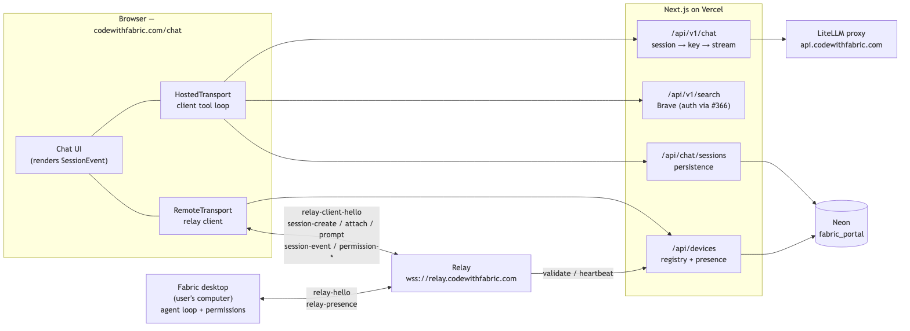
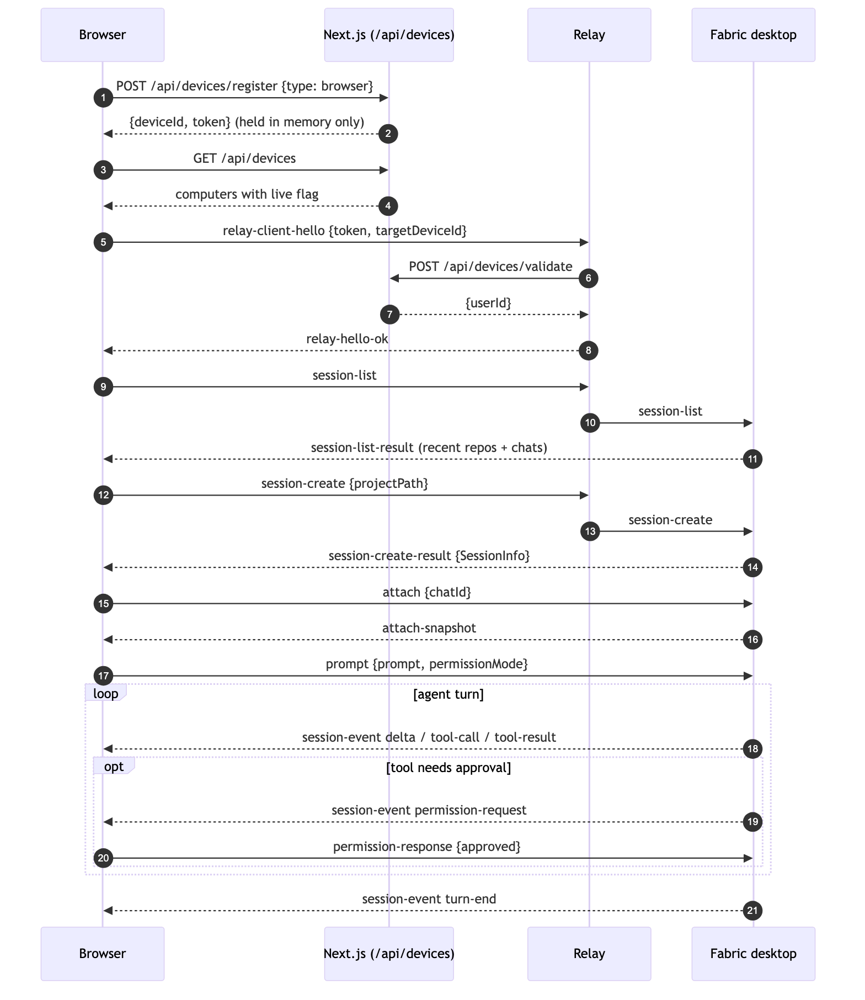
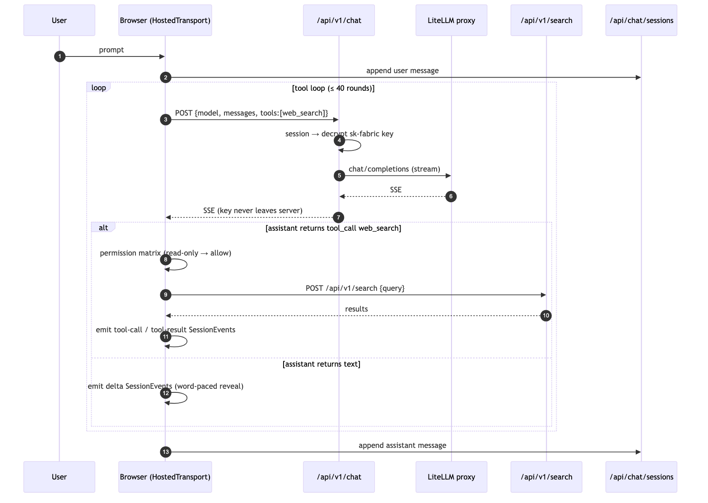
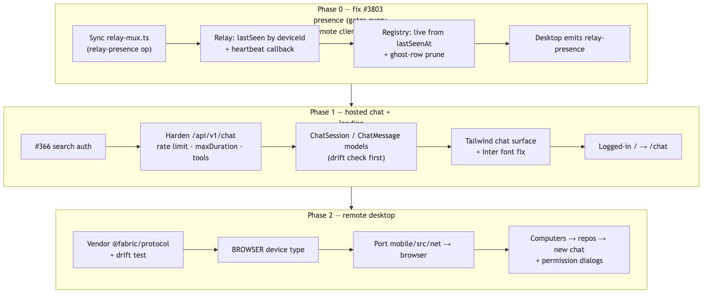

# Web Chat — a thin client for codewithfabric.com

*Plan v1 — 2026-09-03. Status: awaiting approval.*

## Summary

When a logged-in user lands on codewithfabric.com they should see **chat, not the dashboard** — a Tailwind rebuild of the Fabric desktop chat surface, with two transports behind one UI:

1. **Hosted chat** — the same model the iOS app uses today: the browser runs the tool loop, completions stream through our proxy, `web_search` hits our Brave-backed search proxy. Conversations are persisted server-side (the phone keeps them local; the web can't).
2. **Remote desktop** — list the user's online computers, connect to one over the existing relay, open a **new chat in one of its recent repos**, send a prompt, stream the response, and **answer the desktop's permission prompts from the browser**. This is what the iOS app already does — through a relay, a device registry and a wire protocol that all exist and are reusable unchanged.

Login required for both. No anonymous tier.

Three shippable phases: **fix relay presence (#3803)** → **hosted chat + landing** → **remote desktop**.

## What recon established

| Fact | Where |
|---|---|
| The iOS app has a standalone hosted chat with a **client-side tool loop** (`MAX_TOOL_ROUNDS = 40`) and exactly one tool, `web_search` | `Fabric/mobile/src/lib/chatStream.ts`, `webSearch.ts` |
| It calls `api.codewithfabric.com/v1/chat/completions` **directly with the user's `sk-fabric-*` key**, and `codewithfabric.com/api/v1/search` for search | `Fabric/packages/fabric-shared/src/{endpoints,tools}.ts` |
| `@fabric/shared` (endpoints, model ladder, SSE parser, `WEB_SEARCH_TOOL`) is portable TS shared by mobile + CLI; the desktop does **not** use it | `Fabric/packages/fabric-shared` |
| The relay (`services/relay`) is a stateless `ws` pairing service, alive behind Cloudflare at `wss://relay.codewithfabric.com`; desktops dial `/device`, clients dial `/client` | `codewithfabric/services/relay/src/server.ts` |
| `Device` (#309) is a real registry with heartbeat + revocation; `GET /api/devices` returns `{name, type, live}` behind session auth | `codewithfabric/src/app/api/devices/*`, `src/lib/devices.ts` |
| The phone creates a **new chat in a repo** with `session-create {projectPath}` → `attach` → `prompt`; responses fan out as `session-event`s incl. `permission-request` | `Fabric/src/shared/protocol/{frames,agent-channels,relay-mux}.ts`, `mobile/src/net/remoteSession.ts` |
| "Open repos" = the desktop's **recent-projects list**, not literally open windows | `Fabric/src/main/cli-server/sessionDirectory.ts` |
| **Why iOS is broken:** relay records presence only at connect; `/api/devices/heartbeat` exists but "the relay does not call this yet"; presence lands on a duplicate-name ghost `Device` row. Remote chat works only ~5 min after registration | Fabric issue **#3803** (filed by Ryan); `codewithfabric/src/app/api/devices/heartbeat/route.ts` |
| The relay's vendored `relay-mux.ts` is one revision behind Fabric's (missing the `relay-presence` op) | both `relay-mux.ts` copies |
| Desktop permission modes: **5 modes × 9 tool categories**, pure TS, per-chat, composer popover + Shift+Tab cycle. Phone hardcodes `"ask"` and has no selector | `Fabric/src/utils/permissions/permissionMode.ts`, `ChatInput.tsx` |
| The `feat/web-chat` v0 (`6e60176`) keeps the key server-side and streams correctly, but has no persistence, no rate limit, no `maxDuration`, and renders markdown via `marked` + `dangerouslySetInnerHTML` unsanitised | `src/app/api/v1/chat/route.ts`, `src/app/chat/chat-client.tsx` |
| `/api/v1/search` is currently **unauthenticated with open CORS**; the fix is open as PR **#366** | `src/app/api/v1/search` |
| The whole site renders in a **system font**: `--font-inter` is referenced 29× and defined nowhere | memory `project_font_inter_bug` |
| Desktop UI: React 18 + styled-components + Zustand, dark-only, tokens are plain TS objects (`#1b1b1b`, `#242424`, text `#e1e1e1`, accent `#1BCA98`, user bubble `rgb(52,90,194)`), Inter / Fira Code | `Fabric/src/renderer/Components/Theme/*.ts` |

## Approach

### One UI, two transports, one event schema

The single design decision everything else hangs on: **the chat UI renders Fabric's `SessionEvent` stream and nothing else.** Both transports produce it.

- `RemoteTransport` is a browser port of the phone's relay client. The desktop already emits `SessionEvent`s — the transport just forwards them.
- `HostedTransport` runs the iOS-style client loop and **adapts** OpenAI SSE deltas and tool calls into the same `SessionEvent` shapes (`delta`, `tool-call`, `tool-result`, `turn-start/end`, `usage`).

So message rendering, thinking/tool cards, the permission dialog, streaming pacing and the composer are written once. Adding a third source later (say, a hosted agent with more tools) is another adapter, not another UI.

```
Transport {
  listSessions(): Promise<SessionInfo[]>
  createSession(opts): Promise<SessionInfo>
  attach(chatId): AsyncIterable<SessionEvent>     // snapshot then live
  prompt(chatId, text, permissionMode): void
  respondPermission(requestId, decision): void
  abort(chatId): void
}
```

`SessionInfo`, `SessionEvent`, `PermissionRequestPayload` are **vendored verbatim** from `Fabric/src/shared/protocol` — zod-only, no Electron, already proven portable into the relay and the RN app. Publish `@fabric/protocol` from the Fabric repo (or vendor with a sync script and a drift test) so the two repos cannot silently diverge.

### Hosted transport — what stays on which side

The iOS app puts the raw `sk-fabric-*` key on the device. **The browser must not.** `/api/keys/reveal` was retired on 2026-08-26 for exactly that risk, and a key in `localStorage` is an XSS away from theft. So:

- **Browser**: the tool loop (ported from `chatStream.ts`), the SSE parser (from `@fabric/shared`), the `web_search` executor.
- **Server (Next.js, Vercel)**: two stateless proxies and a persistence layer.
  - `POST /api/v1/chat` — session → decrypted key → stream from LiteLLM. Hardened: `RateLimiter` (already used by `/api/user/status`), model allowlist from the shared ladder, `export const maxDuration`, `runtime = "nodejs"`, a `tools` passthrough. Extract the session→key logic into one helper so remote and future routes don't re-implement decryption.
  - `POST /api/v1/search` — as today, once **#366** lands (auth + CORS lock). Hosted chat must not ship against an open search proxy.
  - `ChatSession` / `ChatMessage` Prisma models + `/api/chat/sessions[...]` CRUD, so the session list and history survive refresh and cross-device.

The loop makes one proxy call per round; the key is decrypted per request, never cached client-side. Metering is unchanged — the proxy sees the user's own key.

### Remote transport

A straight port of `mobile/src/net/{relayConnection,remoteSession,deviceRoster,remoteHandoff}.ts`: RN `WebSocket` → browser `WebSocket`, `expo-secure-store` → **nothing durable**. The browser registers as a `BROWSER` device (new `DeviceType` + wire type, additive migration) and holds its relay token **in memory only**, minted per tab through a session-authed `POST /api/devices/register`; a page reload re-registers and the old row is pruned by a short TTL. Relay validation via `/api/devices/validate` is unchanged. Tenancy stays as today: the relay resolves `targetDeviceId` under the token's own `userId`, so a cross-tenant probe is indistinguishable from offline.

Flow: `GET /api/devices` → pick a live computer → `relay-client-hello` → `session-list` (repos + existing chats) → `session-create {projectPath}` → `attach` → `prompt {permissionMode}` → render `session-event`s → answer `permission-request` with `permission-response`.

The browser talks to `wss://relay.codewithfabric.com` **directly**, exactly as the phone does. Nothing long-lived runs on Vercel.

### Permission modes

Port `permissionMode.ts` (enum, `PERMISSION_MODE_ORDER`, the 9-category policy matrix, `shouldPrompt`, the CLI alias map) as pure TS into the web client. UI: the same composer popover and **Shift+Tab cycle**, per-chat, persisted with the session.

- **Remote mode:** the selected mode is sent as the `prompt` frame's string alias (`readonly | ask | edit | wheel` …). The desktop enforces, and `resolveDispatchPermissionMode` treats the browser's mode as a **ceiling** — it can narrow the chat's persisted mode, never widen it. All five are offered; unlike the phone (hardcoded `"ask"`), a browser tab is attended.
- **Hosted mode:** the matrix is wired in front of the client tool executor. Today it gates nothing — `web_search` is read-only and ungated in the desktop too. That is stated in the UI copy rather than hidden; the point of porting it now is that the next hosted tool slots into a policy that already exists.

### Phase 0 — fix #3803 (both repos)

1. Sync `services/relay/src/relay-mux.ts` with Fabric's (adds `relay-presence`).
2. Relay: update `lastSeen` on every `relay-presence` op (and on WebSocket ping if the `ws` server exposes it); key presence by **`deviceId`**, never by name.
3. Relay → `POST /api/devices/heartbeat` on a bounded interval per connected device; registry marks `live` from `lastSeenAt` with a tolerance window.
4. Desktop: emit `relay-presence` on the existing 30 s cadence (Fabric's shared protocol already has the op).
5. Registry: dedupe ghost rows — re-registration with the same `deviceId` updates in place; a cleanup script retires duplicate-name rows with no live token.

This ships first because it gates **every** remote client, iOS included, and it is the smallest change with the largest effect.

### Phase 1 — hosted chat + landing

- Merge/rebase `feat/web-chat`, then harden `/api/v1/chat` as above; replace `marked` + `dangerouslySetInnerHTML` with `react-markdown` + `remark-gfm` (Fabric's own stack; no raw HTML by default).
- Add the persistence models (see **Files**) — with the `prisma migrate diff` drift check in CLAUDE.md run first, every time.
- Land **#366** first.
- Landing: for a session, `/` (and `/{locale}`) redirects to `/chat`; the dashboard moves behind a nav item. Logged-out visitors keep the marketing homepage.
- Fix the Inter font (two lines) — the facsimile is not a facsimile in a system font.
- The UI (below) ships here with `HostedTransport` only.

### Phase 2 — remote desktop

- Vendor `@fabric/protocol`; port the four `mobile/src/net` modules; `BROWSER` device type; the computers → repos → new chat flow; permission dialogs wired to `permission-response`.
- A mock relay in tests (the real one is stateless and small, so a faithful fake is cheap).

### The UI — Tailwind rebuild of the desktop surface

Ryan's call: rebuild in Next.js / Tailwind rather than ship a Fabric web target. What must be reproduced to read as "the same app", from the inventory:

| Desktop component | Web plan |
|---|---|
| Layout: icon rail (trimmed to chat / computers / settings), sessions sidebar, chat pane, composer | Tailwind grid; the desktop's terminal, file tree, editor, DB, graph, Mission Control panes are omitted |
| `Theme/*.ts` tokens | Copied **verbatim as values** into a Tailwind v4 `@theme` block — same hexes, same radii, same spacing. Dark-only, like the desktop |
| `useWordReveal` | Copied as-is — the word-paced reveal is the single most recognisable trait of Fabric's streaming |
| `MarkdownText` (react-markdown + remark-gfm) | Same libraries |
| `SyntaxHighlighter` (Prism, VSC dark-plus) | Same Prism theme, run **client-side** (the desktop round-trips to main process; the web has none) |
| `UnifiedThinking/*` — collapsible thinking + tool-call cards, model-colour line, phase labels | Rebuilt to the same visual spec; drives from `ResponseSegment` types copied from `useChatStore.ts` (types only, never the 6,778-line store) |
| `PermissionShell`, `QuestionDialog`, `FileEditPermissionDialog` | Rebuilt; bound to `permission-request` / `permission-response` |
| `ModelSelector` | Rebuilt; sources the ladder from `@fabric/shared` `FABRIC_MODEL_LADDER` |
| `ChatInput` (3,808 lines, Lexical) | **v1: the same chrome — rounded input, Stop/Send treatment, mode popover, Shift+Tab — over an auto-growing textarea.** Lexical (@-mentions, slash commands) is a follow-up; those features need a desktop behind them anyway |
| User bubble `rgb(52,90,194)`, accent `#1BCA98`, Inter / Fira Code | Exact |

### Files to modify

| File | Change |
|---|---|
| `prisma/schema.prisma` | `ChatSession`, `ChatMessage`; `DeviceType.BROWSER` |
| `src/app/api/v1/chat/route.ts` | harden per above; `tools` passthrough; shared key helper |
| `src/app/api/v1/search/route.ts` | via #366 |
| `src/app/api/devices/{register,route}.ts`, `src/lib/devices.ts` | `BROWSER` wire type, TTL prune |
| `src/app/api/devices/heartbeat/route.ts` | called by the relay; `live` derived from `lastSeenAt` |
| `services/relay/src/{server,relay-mux,validator}.ts` | presence by `deviceId`, heartbeat callback, protocol sync |
| `src/app/[locale]/page.tsx`, `middleware.ts` | session → `/chat` redirect |
| `src/app/globals.css` / Tailwind theme | Fabric tokens; define `--font-inter` |
| `src/app/chat/*` (from `feat/web-chat`) | replaced by the new surface |
| **Fabric repo:** `src/main/cli-server/relayClient.ts` | emit `relay-presence` |

### New files

| File | Purpose |
|---|---|
| `src/lib/chat/protocol/` | vendored `@fabric/protocol` (+ drift test) |
| `src/lib/chat/transport.ts` | the `Transport` interface + shared types |
| `src/lib/chat/hosted-transport.ts` | client loop, SSE adapter → `SessionEvent` |
| `src/lib/chat/remote-transport.ts`, `relay-connection.ts`, `device-roster.ts` | browser port of `mobile/src/net` |
| `src/lib/chat/permission-mode.ts` | port of `permissionMode.ts` |
| `src/lib/chat/session-key.ts` | session → decrypted key helper (server) |
| `src/app/api/chat/sessions/[...]/route.ts` | hosted persistence CRUD |
| `src/app/chat/` — `layout.tsx`, `page.tsx`, `components/{Rail,SessionList,MessageList,UserMessage,AssistantMessage,ThinkingBlock,ToolCallCard,PermissionDialog,Composer,ModelSelector,ComputerPicker,RepoPicker}.tsx`, `hooks/useWordReveal.ts` | the surface |
| `scripts/sync-fabric-protocol.ts` | copies the protocol from the Fabric checkout and fails on hand-edits |
| `scripts/prune-ghost-devices.ts` | phase-0 cleanup |

## Test strategy

Tests first, per the workflow; contracts, not internals.

- **Protocol drift** — vendored zod schemas parse recorded real frames from the phone/desktop; `sync-fabric-protocol` fails CI if the copy differs from source.
- **Permission matrix** — every (mode × category) cell asserted against the desktop's table; alias parsing round-trips; a browser mode can only narrow, never widen.
- **Hosted transport** — mocked `fetch`: multi-round tool loop terminates at the cap; a `web_search` tool call yields `tool-call` → `tool-result` → `delta` events in order; abort mid-stream ends the turn; malformed SSE frames never crash the loop; the raw key never appears in any client-side object (assert on serialised state).
- **Remote transport** — a fake relay: `session-list` → `session-create` → `attach` snapshot → `prompt` → events; `permission-request` blocks until `permission-response`; `DEVICE_OFFLINE` and socket drop surface as UI states, not exceptions; reconnect does not duplicate events (seq-based).
- **Routes** — `/api/v1/chat`: 401 without session, 429 over the limit, 400 off-allowlist model, streams `text/event-stream`, `tools` forwarded; sessions CRUD is user-scoped (another user's id → 404). `/api/devices` with a `BROWSER` row: listed, pruned after TTL, never appears as a target.
- **Relay (phase 0)** — presence keyed by `deviceId`; a renamed device does not create a ghost; `lastSeen` advances on `relay-presence`; the heartbeat callback fires at the bounded interval and stops on disconnect.
- **Components** — message rendering from fixture `SessionEvent` streams (delta pacing observable via fake timers); thinking/tool cards collapse and expand; the mode popover cycles on Shift+Tab; the permission dialog renders each request kind and emits the right response.
- **E2E (Playwright, prod-shaped)** — login → land on `/chat` → send → streamed reply persists across reload; computers list shows a live desktop; new chat in a repo → prompt → permission prompt appears → approve → tool result streams.
- **Landing** — session → `/chat`; no session → marketing home; locale prefix preserved.

## Risks

| Risk | Mitigation |
|---|---|
| Phase 0 spans two repos and a live relay | Relay change is backwards-compatible (old desktops still work, just without presence); ship relay → registry → desktop in that order |
| A browser relay token in the wrong place becomes the `keys/reveal` problem again | Memory-only, per tab, short TTL; never `localStorage`; register through the session cookie |
| Vercel function duration on a streaming proxy | `maxDuration` set explicitly; the loop is client-driven so each round is one bounded request |
| The Tailwind rebuild drifts from the desktop over time | Tokens and types are copied from source with a drift test; every visual is written to the inventory's spec. **This is the cost of the rebuild decision and it does not go away** |
| `prisma db push` on the shared `fabric_portal` DB | The CLAUDE.md drift check before every push; additive migrations only |
| Search proxy is unauthenticated today | #366 is a hard prerequisite for phase 1 |
| Hosted mode's permission selector gates nothing yet | Say so in the UI; it exists for the tools that come next |
| Two-repo protocol divergence | Sync script + drift test; publish `@fabric/protocol` when the Fabric side is ready |

## SOLID analysis

- **S** — Transport, tool loop, rendering, persistence and permission policy are separate modules with one job each. `hosted-transport.ts` must not know about React; components must not know about `fetch` or `WebSocket`.
- **O** — New sources of chat (a hosted agent with more tools, a future LAN transport) are new `Transport` implementations; the UI is closed to that change. New tools in hosted mode are entries in the executor map plus a category in the matrix.
- **L** — Both transports satisfy the same interface and the same event contract; the test suite runs the *same* component fixtures against both.
- **I** — `Transport` is six methods. Session persistence is a separate interface the hosted transport uses and the remote transport ignores — remote sessions live on the desktop.
- **D** — Components depend on `Transport` and `SessionEvent`, never on transport internals; the server route depends on the session-key helper, not on Prisma calls scattered inline.

**Deliberate non-abstractions:** one persistence model, not a repository pattern; no shared "session store" across transports — their session lists come from different places and pretending otherwise would invent a sync problem. The permission matrix is a table, not a policy engine.

**Revision after the pass:** the first draft had `HostedTransport` persisting messages itself. Moved persistence behind a `SessionStore` the transport is *given*, so a test can run the loop with an in-memory store and the component tests never touch the network.

## Diagrams








